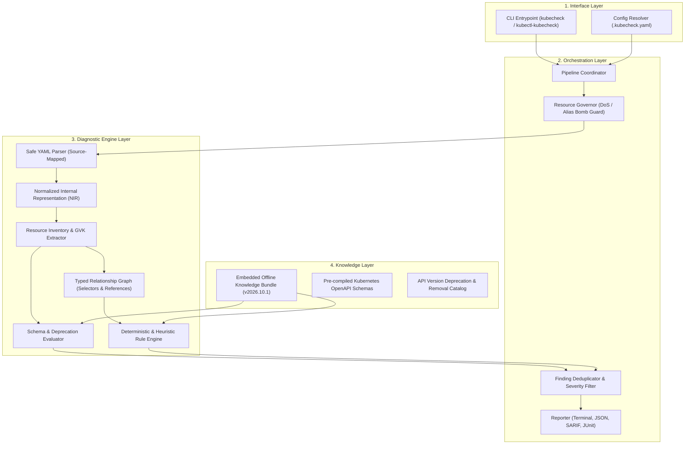

# KubeCheck

[](https://pypi.org/project/kubecheck/)
[](https://pypi.org/project/kubecheck/)
[](https://opensource.org/licenses/Apache-2.0)
[](#security--offline-guarantee)
[](https://kubernetes.io)

**KubeCheck** is a lightweight, offline-first static analysis engine and CLI tool designed to diagnose Kubernetes manifest problems before they hit your cluster. 

It validates YAML syntax, OpenAPI schema conformance, cross-resource semantic relationships, security posture, and API deprecations in a single unified, reproducible pass—with **zero network access, no cluster connection, and no external dependencies required.**

---

## Table of Contents

- [The Problem KubeCheck Solves](#the-problem-kubecheck-solves)
- [Architecture Overview](#architecture-overview)
- [Installation](#installation)
  - [1. Via Python / pip (Recommended)](#1-via-python--pip-recommended)
  - [2. Via Standalone Native Binary](#2-via-standalone-native-binary)
  - [3. Via Kubernetes Krew](#3-via-kubernetes-krew)
  - [4. Build From Source](#4-build-from-source)
- [How to Use KubeCheck](#how-to-use-kubecheck)
  - [Basic Analysis](#basic-analysis)
  - [Recursive Directory Scans](#recursive-directory-scans)
  - [Target Specific Kubernetes Versions](#target-specific-kubernetes-versions)
  - [Standard Input / UNIX Piping](#standard-input--unix-piping)
  - [Structured Output (SARIF, JSON, JUnit)](#structured-output-sarif-json-junit)
  - [Using as a kubectl Plugin](#using-as-a-kubectl-plugin)
  - [Inspecting the Rules Catalog](#inspecting-the-rules-catalog)
- [Exit Codes Contract (CI/CD Gating)](#exit-codes-contract-cicd-gating)
- [CI/CD Pipeline Integration](#cicd-pipeline-integration)
- [Security & Offline Guarantee](#security--offline-guarantee)
- [License](#license)

---

## The Problem KubeCheck Solves

Kubernetes manifests are declarative API objects serialized in YAML. In real-world software delivery, manifests fail across six distinct, interconnected dimensions:

```
┌────────────────────────────────────────────────────────────────────────┐
│                      Manifest Failure Dimensions                       │
├────────────────────────────┬───────────────────────────────────────────┤
│ 1. Syntactic Defects       │ YAML tab errors, duplicate keys, bombs    │
│ 2. Schema Violations       │ Unknown fields, wrong types, missing reqs │
│ 3. Semantic Inconsistencies│ Service selectors matching 0 workloads    │
│ 4. Security Posture Risks  │ Privileged root containers, wildcards     │
│ 5. Operational Pitfalls    │ Missing probes, unbound CPU/memory limits │
│ 6. API Version Drift       │ Deprecated or removed Kubernetes APIs     │
└────────────────────────────┴───────────────────────────────────────────┘
```

### Why Existing Tooling Falls Short

Historically, engineering teams have had to stitch together multiple fragmented tools:
- **Schema validators** (e.g., `kubeconform`) check OpenAPI schemas but ignore cross-resource semantic references and best practices, often requiring remote network requests to download schemas on the fly.
- **Linters** (e.g., `kube-linter`, `kube-score`) audit security practices but do not perform comprehensive schema validation as a primary engine.
- **`kubectl --dry-run=client`** requires a working `kubectl` setup and lacks deep cross-document semantic relationship reasoning.

This fragmentation leads to:
1. **Broken Air-Gapped Deployments:** Network-dependent schema fetchers fail in restricted, air-gapped, or regulated environments.
2. **Conflicting & Non-Actionable Findings:** Chaining multiple CLI tools produces noisy, mismatched outputs without precise line/column evidence or remediation guidance.
3. **Silent Runtime Outages:** Individually valid YAML files crash at runtime because selectors do not match, ports are misaligned, or deprecated APIs break on cluster upgrades.

### How KubeCheck Solves This

KubeCheck provides a **single, unified diagnostic layer**:
* **Complete Offline Hermeticity:** Bundles versioned schemas (Kubernetes v1.24 through v1.31) and rules locally.
* **Deterministic Normalized Internal Representation (NIR):** Parses manifests once into a canonical graph model with byte-exact source maps.
* **Cross-Resource Relationship Graph:** Validates interactions between resources (e.g., `Service` $\rightarrow$ `Deployment` selector matching).
* **Explainable Diagnostics:** Every finding includes exact file coordinates (line & column), rule ID, confidence rating, evidence class, and actionable remediation steps.

---

## Architecture Overview

KubeCheck is organized into four strictly decoupled layers with unidirectional dependencies:



### Key Architectural Traits

* **Resource Governor:** Safeguards your environment by strictly enforcing bounded execution limits on input size, document count, nesting depth, and YAML alias expansions (preventing YAML billion-laughs attacks).
* **Near-Zero Footprint:** Compiled native engine runs with $\le 8\text{ MB}$ peak RAM and executes typical scans in **under 40 milliseconds**.
* **Cross-Channel Parity:** Whether executed via Python (`pip`), Kubernetes Krew (`kubectl check`), or standalone binary, the analysis results and exit codes are 100% bit-for-bit identical.

---

## Installation

### 1. Via Python / pip (Recommended)

KubeCheck is published on PyPI as a PEP 517 / PEP 621 compliant package:

```bash
pip install kubecheck
```

*Prerequisites: Python 3.8+*

This installs both the `kubecheck` command and the `kubectl-kubecheck` plugin wrapper automatically.

---

### 2. Via Standalone Native Binary

Zero dependencies, no Python runtime or Go toolchain needed. Pre-compiled binaries with SHA-256 checksums are available for all major platforms:

```bash
# Linux (x86_64)
curl -Lo kubecheck https://github.com/kashifhm333/kubecheck/releases/latest/download/kubecheck-linux-amd64
chmod +x kubecheck
sudo mv kubecheck /usr/local/bin/

# Linux (ARM64)
curl -Lo kubecheck https://github.com/kashifhm333/kubecheck/releases/latest/download/kubecheck-linux-arm64
chmod +x kubecheck
sudo mv kubecheck /usr/local/bin/

# macOS (Apple Silicon / M-series)
curl -Lo kubecheck https://github.com/kashifhm333/kubecheck/releases/latest/download/kubecheck-darwin-arm64
chmod +x kubecheck
sudo mv kubecheck /usr/local/bin/

# macOS (Intel)
curl -Lo kubecheck https://github.com/kashifhm333/kubecheck/releases/latest/download/kubecheck-darwin-amd64
chmod +x kubecheck
sudo mv kubecheck /usr/local/bin/
```

---

### 3. Via Kubernetes Krew

Install directly as a `kubectl` plugin through Krew:

```bash
kubectl krew install check
```

Then invoke directly:
```bash
kubectl check analyze manifest.yaml
```

---

### 4. Build From Source

Clone the repository and build using Go (1.23+):

```bash
git clone https://github.com/kashifhm333/kubecheck.git
cd kubecheck
make build
./bin/kubecheck --version
```

---

## How to Use KubeCheck

### Basic Analysis

Scan a single manifest for syntax, schema, security, and semantic issues:

```bash
kubecheck analyze deployment.yaml
```

**Example Output:**

```text
INFO [SEC-CTX-004] in deployment.yaml:17:9 [Doc #0]:
  Container "web" does not drop ALL capabilities in securityContext
  Confidence: context-dependent · Remediation: Specify securityContext.capabilities.drop: ['ALL']

WARNING [WL-RES-001] in deployment.yaml:17:9 [Doc #0]:
  Container "web" is missing resource requests and limits
  Confidence: probable · Remediation: Define both resources.requests and resources.limits

--------------------------------------------------------------------------------
Scan Summary:
  Target Version:  v1.31
  Documents:       1 parsed
  Resources:       1 evaluated
  Findings:        0 Error, 1 Warning, 1 Info
Result: PASSED
```

---

### Recursive Directory Scans

Scan an entire tree of manifests across subdirectories:

```bash
kubecheck analyze -R ./deployments/
```

---

### Target Specific Kubernetes Versions

Validate against older or newer Kubernetes versions (from `1.24` through `1.31`) to catch API deprecations or removals before cluster upgrades:

```bash
kubecheck analyze -R ./manifests/ --target-version 1.28
```

If an obsolete API is used (e.g., `extensions/v1beta1 Ingress`), KubeCheck flags it with the exact Kubernetes version where it was removed and provides the replacement API (`networking.k8s.io/v1`).

---

### Standard Input / UNIX Piping

Integrate seamlessly into CLI pipes and templating workflows (such as Helm or Kustomize):

```bash
# Analyze rendered Helm templates
helm template my-release ./chart | kubecheck analyze -

# Analyze Kustomize builds
kustomize build ./overlays/production | kubecheck analyze -
```

---

### Structured Output (SARIF, JSON, JUnit)

Export results in machine-readable formats for automated tooling, CI summaries, and GitHub Code Scanning:

```bash
# GitHub Code Scanning (SARIF)
kubecheck analyze manifests/ --output sarif > results.sarif

# Standard JSON Output
kubecheck analyze manifests/ --output json > results.json

# CI Test Report (JUnit XML)
kubecheck analyze manifests/ --output junit > junit.xml

# Compact Single-Line Grep-Friendly Output
kubecheck analyze manifests/ --output compact
```

---

### Using as a `kubectl` Plugin

When installed via `pip install kubecheck`, KubeCheck registers the `kubectl-kubecheck` plugin:

```bash
kubectl kubecheck analyze manifest.yaml
```

*(Or `kubectl check analyze manifest.yaml` if installed via Krew).*

---

### Inspecting the Rules Catalog

Inspect all built-in rules, their severities, categories, and descriptions:

```bash
kubecheck rules
```

Check the status of the embedded knowledge bundle:

```bash
kubecheck bundle status
```

---

## Exit Codes Contract (CI/CD Gating)

KubeCheck follows an immutable, deterministic exit-code contract to enable precise failure handling in automated pipelines:

| Exit Code | Canonical Label | Trigger Condition |
|:---:|---|---|
| `0` | `SUCCESS` | Clean run; zero findings at or above configured failure threshold. |
| `1` | `FINDINGS_DETECTED` | One or more findings detected at or above failure threshold (`error`). |
| `2` | `USAGE_ERROR` | Command-line syntax error, invalid flags, or mutually exclusive options. |
| `3` | `INPUT_ERROR` | Manifest file not found, permission denied, or unreadable stream. |
| `4` | `OPERATIONAL_ERROR` | Internal limit exceeded (alias bomb, memory governor, recursion cap). |
| `5` | `PARTIAL_SCAN` | Analysis interrupted by SIGINT / SIGTERM user cancellation. |
| `6` | `BUNDLE_ERROR` | Corrupted, unverified, or incompatible knowledge bundle artifact. |

---

## CI/CD Pipeline Integration

### GitHub Actions

Add KubeCheck to your pull-request validation workflow:

```yaml
name: Validate Kubernetes Manifests

on:
  pull_request:
    paths:
      - 'deployments/**'
      - 'k8s/**'

jobs:
  kubecheck:
    runs-on: ubuntu-latest
    steps:
      - name: Check out code
        uses: actions/checkout@v4

      - name: Set up Python
        uses: actions/setup-python@v5
        with:
          python-version: '3.12'

      - name: Install KubeCheck
        run: pip install kubecheck

      - name: Run KubeCheck Static Analysis
        run: |
          kubecheck analyze -R ./deployments/ --target-version 1.31
```

---

## Security & Offline Guarantee

KubeCheck is built specifically for security-sensitive and air-gapped environments:

1. **Zero Outbound Telemetry:** Core manifest parsing and diagnostic analysis contain **zero network calls**.
2. **Safe Deserialization:** Prohibits arbitrary YAML constructor execution (`!python/object`, `!!js/function`, etc.).
3. **Denial-of-Service Defense:** Rejects exponential alias expansions (Billion Laughs attacks), circular anchors, and deeply nested structures.
4. **Secret Privacy:** Plaintext secrets in manifests are redacted from standard diagnostic log streams to prevent accidental leakage into CI logs.

---

## License

KubeCheck is open-source software licensed under the [Apache License, Version 2.0](LICENSE).  
Copyright 2026 Kashif Hussain and KubeCheck Contributors.
