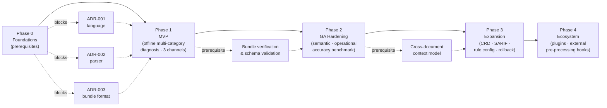
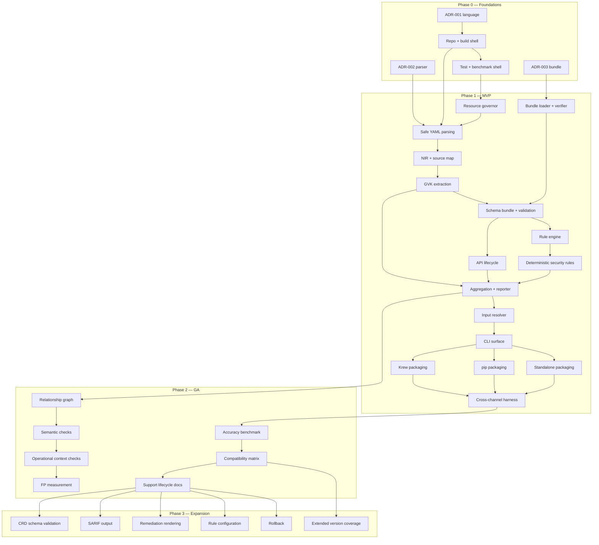
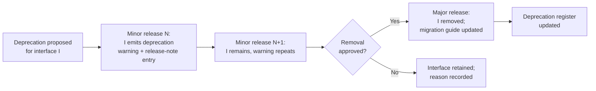
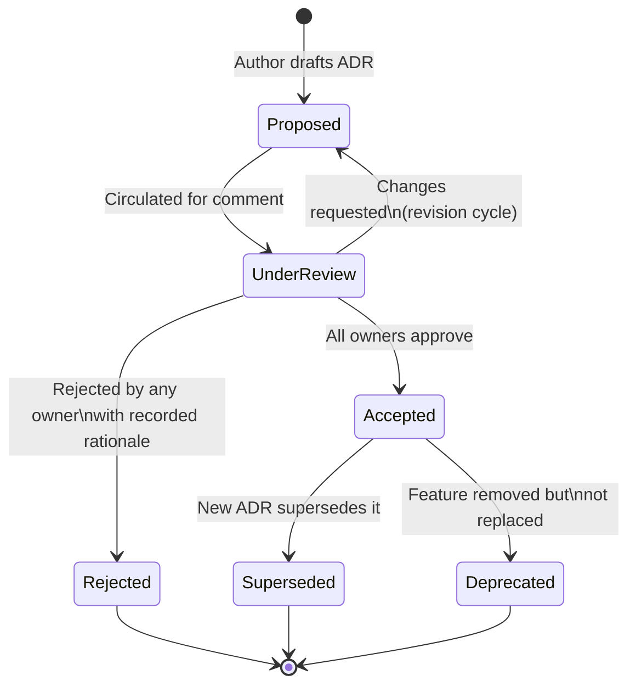

# KubeCheck — Roadmap and Architecture Decision Process

**Document ID:** ROADMAP-001  
**File:** `docs/architecture/ROADMAP_AND_DECISIONS.md`  
**Status:** Normative — Approved  
**Version:** 1.0.0  
**Product:** KubeCheck  
**Owner:** Technical Program Architecture  
**Last reviewed:** 2026-10-31  

**Related documents:**
- `docs/architecture/PRODUCT_VISION.md`
- `docs/architecture/SYSTEM_ARCHITECTURE.md`
- `docs/architecture/REQUIREMENTS_AND_NFRS.md`
- `docs/architecture/OFFLINE_KNOWLEDGE_BUNDLES.md`
- `docs/architecture/ADR/` (all ADRs referenced by number)
- `docs/diagnostics/DIAGNOSTIC_TAXONOMY.md`
- `docs/diagnostics/RULE_MODEL.md`
- `docs/security/SECURITY_MODEL.md`
- `docs/security/THREAT_MODEL.md`
- `docs/cli/COMMAND_REFERENCE.md`
- `docs/cli/EXIT_CODE_CONTRACT.md`
- `docs/output/JSON_SCHEMA.md`
- `docs/distribution/KREW_PACKAGING.md`
- `docs/distribution/PIP_PACKAGING.md`
- `docs/distribution/STANDALONE_BINARIES.md`
- `docs/testing/ACCURACY_BENCHMARK_PROTOCOL.md`
- `docs/testing/DETERMINISM_TESTS.md`
- `docs/testing/OFFLINE_VALIDATION.md`
- `docs/testing/REQUIREMENT_TRACEABILITY.md`

---

## 1. Purpose and scope

This document defines KubeCheck's **implementation roadmap** and **architecture decision process**. It specifies:

- The phased delivery plan from prerequisites through MVP, GA, expansion, and future ecosystem work.
- The dependency order between workstreams.
- Measurable exit criteria for every phase.
- Release gates and the release-blocking defect taxonomy.
- The compatibility and deprecation policy.
- The Architecture Decision Record (ADR) template, lifecycle states, review process, and supersession rules.
- How roadmap entries, ADRs, requirements, and tests are linked.
- The governance rules that prevent roadmap entries from being misinterpreted as delivered capabilities.

**In scope:** planning, governance, and decision process.

**Out of scope:** implementation details (governed by `SYSTEM_ARCHITECTURE.md` and downstream specifications), individual rule definitions (governed by `docs/diagnostics/`), and verified benchmark results (recorded in `docs/testing/results/`).

---

## 2. Status vocabulary and conventions

### 2.1 The rule this document enforces

**A roadmap entry is a plan, not a status report.** No feature in this document is to be interpreted as implemented, verified, or released unless it is explicitly accompanied by a status label **and** that label is backed by an artefact recorded in the KubeCheck repository per §2.3.

This is a normative governance rule.

| Req ID | Requirement | Rationale | Test method | Priority | Owner |
|---|---|---|---|---|---|
| ROAD-REQ-001 | Every deliverable, feature, milestone, and cross-phase workstream in this document MUST carry a status label from §2.2. | Prevents silent drift between plan and reality. | Documentation audit in the release checklist; automated parse of this document's status fields against the current release manifest. | P0 | Technical Program Architecture |
| ROAD-REQ-002 | A status label other than `PLANNED` MUST NOT appear in this document unless the backing artefact required by §2.3 exists and is linkable. | Prevents false status claims. | Release checklist audit; spot-check of every non-`PLANNED` entry. | P0 | Technical Program Architecture |
| ROAD-REQ-003 | Downstream documents MUST NOT cite a roadmap entry as evidence that a feature is implemented, tested, or supported. | Breaks the circular inference from plan to fact. | Documentation review; prohibition in the documentation style guide. | P0 | Technical Program Architecture / Documentation |

### 2.2 Status labels

| Label | Definition | Requires artefact |
|---|---|---|
| **PLANNED** | On the roadmap; no design or implementation artefact exists. This is the default. | No |
| **IN DESIGN** | An ADR is in `Proposed` state, or a design document is under active review. | ADR or design document link |
| **DESIGN APPROVED** | All blocking ADRs are `Accepted` and the design document is approved. Implementation may begin. | Accepted ADRs and approved design document |
| **IN PROGRESS** | Implementation work has started and is tracked in the project's issue tracker. | Linked issues with active state |
| **IMPLEMENTED** | Code merged to the main development branch; unit tests exist and pass. | Merged change references |
| **VERIFIED** | Meets the acceptance criteria in this document; tests exist and pass in CI. | CI run artefacts, requirement-traceability entries |
| **RELEASED** | Shipped in a tagged release. | Release notes reference |
| **DEFERRED** | Moved out of the current phase with a documented reason and target phase. | Deferral decision record |
| **DROPPED** | Removed from the roadmap with a documented rationale; may be superseded by a replacement. | Decision record |
| **BLOCKED** | Waiting on a named prerequisite; the prerequisite is cited. | Linked prerequisite requirement |

**Current state of this document:** Every feature in this document is `PLANNED` unless the row explicitly shows another label backed by §2.3. At the time of writing (2026-10-31), **no feature has any label other than `PLANNED`**, and no implementation artefact exists in the project repository. This is a factual statement about the current state, not a limitation of the roadmap.

### 2.3 Status evidence

Every non-`PLANNED` label MUST link to at least one of:

- An ADR in `docs/architecture/ADR/` with a recorded state.
- A design document with a recorded approval.
- A merged change reference in the project's version control.
- A CI run artefact under `docs/testing/results/` (for `VERIFIED`).
- A release tag and release notes entry (for `RELEASED`).

The links are appended to the status cell in the format `[status: LABEL] [evidence: <path-or-reference>]`. Absence of an evidence link is itself a documentation defect.

### 2.4 Requirement ID domains

| Domain | Prefix | Purpose |
|---|---|---|
| Roadmap | `ROAD-REQ-NNN` | Governance of this document |
| Release gate | `GATE-REQ-NNN` | Release-blocking criteria |
| Deprecation | `DEP-REQ-NNN` | Deprecation policy |
| ADR process | `ADRP-REQ-NNN` | Decision process |
| Defect taxonomy | `BLK-REQ-NNN` | Release-blocking defects |

Requirement IDs introduced in companion documents (e.g., `PLAT-REQ-*`, `SEC-REQ-*`, `FEAT-MVP-*`, `PERF-REQ-*`) are referenced here, not renumbered.

---

## 3. Governance principles

| Principle | Statement | Enforcement |
|---|---|---|
| **G1. Plan and evidence are separate** | A roadmap entry states intent. Evidence of implementation is recorded separately (§2.3). | `ROAD-REQ-001`–`ROAD-REQ-003` |
| **G2. Every blocking decision is an ADR** | Any decision affecting cross-team architecture, security guarantees, or compatibility is recorded as an ADR before implementation begins. | `ADRP-REQ-001` |
| **G3. Phases gate each other** | A phase cannot exit until its exit criteria are met. The next phase cannot begin implementation until the prior phase has exited. | §11 |
| **G4. Requirements trace to tests** | Every normative requirement maps to at least one test; the traceability matrix is authoritative. | `TEST-REQ-001` (from `REQUIREMENTS_AND_NFRS.md`) |
| **G5. Release gates are non-negotiable** | A release cannot ship with any open release-blocking defect (§13). Waivers require an explicit governance ADR. | §12 |
| **G6. Status changes are auditable** | Any change to a status label is a versioned change to this document with a `Change log` entry. | §20 |
| **G7. Deferred is not dropped** | A `DEFERRED` item retains its identifier and target phase; a `DROPPED` item requires a decision record. | §14 |
| **G8. ADRs are immutable** | An approved ADR is never edited except to append a supersession link; changes require a new ADR. | `ADRP-REQ-007` |

---

## 4. Roadmap overview

KubeCheck is delivered in five phases. Phase 0 must exit before any Phase 1 implementation work begins; Phase 1 must exit before Phase 2 implementation begins; and so on. The phase boundary is enforced by the exit criteria in §5–§9 and the release gates in §12.



**Key dependencies between phases:**

- Phase 0 resolves ADR-001, ADR-002, and ADR-003 (see §10 for ADR process). ADR-004 remains `Proposed`.
- Phase 1 delivers a working MVP that covers the MVP feature set in `PRODUCT_VISION.md` §12.1.
- Phase 2 requires Phase 1's bundle and cross-channel harness to be verified.
- Phase 3 requires Phase 2's cross-document context model.
- Phase 4 requires an approved ADR-004 (plugin boundary) and is deferred until the plugin decision is resolved.

---

## 5. Phase 0 — Foundations

**Goal:** Establish the decisions, repository structure, build pipeline, and test harness required for any implementation work. No user-visible feature is delivered in Phase 0.

**Entry prerequisites:** Product vision (`PRODUCT_VISION.md`) and system architecture (`SYSTEM_ARCHITECTURE.md`) approved.

| Deliverable ID | Deliverable | Prerequisites | Acceptance criteria | Verification | Status |
|---|---|---|---|---|---|
| ROAD-D0-01 | ADR-001 implementation language: `Accepted` | PRODUCT_VISION.md, SYSTEM_ARCHITECTURE.md | ADR contains context, candidate alternatives with trade-off analysis, decision, consequences, and links to affected documents and tests. | ADRP-REQ-004 review record; ADR file present at `docs/architecture/ADR/ADR-001-implementation-language.md`. | PLANNED |
| ROAD-D0-02 | ADR-002 YAML parser selection: `Accepted` | ROAD-D0-01 | Same review requirements as ROAD-D0-01; includes YAML 1.2.2 conformance decisions and duplicate-key resolution rule. | Review record; ADR file. | PLANNED |
| ROAD-D0-03 | ADR-003 bundle format and signature scheme: `Accepted` | ROAD-D0-01 | Same; includes bundle manifest schema, signature algorithm, trust-anchor representation, and rollback semantics. | Review record; ADR file. | PLANNED |
| ROAD-D0-04 | ADR-004 plugin boundary: `Proposed` (may remain open) | ROAD-D0-01 | ADR drafts the plugin constraints from `SYSTEM_ARCHITECTURE.md` §12 and identifies unresolved questions. | ADR file present with `Proposed` status. | PLANNED |
| ROAD-D0-05 | Repository skeleton and build pipeline shell | ROAD-D0-01 | Directory layout matches `SYSTEM_ARCHITECTURE.md` layering; build pipeline produces a hello-world binary for every platform in `PLAT-REQ-001` through `PLAT-REQ-003`; CI executes on all supported platforms. | Build pipeline run in CI; artefact manifest. | PLANNED |
| ROAD-D0-06 | Test harness shell | ROAD-D0-05 | Test harness runs offline and without a cluster; executes a placeholder test that asserts offline behavior; integrated with CI. | CI run; `BENCH-REQ-001` verification. | PLANNED |
| ROAD-D0-07 | Benchmark harness shell | ROAD-D0-06 | Implements §14 of `REQUIREMENTS_AND_NFRS.md` methodology skeleton: reference-environment recording, result-file schema, no-network enforcement. | Benchmark harness dry-run with placeholder corpus; result-file schema validation. | PLANNED |
| ROAD-D0-08 | Requirement traceability matrix scaffold | ROAD-D0-05 | Matrix file exists at `docs/testing/REQUIREMENT_TRACEABILITY.md` with every requirement ID from `REQUIREMENTS_AND_NFRS.md` and empty test-links column. | Matrix file present; parse validation. | PLANNED |

**Phase 0 exit criteria (all required):**

1. ROAD-D0-01, ROAD-D0-02, ROAD-D0-03 are `Accepted` ADRs. ROAD-D0-04 may be `Proposed`.
2. ROAD-D0-05, ROAD-D0-06, ROAD-D0-07 are `VERIFIED` with CI artefacts.
3. ROAD-D0-08 is `VERIFIED`.
4. No blocking ADR remains `OPEN` for Phase 1 work.

**Phase 0 does not exit if:** any of ADR-001 through ADR-003 is `Proposed`, `Rejected`, or `Superseded` without a replacement.

---

## 6. Phase 1 — MVP

**Goal:** Deliver offline multi-category diagnosis (syntax, schema, API lifecycle, deterministic security) through Krew, pip, and standalone channels, with structured output, documented exit codes, and a verifiable knowledge bundle.

**Entry prerequisites:** Phase 0 exit.

**MVP features** are drawn from `PRODUCT_VISION.md` §12.1 (`FEAT-MVP-001` through `FEAT-MVP-008`). Each deliverable below links to those feature IDs and to the requirements in `REQUIREMENTS_AND_NFRS.md` that verify them.

### 6.1 YAML parsing and validation milestones

| Deliverable ID | Deliverable | Prerequisites | Acceptance criteria | Verification | Status |
|---|---|---|---|---|---|
| ROAD-D1-01 | Safe YAML parsing (`FEAT-MVP-001`) | ROAD-D0-02, ROAD-D0-05 | SEC-REQ-001 through SEC-REQ-005 pass; adversarial corpus produces parse/security findings, not code execution; source locations preserved per `SARCH-REQ-022`. | Adversarial parser test suite; source-map resolution tests. | PLANNED |
| ROAD-D1-02 | NIR and source map (`SARCH-REQ-023` through `SARCH-REQ-024`) | ROAD-D1-01 | NIR contains no host-language objects; source-map resolution covers every node type. | Unit tests; `SARCH-REQ-024` determinism test. | PLANNED |
| ROAD-D1-03 | Resource governor (`LIM-REQ-001` through `LIM-REQ-008`) | ROAD-D0-05 | Every limit dimension produces a structured governor finding; no limit is disablable by a single flag. | Limit-enforcement test matrix. | PLANNED |
| ROAD-D1-04 | GVK extraction and document admission | ROAD-D1-02 | Documents lacking valid GVK are reported and excluded; admitted documents enter the inventory. | `SARCH-REQ-025` test suite. | PLANNED |

### 6.2 Schema and API-version coverage

| Deliverable ID | Deliverable | Prerequisites | Acceptance criteria | Verification | Status |
|---|---|---|---|---|---|
| ROAD-D1-05 | Initial schema bundle for built-in resources (`FEAT-MVP-002`) | ROAD-D0-03, ROAD-D1-04 | Bundle contains versioned OpenAPI schemas for the target Kubernetes version range declared in `OPEN-001` of `PRODUCT_VISION.md`; bundle manifest declares compatible engine range. | Bundle build reproducible per `BUILD-REQ-001`; schema-validation fixture suite. | PLANNED |
| ROAD-D1-06 | API-version lifecycle check (`FEAT-MVP-003`, `SARCH-REQ-040`) | ROAD-D1-05 | Lifecycle data derived from upstream deprecation policy artefacts; removed API versions produce `error` findings; GA versions produce none. | Lifecycle fixture suite per supported target version; `SARCH-REQ-041` tests. | PLANNED |
| ROAD-D1-07 | Bundle loader and verifier (`FEAT-MVP-008`, `SARCH-REQ-050` through `SARCH-REQ-053`, `SEC-REQ-006` through `SEC-REQ-008`) | ROAD-D0-03 | Signature verification succeeds offline; tampered bundles rejected; prior bundle retained on failure; incompatible bundles rejected with a clear error. | Negative-path signature suite; `NET-REQ-003`; `NET-REQ-008`. | PLANNED |

### 6.3 Diagnostic engine and security rules

| Deliverable ID | Deliverable | Prerequisites | Acceptance criteria | Verification | Status |
|---|---|---|---|---|---|
| ROAD-D1-08 | Rule engine (declarative, bundle-driven) (`SARCH-REQ-035` through `SARCH-REQ-039`) | ROAD-D1-04, ROAD-D1-05 | Rules execute from bundle artefacts; rule failures isolated; evidence class enforced. | Rule-isolation tests; `SARCH-REQ-038` audit. | PLANNED |
| ROAD-D1-09 | Deterministic security rules (initial set) (`FEAT-MVP-004`, `SEC-REQ-*` as applicable) | ROAD-D1-08 | Each initial rule has positive and negative fixtures; evidence class is `deterministic`; no rule relies on cluster state. | Rule fixture suite; `ACC-REQ-003` metadata consistency test. | PLANNED |
| ROAD-D1-10 | Inventory builder and duplicate-identity detection | ROAD-D1-04 | Duplicate resource identities within one invocation produce a `maintainability` finding that cites both anchors. | `SARCH-REQ-031` test. | PLANNED |
| ROAD-D1-11 | Diagnostic aggregation, deduplication, confidence classification, and reporter (`SARCH-REQ-043` through `SARCH-REQ-048`) | ROAD-D1-09, ROAD-D1-10 | Canonical ordering is deterministic (`ACC-REQ-001`); JSON validates against `docs/output/JSON_SCHEMA.md`; exit codes match `docs/cli/EXIT_CODE_CONTRACT.md`. | Determinism harness; JSON-schema validator; exit-code contract tests. | PLANNED |

### 6.4 Input handling and CLI surface

| Deliverable ID | Deliverable | Prerequisites | Acceptance criteria | Verification | Status |
|---|---|---|---|---|---|
| ROAD-D1-12 | Input resolver: single-file, directory, stream, stdin (`FEAT-MVP-006`, `INP-REQ-001` through `INP-REQ-005`) | ROAD-D1-01 | All four input forms produce identical findings for equivalent content; directory traversal is deterministic; symlinks not followed by default. | Input-form equivalence test; `SARCH-REQ-011` audit. | PLANNED |
| ROAD-D1-13 | CLI surface: `analyze`, `bundle` subcommands, `version`, `help` | ROAD-D1-11 | Command router isolates `analyze` from bundle mutation (`SARCH-REQ-006`); unknown commands/flags produce exit code `2`. | Command-routing tests; usage-error test matrix. | PLANNED |
| ROAD-D1-14 | Logging sink (stderr-only, redacted) (`SEC-REQ-013` through `SEC-REQ-015`) | ROAD-D1-13 | Logs never emit manifest values by default; debug mode redacts secret-bearing fields; `stdout` reserved for report output. | Adversarial log inspection; stream-separation test. | PLANNED |

### 6.5 Distribution channels

| Deliverable ID | Deliverable | Prerequisites | Acceptance criteria | Verification | Status |
|---|---|---|---|---|---|
| ROAD-D1-15 | Krew packaging (`FEAT-MVP-007`, `DIST-REQ-001`, `PLAT-REQ-006`) | ROAD-D1-13 | `kubectl kubecheck` resolves through PATH plugin discovery; plugin manifest declares compatible `kubectl` range. | Krew install test; `kubectl plugin list` assertion. | PLANNED |
| ROAD-D1-16 | pip packaging (`FEAT-MVP-007`, `DIST-REQ-002`) | ROAD-D1-13 | Wheel installs from a local wheelhouse without network; console-script entry point matches standalone behavior. | Offline wheelhouse install test; entry-point smoke test. | PLANNED |
| ROAD-D1-17 | Standalone binaries (`FEAT-MVP-007`, `DIST-REQ-003`, `PLAT-REQ-001` through `PLAT-REQ-003`) | ROAD-D1-13 | Binaries produced for all three platforms; runtime dependencies documented; decompression path documented. | Release artefact audit; platform smoke tests. | PLANNED |
| ROAD-D1-18 | Cross-channel equivalence harness | ROAD-D1-15, ROAD-D1-16, ROAD-D1-17 | Same input + same bundle ID produces identical normalized finding sets across channels. | `BUILD-REQ-004` harness in CI. | PLANNED |

### 6.6 MVP exit criteria (all required)

1. **Feature completion:** `FEAT-MVP-001` through `FEAT-MVP-008` are `VERIFIED` with passing CI runs and traceability entries.
2. **Requirement verification:** All P0 requirements from `REQUIREMENTS_AND_NFRS.md` have passing tests or, where a test cannot yet be written (e.g., benchmark targets), a benchmark-harness entry that records the target as `PROVISIONAL` with a planned measurement date.
3. **Determinism:** `ACC-REQ-001` and `ACC-REQ-002` pass the determinism harness.
4. **Cross-channel equivalence:** `BUILD-REQ-004` passes for the MVP rule set.
5. **Offline operation:** `NET-REQ-001` through `NET-REQ-005` pass in a network-isolated sandbox.
6. **Security:** `SEC-REQ-001` through `SEC-REQ-008` pass their test matrices.
7. **No open release-blocking defects:** §13 (`BLK-REQ-*`) fully satisfied.
8. **Documentation:** Every MVP-facing document references only `VERIFIED` or `PLANNED` statuses; no document claims implementation without evidence per §2.3.

**MVP does not exit if:** any `FEAT-MVP-*` is not `VERIFIED`, or any cross-channel equivalence test fails, or any release-blocking defect is open.

---

## 7. Phase 2 — GA Hardening

**Goal:** Extend the MVP into a GA-quality release with cross-document semantic checks, operational-context checks, full accuracy benchmarking, and a documented compatibility policy.

**Entry prerequisites:** Phase 1 exit.

| Deliverable ID | Deliverable | Prerequisites | Acceptance criteria | Verification | Status |
|---|---|---|---|---|---|
| ROAD-D2-01 | Cross-document semantic checks (`FEAT-R2-001`, `SARCH-REQ-032` through `SARCH-REQ-034`) | Phase 1 exit; ADR-005 cross-document context model (new) | Relationship graph construction is deterministic; unresolved edges produce context-dependent or informational findings per taxonomy; no false `deterministic` classification. | Graph-ordering test; `SARCH-REQ-038` audit. | PLANNED |
| ROAD-D2-02 | Operational-context checks (`FEAT-R2-002`) | ROAD-D2-01 | Each operational finding is classified `context-dependent` or `probable`; false-positive rate is measured per `ACC-REQ-009`. | Stratified-sample adjudication per `ACC-REQ-009`. | PLANNED |
| ROAD-D2-03 | Full deterministic accuracy benchmark (`ACC-REQ-005`, `ACC-REQ-007`, `ACC-REQ-012`) | Phase 1 exit; benchmark corpus available | Independent labelling complete; per-category precision ≥ 99% target measured and reported with confidence intervals. | Result file under `docs/testing/results/`; peer review of labelling. | PLANNED |
| ROAD-D2-04 | Full context-dependent false-positive measurement (`ACC-REQ-009`) | ROAD-D2-02 | Per-category false-positive rate measured and published with sample size. | Result file; peer review. | PLANNED |
| ROAD-D2-05 | Determinism test suite at scale (`ACC-REQ-001`, `TEST-REQ-005`) | Phase 1 exit | Full corpus determinism run; 100% identical outputs across repeated runs and across channels. | Determinism suite in CI as release gate. | PLANNED |
| ROAD-D2-06 | Full security rule set (finalized) | ROAD-D2-01 | Every security rule has positive and negative fixtures; evidence class enforced; secret redaction verified. | Rule fixture suite; log/evidence inspection. | PLANNED |
| ROAD-D2-07 | Configuration and severity-elevation policy | ROAD-D2-01 | Configuration keys versioned; deprecation policy per §15; severity elevation cannot reclassify `context-dependent` as `deterministic`. | `DEP-REQ-*` tests; `SARCH-REQ-038` audit. | PLANNED |
| ROAD-D2-08 | Bundle-only update support (`TEST-REQ-006`) | Phase 1 exit | Rule or schema changes in a new bundle change behavior without engine rebuild. | Bundle-only update test. | PLANNED |
| ROAD-D2-09 | Compatibility matrix (`COMP-REQ-001` through `COMP-REQ-005`) | ROAD-D2-08 | Engine loads bundles with schema version N and N−1; incompatible bundles rejected with clear error. | Compatibility matrix tests. | PLANNED |
| ROAD-D2-10 | Support lifecycle documentation (`COMP-REQ-006` through `COMP-REQ-007`) | ROAD-D2-09 | Release notes declare supported OS, architectures, bundle schema versions, Kubernetes target versions, and support window. | Release notes audit. | PLANNED |

### 7.1 Phase 2 exit criteria (all required)

1. All Phase 2 deliverables are `VERIFIED`.
2. The accuracy benchmark report exists in `docs/testing/results/` and demonstrates the per-category precision target for deterministic categories, or, if the target is not met, the affected checks are reclassified or removed (recorded in an ADR).
3. The determinism harness passes for the full corpus, including semantic and operational checks.
4. The compatibility matrix passes for N and N−1 bundle schema versions.
5. Every P0 and P1 requirement from `REQUIREMENTS_AND_NFRS.md` has a passing test or a documented `DEFERRED` status with a governance-approved deferral record.
6. No release-blocking defect is open.

---

## 8. Phase 3 — Expansion

**Goal:** Add CRD schema validation, SARIF output, human-readable remediation, rule configuration, and rollback semantics.

**Entry prerequisites:** Phase 2 exit.

| Deliverable ID | Deliverable | Prerequisites | Acceptance criteria | Verification | Status |
|---|---|---|---|---|---|
| ROAD-D3-01 | CRD schema validation from local inputs (`FEAT-R2-003`, `PRD-011`) | Phase 2 exit; ADR-006 CRD scope (new) | CRD instances validate against supplied schemas; findings labelled `schema-scope`; no semantic/operational findings emitted for CRDs. | CRD fixture suite; scope-label assertion. | PLANNED |
| ROAD-D3-02 | SARIF output (`FEAT-R2-004`) | Phase 2 exit | SARIF output validates against SARIF v2.1.0 schema; deterministic ordering within SARIF runs. | SARIF schema validator; determinism check. | PLANNED |
| ROAD-D3-03 | Human-readable remediation rendering (`FEAT-R2-005`) | Phase 2 exit | Findings include document excerpts with correct anchors; no secret values rendered. | Sample audit; `SEC-REQ-014` test. | PLANNED |
| ROAD-D3-04 | Project-level rule configuration and severity elevation (`FEAT-R3-001`) | ROAD-D2-07 | Cannot reclassify `context-dependent` to `deterministic`; configuration schema versioned. | `SARCH-REQ-038` audit; config schema validation. | PLANNED |
| ROAD-D3-05 | Bundle update with offline rollback (`FEAT-R3-002`, `TEST-REQ-011`, `TEST-REQ-012`) | ROAD-D2-08 | Rollback restores previous active bundle; corrupt-bundle recovery documented and tested. | Rollback test suite. | PLANNED |
| ROAD-D3-06 | Extended Kubernetes target version coverage | ROAD-D2-09 | Additional target versions supported via bundle-only update; compatibility matrix updated. | Compatibility matrix rerun. | PLANNED |

### 8.1 Phase 3 exit criteria

1. All Phase 3 deliverables `VERIFIED`.
2. SARIF output passes schema validation and determinism checks.
3. Rollback restores the prior bundle in all tested corruption scenarios.
4. Rule configuration cannot violate evidence-class separation.
5. No release-blocking defect is open.

---

## 9. Phase 4 — Ecosystem (deferred)

**Goal:** Optional ecosystem integrations: plugin mechanism (if approved), external pre-processing hooks for Helm and Kustomize (external, not bundled), policy-pack integration, and additional CI/CD integrations.

**Entry prerequisites:** Phase 3 exit; **ADR-004 plugin boundary `Accepted`**; **ADR-007 external pre-processing hook `Accepted`**.

**Deferral rationale:** Phase 4 features are explicitly out of scope per `PRODUCT_VISION.md` §10 (`NG-007`) and §12.3 until the ADRs are approved. No Phase 4 work may begin while ADR-004 or ADR-007 is `Proposed` or `OPEN`.

| Deliverable ID | Deliverable | Prerequisites | Acceptance criteria | Verification | Status |
|---|---|---|---|---|---|
| ROAD-D4-01 | Plugin mechanism (per ADR-004) | ADR-004 accepted | Plugins satisfy `SARCH-REQ-082` through `SARCH-REQ-086`; plugin failure isolated; no network access from plugins. | Plugin sandbox tests; network-trace audit. | PLANNED |
| ROAD-D4-02 | Optional external pre-processing hook (per ADR-007) | ADR-007 accepted | Pre-processing is opt-in, isolated from the core path, and never required for deterministic analysis. | Feature-flag test; core-path audit. | PLANNED |
| ROAD-D4-03 | Policy-pack integration | ROAD-D4-01 | Policy packs execute as declarative rules with evidence-class constraints. | Policy-pack fixture suite. | PLANNED |
| ROAD-D4-04 | Additional CI/CD integrations | Phase 3 exit | Each integration documented with installation, invocation, and exit-code mapping; offline behavior preserved. | Integration test matrix. | PLANNED |

**Deferred indefinitely:** Helm chart rendering, Kustomize build, and template expansion as bundled features (`NG-007`). Any future change to this boundary requires a superseding ADR to `NG-007`.

---

## 10. Cross-phase workstreams

These workstreams span multiple phases and are tracked independently of phase boundaries.

| Workstream ID | Workstream | Phases | Owner | Status |
|---|---|---|---|---|
| ROAD-WS-01 | Bundle generation, signing, and distribution pipeline | 0, 1, 2, 3 | Bundle maintainers | PLANNED |
| ROAD-WS-02 | Cross-channel packaging and release engineering | 1, 2, 3 | Build / Packaging | PLANNED |
| ROAD-WS-03 | Test corpus construction and curation | 0, 1, 2, 3 | Testing / Benchmark | PLANNED |
| ROAD-WS-04 | Fuzz testing and adversarial corpus | 1, 2, 3 | Security / Testing | PLANNED |
| ROAD-WS-05 | Performance benchmarking | 1, 2, 3 | Benchmark maintainers | PLANNED |
| ROAD-WS-06 | Documentation and traceability | 0–4 | Documentation | PLANNED |
| ROAD-WS-07 | Security model and threat model maintenance | 0–4 | Security Architecture | PLANNED |
| ROAD-WS-08 | Compatibility and deprecation register | 2–4 | Release Management | PLANNED |

### 10.1 Bundle generation, signing, and rollback (`ROAD-WS-01`)

| Req ID | Requirement | Rationale | Target (classification) | Test method | Priority | Owner |
|---|---|---|---|---|---|---|
| ROAD-REQ-004 | Bundle generation MUST be reproducible from a pinned upstream schema commit and a pinned rule set; the generated bundle MUST record the upstream commit hash and generation timestamp in its manifest. | Reproducibility of knowledge. | Design target (unverified). | Regenerate bundle from the same commit; byte-compare (modulo manifest timestamp). | P0 | Bundle maintainers |
| ROAD-REQ-005 | Every bundle MUST be signed with the current release key before distribution; the signing key MUST NOT be co-located with the bundle on distribution channels. | Supply-chain integrity. | Design target (unverified). | Release artefact audit; signature-presence check. | P0 | Build / Packaging |
| ROAD-REQ-006 | The distribution channel MUST retain at least the last two signed bundles to enable rollback (per `FEAT-R3-002`). | Rollback capability. | Design target (unverified). | Rollback test. | P1 | Bundle maintainers |
| ROAD-REQ-007 | Bundle generation MUST validate the generated bundle against the bundle manifest schema and MUST fail the release if validation fails. | Prevents shipping malformed bundles. | Design target (unverified). | Release pipeline validation step. | P0 | Bundle maintainers |
| ROAD-REQ-008 | The bundle schema version MUST be declared per bundle and MUST be compatible with the engine's supported range per `COMP-REQ-001` and `COMP-REQ-002`. | Compatibility. | Design target (unverified). | Compatibility matrix test. | P0 | Bundle maintainers |

### 10.2 CI, test corpus, fuzzing, performance benchmarks (`ROAD-WS-03`, `ROAD-WS-04`, `ROAD-WS-05`)

| Req ID | Requirement | Rationale | Target (classification) | Test method | Priority | Owner |
|---|---|---|---|---|---|---|
| ROAD-REQ-009 | CI MUST execute the full test suite on every supported platform from `PLAT-REQ-001` through `PLAT-REQ-003`. | Cross-platform behavior. | Design target (unverified). | CI matrix configuration audit. | P0 | Build / Packaging |
| ROAD-REQ-010 | CI MUST include a network-isolated job that runs the full acceptance suite offline and without a Kubernetes cluster. | Offline-first contract. | Design target (unverified). | CI job audit. | P0 | Build / Packaging |
| ROAD-REQ-011 | CI MUST include the cross-channel equivalence harness (`BUILD-REQ-004`) and the determinism harness (`ACC-REQ-001`) as required checks. | Reproducibility and equivalence. | Design target (unverified). | CI required-check list. | P0 | Build / Packaging |
| ROAD-REQ-012 | CI MUST include a fuzz testing job that runs continuously (nightly) and a PR-gating subset that must complete within a documented time budget. | Defence against input-handling defects. | Design target (unverified). | CI job audit. | P1 | Security / Testing |
| ROAD-REQ-013 | The benchmark harness (`BENCH-REQ-001` through `BENCH-REQ-004`) MUST be runnable locally and in CI, and its result files MUST be committed to `docs/testing/results/` for every release. | Verified measurements traceability. | Design target (unverified). | Result-file presence audit per release. | P0 | Benchmark maintainers |
| ROAD-REQ-014 | The adversarial corpus MUST include: safe-YAML tag attacks, alias expansion bombs, deeply nested structures, oversized inputs, non-UTF-8 byte sequences, zip-slip archives, and path traversal attempts. | Covers the known risk surface. | Design target (unverified). | Corpus manifest review; corpus execution in CI. | P0 | Security / Testing |

### 10.3 Security model and threat model maintenance (`ROAD-WS-07`)

| Req ID | Requirement | Rationale | Target (classification) | Test method | Priority | Owner |
|---|---|---|---|---|---|---|
| ROAD-REQ-015 | The threat model in `docs/security/THREAT_MODEL.md` MUST be reviewed at every phase boundary and at every major-version release. | Prevents stale threat model. | Design target (unverified). | Review record in release checklist. | P0 | Security Architecture |
| ROAD-REQ-016 | Every new diagnostic rule MUST be reviewed against the threat model for potential information-disclosure risks (secret echoing) before merge. | Prevents rule-driven leakage. | Design target (unverified). | Rule review record. | P0 | Security Architecture / rule authors |

---

## 11. Dependency graph

The full feature dependency graph for Phases 0–3 is shown below. Phase 4 is excluded from this graph pending ADR-004 and ADR-007.



**Critical-path items (blocking downstream work):**

- ADR-001, ADR-002, ADR-003
- Safe YAML parsing → NIR → GVK
- Bundle loader + verifier → schema validation
- Aggregation + reporter → CLI surface → packaging → equivalence harness
- Equivalence harness → accuracy benchmark → compatibility → Phase 3 items

---

## 12. Release gates

A release gate is a checklist that must be fully satisfied before a release tag is created and pushed.

| Gate ID | Gate | Applies to | Blocking criteria |
|---|---|---|---|
| GATE-REQ-001 | Phase exit criteria | Every phase | All exit criteria for the target phase are satisfied. |
| GATE-REQ-002 | Requirement traceability | Every release | Every normative requirement in `REQUIREMENTS_AND_NFRS.md` has a passing test or a documented `DEFERRED` status with a governance-approved deferral record. |
| GATE-REQ-003 | Determinism harness | Every release | `ACC-REQ-001` and `ACC-REQ-002` pass over the full corpus. |
| GATE-REQ-004 | Cross-channel equivalence | Every release | `BUILD-REQ-004` passes. |
| GATE-REQ-005 | Offline acceptance | Every release | `NET-REQ-001` through `NET-REQ-005` pass in a network-isolated sandbox. |
| GATE-REQ-006 | Security acceptance | Every release | `SEC-REQ-001` through `SEC-REQ-008` pass; secret-redaction tests pass. |
| GATE-REQ-007 | No open release-blocking defects | Every release | §13 taxonomy is fully clear. |
| GATE-REQ-008 | Documentation audit | Every release | No document claims implementation without evidence per §2.3; no aggregated accuracy claim without result file. |
| GATE-REQ-009 | Benchmark result recorded | Every release | `BENCH-REQ-002` through `BENCH-REQ-004` satisfied; result file present under `docs/testing/results/`. |
| GATE-REQ-010 | Bundle signature and compatibility | Every release | The released bundles pass signature verification; compatibility matrix passes for N and N−1 bundle schema versions. |
| GATE-REQ-011 | Threat-model review | Every phase-boundary release | ROAD-REQ-015 review record present. |
| GATE-REQ-012 | Release artefact checksums and signatures | Every release | Every artefact has a SHA-256 checksum and signature; verification instructions present. |

**Waivers:** A release may ship with a failing gate only under a governance ADR that explicitly grants a waiver, names the gate, states the duration, and records the mitigation. Waivers are recorded in the release notes and expire automatically at the next minor release unless renewed by another ADR.

---

## 13. Release-blocking defect taxonomy

Any defect matching the following patterns MUST be treated as release-blocking. The taxonomy is not exhaustive; additional defects may be classified as blocking by the release manager in consultation with the affected owner.

| Defect ID | Blocking condition | Category | Discovery methods |
|---|---|---|---|
| BLK-REQ-001 | Any P0 requirement without a passing test. | Requirement coverage | Gate-REQ-002 |
| BLK-REQ-002 | Any input that causes the tool to panic, crash, or emit an unhandled exception without a structured finding. | Robustness | Fuzz corpus, adversarial corpus |
| BLK-REQ-003 | Any network call during the `analyze` command, including DNS resolution, NTP, or telemetry. | Offline guarantee | Syscall trace, network-namespace test |
| BLK-REQ-004 | Any cross-channel divergence in findings for the same input and bundle ID. | Equivalence | Cross-channel harness |
| BLK-REQ-005 | Any verified false positive in a `deterministic` category. | Accuracy | Benchmark adjudication |
| BLK-REQ-006 | Any unhandled unsafe YAML tag that results in host-language object construction or code execution. | Security | Adversarial parser suite |
| BLK-REQ-007 | Any secret value emitted in logs, findings, or report metadata. | Secret leakage | Log/evidence inspection, `SEC-REQ-013` through `SEC-REQ-015` |
| BLK-REQ-008 | Any nondeterministic finding ordering or content for identical inputs and bundle ID. | Determinism | Determinism harness |
| BLK-REQ-009 | Any bundle signature verification bypass. | Supply chain | Signature negative-path suite |
| BLK-REQ-010 | Any path traversal, zip-slip, or write outside the documented write set. | Input safety | Adversarial corpus, filesystem audit |
| BLK-REQ-011 | Any resource-limit bypass that allows memory exhaustion or unbounded runtime. | Resource safety | Limit test matrix |
| BLK-REQ-012 | Any compatibility violation where the engine accepts a bundle outside its declared supported range. | Compatibility | Compatibility matrix |
| BLK-REQ-013 | Any accepted manifest whose deterministic finding set depends on ambient environment (locale, timezone, umask, hostname). | Determinism | Environment-variation test |
| BLK-REQ-014 | Any release where a documented requirement has no test and no governance-approved deferral record. | Documentation accuracy | Gate-REQ-002, documentation audit |

**Blocking-defect process:**

1. A defect matching §13 is opened as a `BLK` issue with the taxonomy ID.
2. The affected owner assigns a fix within the phase's active milestone.
3. Release is blocked until the defect is closed and verified in CI.
4. Any waiver is granted only by a governance ADR (§12).

---

## 14. Compatibility and deprecation policy

### 14.1 Compatibility register

The compatibility register records the current supported range for each versioned surface. It is maintained in the release notes and updated per release.

| Surface | Compatibility requirement | Register owner |
|---|---|---|
| Engine binary ↔ bundle schema version | `COMP-REQ-001`, `COMP-REQ-002` | Bundle Loader |
| Engine ↔ CLI flags | `COMP-REQ-004` | CLI Architecture |
| Engine ↔ configuration keys | `COMP-REQ-003` | CLI Architecture |
| Engine ↔ rule identifiers | `COMP-REQ-005` | Rule Engine |
| Engine ↔ JSON output schema | `OUT-REQ-003`, `OUT-REQ-004` | Reporter / Serializer |
| Engine ↔ exit-code semantics | `OUT-REQ-007`, `OUT-REQ-008` | CLI Entry |
| Engine ↔ supported operating systems and architectures | `COMP-REQ-006` | Build / Packaging |
| Engine ↔ supported Kubernetes target versions | `COMP-REQ-006` | Bundle maintainers |

### 14.2 Deprecation policy

| Req ID | Requirement | Rationale | Test method | Priority | Owner |
|---|---|---|---|---|---|
| DEP-REQ-001 | Within a major version, no deprecated interface (CLI flag, configuration key, rule ID, output field, exit code) may be removed without at least one minor release of deprecation notice. | Protects downstream automation. | Changelog audit; deprecation-warning test. | P0 | Release Management |
| DEP-REQ-002 | Deprecated interfaces MUST emit a warning that names the interface and states the version in which removal is planned. | Operator awareness. | Warning-emission test. | P0 | CLI Entry / Reporter |
| DEP-REQ-003 | Rule identifiers MUST NOT be renumbered or removed within a major version. A rule may be superseded by a new rule with a new ID; the original ID must remain as a deprecated alias for the remainder of the major version. | Downstream consumers key on rule IDs. | Rule ID audit per release. | P0 | Rule Engine |
| DEP-REQ-004 | Bundle schema versions MUST support at least one prior schema version per `COMP-REQ-002`. Removing prior-schema support requires a major-version change and a documented migration path. | Operational stability. | Compatibility matrix. | P0 | Bundle Loader |
| DEP-REQ-005 | JSON output fields classified as `stable` MUST NOT be removed or have their semantics changed within a major version. Fields classified `experimental` may change, but must be marked and documented per `OUT-REQ-004`. | Downstream stability. | Schema diff review per release. | P0 | Reporter / Serializer |
| DEP-REQ-006 | A deprecation notice MUST be recorded in the release notes for every release in which the deprecated interface remains available. | Auditability. | Release notes audit. | P0 | Release Management |
| DEP-REQ-007 | When a major version is released, the migration guide MUST enumerate every breaking change and provide replacement guidance. | Migration support. | Migration guide review. | P0 | Documentation |

### 14.3 Deprecation workflow



### 14.4 Upgrade behavior

| Req ID | Requirement | Priority | Owner |
|---|---|---|---|
| DEP-REQ-008 | Engine upgrade MUST NOT invalidate a previously verified bundle that remains within the engine's supported schema range. | P0 | Bundle Loader |
| DEP-REQ-009 | If an engine upgrade invalidates the active bundle, the tool MUST fail closed with a structured error naming the incompatible bundle and the required action. | P0 | Bundle Loader |
| DEP-REQ-010 | Bundle rollback (`FEAT-R3-002`) MUST be available when an upgraded bundle is found unsuitable in production; rollback MUST restore the previous verified bundle without network access. | P1 | Update Subsystem |

---

## 15. Architecture Decision Record (ADR) process

### 15.1 ADR scope

An ADR is required for any decision that:

- Affects cross-team architecture (`SARCH-REQ-*`).
- Changes a security guarantee (`SEC-REQ-*`).
- Changes a compatibility surface (`COMP-REQ-*`, `DEP-REQ-*`).
- Introduces a new component or modifies a component interface defined in `SYSTEM_ARCHITECTURE.md` §14.
- Introduces a new dependency (runtime or build).
- Changes a product boundary (`NG-*`, `PRD-*`).
- Waives a release gate (`GATE-REQ-*`).

| Req ID | Requirement | Priority | Owner |
|---|---|---|---|
| ADRP-REQ-001 | Any decision in the scope of §15.1 MUST be recorded as an ADR before implementation begins. | P0 | Technical Program Architecture |
| ADRP-REQ-002 | The ADR template in §15.2 MUST be used for every ADR; missing sections are a review-blocking defect. | P0 | Technical Program Architecture |
| ADRP-REQ-003 | Every ADR MUST be stored as a file at `docs/architecture/ADR/ADR-NNN-<short-title>.md` with a monotonically increasing three-digit number. Numbers are never reused. | P0 | Technical Program Architecture |
| ADRP-REQ-004 | Every ADR MUST record the review record: reviewers, dates of review, decisions, and open questions. | P0 | Technical Program Architecture |
| ADRP-REQ-005 | Every `Accepted` ADR MUST link to the documents and tests affected by the decision. The links are updated in the same change that merges the ADR. | P0 | Technical Program Architecture / Documentation |
| ADRP-REQ-006 | An `Accepted` ADR is immutable except for appending a supersession link. Content changes require a new ADR. | P0 | Technical Program Architecture |
| ADRP-REQ-007 | Supersession requires a new ADR with status `Accepted` that cites the superseded ADR; on merge, the superseded ADR's status is updated to `Superseded by ADR-NNN`. | P0 | Technical Program Architecture |
| ADRP-REQ-008 | An ADR is not `Accepted` until it is approved by all affected owners per §15.4. | P0 | Technical Program Architecture |
| ADRP-REQ-009 | The ADR index at `docs/architecture/ADR/README.md` MUST list every ADR with its number, title, state, and date of last state change. | P0 | Technical Program Architecture |
| ADRP-REQ-010 | Conflicting `Accepted` ADRs MUST be detected and either reconciled or resolved by supersession before either ADR's decided behavior is shipped. | P0 | Technical Program Architecture |

### 15.2 ADR template

```markdown
# ADR-NNN: <Title>

**Status:** Proposed | Accepted | Rejected | Superseded by ADR-NNN | Deprecated
**Date proposed:** YYYY-MM-DD
**Date decided:** YYYY-MM-DD (or `—` if not yet decided)
**Decision owners:** <names / roles>
**Affected documents:** <list of docs paths>
**Affected tests:** <list of test paths or requirement IDs>
**Supersedes:** <ADR-NNN or `—`>
**Superseded by:** <ADR-NNN or `—`>

## Context

What problem is being solved? What constraints and forces apply? Include
version-sensitive facts and their sources. Any assumption must be labelled
`ASSUMPTION`; any unverified claim must be labelled `UNVERIFIED`.

## Decision

What is the decision? State it as a single clear paragraph followed by any
normative requirements with stable IDs.

## Consequences

What becomes easier or harder as a result? Include:

- Positive consequences.
- Negative consequences.
- New requirements introduced.
- Requirements invalidated or superseded.
- Security, performance, compatibility, distribution impacts.

## Alternatives considered

Enumerate each alternative with a short description, its trade-offs, and the
reason it was rejected. Include the "do nothing" alternative.

## References

- Authoritative sources with version and retrieval date.
- Related ADRs.
- Related sections of downstream documents.

## Review record

| Reviewer | Role | Date | Decision (approve / request changes / reject) | Notes |
|---|---|---|---|---|

## Open questions

Any unresolved questions. Each has an owner and, if applicable, a target ADR
for resolution.
```

### 15.3 ADR lifecycle



| State | Meaning | Permitted transitions |
|---|---|---|
| `Proposed` | Draft exists; not yet under review. | → `UnderReview`, `Rejected` |
| `UnderReview` | Circulated for comment; reviewers assigned. | → `Proposed` (revision), `Accepted`, `Rejected` |
| `Accepted` | Approved; binding on affected documents and tests. | → `Superseded`, `Deprecated` |
| `Rejected` | Not approved; rationale recorded. | (terminal) |
| `Superseded` | Replaced by another ADR; the superseding ADR is cited. | (terminal) |
| `Deprecated` | The decided behavior is no longer supported but not replaced. | (terminal) |

### 15.4 Review and approval

| Req ID | Requirement | Priority | Owner |
|---|---|---|---|
| ADRP-REQ-011 | An ADR affecting only one owner's domain requires approval by that owner and acknowledgement from the Technical Program Architect. | P0 | Technical Program Architecture |
| ADRP-REQ-012 | An ADR affecting multiple domains requires approval by every affected owner and by the Technical Program Architect. | P0 | Technical Program Architecture |
| ADRP-REQ-013 | An ADR affecting security (`SEC-REQ-*`) requires explicit approval from the Security Architecture owner regardless of other approvals. | P0 | Security Architecture |
| ADRP-REQ-014 | An ADR affecting distribution (`DIST-REQ-*`, `BUILD-REQ-*`) requires explicit approval from the Distribution Engineering owner. | P0 | Distribution Engineering |
| ADRP-REQ-015 | An ADR proposing a gate waiver (`GATE-REQ-*`) requires approval from every gate owner and MUST record the waiver duration and mitigation. | P0 | Technical Program Architecture |
| ADRP-REQ-016 | The minimum review period for an ADR in `UnderReview` is five business days, unless every affected owner approves sooner in writing. | P0 | Technical Program Architecture |
| ADRP-REQ-017 | Every approval, rejection, and change-request MUST be recorded in the ADR's review record (§15.2). | P0 | Technical Program Architecture |

### 15.5 Linking ADRs to documents and tests

| Req ID | Requirement | Priority | Owner |
|---|---|---|---|
| ADRP-REQ-018 | Every `Accepted` ADR MUST be cited from every downstream document whose normative content it governs. The citation format is: `Governed by ADR-NNN (see docs/architecture/ADR/ADR-NNN-<title>.md).` | P0 | Documentation |
| ADRP-REQ-019 | Every `Accepted` ADR MUST be cited from every test that validates the decision, via the test's metadata or the requirement-traceability matrix. | P0 | Testing |
| ADRP-REQ-020 | When an ADR is superseded, every downstream document and every test that cited it MUST be updated to cite the superseding ADR in the same change. | P0 | Documentation / Testing |
| ADRP-REQ-021 | The ADR index (`docs/architecture/ADR/README.md`) MUST be regenerated on every ADR state change and MUST show, for each ADR, the list of downstream documents that cite it. | P0 | Technical Program Architecture |

### 15.6 Existing and required ADRs

| ADR | Title | Scope | Status | Phase |
|---|---|---|---|---|
| ADR-001 | Implementation language | Language selection and runtime | OPEN | Phase 0 |
| ADR-002 | YAML parser selection | Parser selection and YAML 1.2.2 conformance decisions | OPEN | Phase 0 |
| ADR-003 | Knowledge bundle format and signature scheme | Bundle format, signing, verification, rollback | OPEN | Phase 0 |
| ADR-004 | Plugin boundary | Plugin mechanism approval and constraints | OPEN | Phase 0 (may remain open into Phase 4) |
| ADR-005 | Cross-document context model | How the input set defines context for semantic checks | Not yet drafted | Phase 2 prerequisite |
| ADR-006 | CRD schema scope | How CRD schemas are sourced, prioritized, and labelled | Not yet drafted | Phase 3 prerequisite |
| ADR-007 | External pre-processing hook | Whether and how optional Helm/Kustomize pre-processing is integrated | Not yet drafted | Phase 4 prerequisite |
| ADR-008 | Governance gate waivers | Process for granting time-bound waivers | Not yet drafted | When first needed |

**Status of ADRs 005–008:** `OPEN`. Drafting begins at the phase boundary where each becomes a prerequisite. No implementation work requiring these ADRs may begin before they are `Accepted`.

---

## 16. Risks and mitigations

| Risk ID | Risk | Likelihood | Impact | Affected phases | Mitigation |
|---|---|---|---|---|---|
| RR-01 | ADR-001 remains `OPEN` past Phase 0, blocking all Phase 1 implementation. | Medium | High | 0, 1 | Explicit phase-gate blocking; weekly decision-status review. |
| RR-02 | ADR-002 parser selection cannot meet YAML 1.2.2 conformance plus source-location requirements. | Medium | High | 0, 1 | Multi-candidate evaluation in ADR-002; fallback: source-map augmentation layer per `ASSUMPTION-SARCH-02`. |
| RR-03 | Bundle size exceeds `PERF-REQ-011` target, forcing reduced Kubernetes version coverage. | Medium | Medium | 1, 2 | Bundle size measured at generation time; coverage scoped by `OPEN-001`. |
| RR-04 | Accuracy benchmark cannot achieve ≥ 99% precision on a deterministic category. | Medium | High | 2 | Affected checks reclassified or removed; recorded in an ADR (`ROAD-REQ-008`-style decision record). |
| RR-05 | Cross-channel divergence emerges late in Phase 2, requiring substantial rework. | Low | High | 1, 2 | Equivalence harness in CI from Phase 1 exit. |
| RR-06 | Fuzzing discovers a class of input-handling defect after MVP. | Medium | High | 1–3 | Continuous fuzz job (`ROAD-REQ-012`); adversarial corpus expanded per phase. |
| RR-07 | Operational-context false-positive rate exceeds tolerance and erodes trust. | Medium | Medium | 2 | Measurement per `ACC-REQ-009`; reclassification or removal as needed. |
| RR-08 | Bundle signature scheme (ADR-003) requires a cryptographic primitive unavailable in the chosen language runtime. | Low | High | 0, 1 | ADR-003 must evaluate primitives against the ADR-001 language. |
| RR-09 | CRD scope overreach (ADR-006) produces false confidence in custom-resource semantics. | Medium | High | 3 | ADR-006 must state scope explicitly; PRD-011 test enforces scope labelling. |
| RR-10 | Plugin mechanism (ADR-004) weakens the offline guarantee. | Low | High | 4 | ADR-004 must satisfy `SARCH-REQ-082` through `SARCH-REQ-086`. |
| RR-11 | Documentation drift between roadmap status and implementation reality. | Medium | Medium | 0–4 | `ROAD-REQ-001`–`ROAD-REQ-003`; automated status parse in release checklist. |
| RR-12 | Gate waiver abuse (`GATE-REQ-*`). | Low | High | 0–4 | Waivers require ADR with duration; auto-expire at next minor release. |

---

## 17. Open questions and unresolved decisions

| ID | Question | Status | Owner | Target phase |
|---|---|---|---|---|
| OPEN-ROAD-01 | Implementation language (ADR-001). | **OPEN** | Software Architecture | Phase 0 exit |
| OPEN-ROAD-02 | YAML parser and 1.2.2 conformance decisions (ADR-002). | **OPEN** | Software Architecture | Phase 0 exit |
| OPEN-ROAD-03 | Bundle format and signature scheme (ADR-003). | **OPEN** | Security Architecture | Phase 0 exit |
| OPEN-ROAD-04 | Plugin mechanism (ADR-004). | **OPEN** | Software Architecture | Phase 4 entry |
| OPEN-ROAD-05 | Cross-document context model (ADR-005). | **OPEN** | Diagnostics Architecture | Phase 2 entry |
| OPEN-ROAD-06 | CRD schema scope (ADR-006). | **OPEN** | Diagnostics Architecture | Phase 3 entry |
| OPEN-ROAD-07 | External pre-processing hook (ADR-007). | **OPEN** | Software Architecture | Phase 4 entry |
| OPEN-ROAD-08 | Initial Kubernetes target version range (`OPEN-001` of `PRODUCT_VISION.md`). | **OPEN** | Product Architecture | Phase 1 entry |
| OPEN-ROAD-09 | Governance waiver process (ADR-008). | **OPEN** | Technical Program Architecture | When first needed |
| OPEN-ROAD-10 | Whether Phase 4 begins immediately after Phase 3 or is gated on external ecosystem demand. | **OPEN** | Product Architecture | Phase 3 exit |

---

## 18. Milestone calendar (indicative)

This section provides **relative ordering**, not fixed dates. Dates are not asserted. Each milestone is defined by its entry criteria and exit criteria, not by a target date.

| Milestone | Entry criteria | Exit criteria | Owner |
|---|---|---|---|
| M0 — Foundation frozen | Product vision + system architecture approved | ADR-001, ADR-002, ADR-003 `Accepted`; ROAD-D0-05–08 `VERIFIED` | Technical Program Architecture |
| M1 — MVP feature-complete | M0 exit | All `FEAT-MVP-*` `VERIFIED`; no open BLK defect | Software Architecture |
| M2 — MVP released | M1 exit | All `GATE-REQ-*` pass; release notes published | Release Management |
| M3 — GA feature-complete | M2 exit; ADR-005 `Accepted` | All Phase 2 deliverables `VERIFIED`; accuracy benchmark recorded | Software Architecture |
| M4 — GA released | M3 exit | All `GATE-REQ-*` pass; compatibility matrix green; no open BLK defect | Release Management |
| M5 — Expansion feature-complete | M4 exit; ADR-006 `Accepted` | All Phase 3 deliverables `VERIFIED` | Software Architecture |
| M6 — Expansion released | M5 exit | All `GATE-REQ-*` pass | Release Management |
| M7 — Phase 4 kickoff | M6 exit; ADR-004 and ADR-007 `Accepted` | Phase 4 plan approved | Product Architecture |

Milestone dates are deliberately omitted. Any timeline communicated in project management tooling must be linked to a specific milestone and updated as the milestone's entry criteria change.

---

## 19. Definition of done

This document is complete when the following conditions hold.

1. Every phase (0–4) has a stated goal, entry prerequisites, deliverables with IDs, prerequisites, acceptance criteria, verification, and status.
2. Every deliverable's status is `PLANNED` unless backed by an artefact per §2.3. At the time of writing, no deliverable has any other status.
3. Every feature from `PRODUCT_VISION.md` §12 and every requirement from `REQUIREMENTS_AND_NFRS.md` is either assigned to a deliverable in this roadmap or explicitly marked `DEFERRED`, `DROPPED`, or `OPEN`.
4. Phase exit criteria are stated as measurable conditions, not as narrative.
5. Release gates (`GATE-REQ-001`–`GATE-REQ-012`) are enumerated and each has clear blocking criteria.
6. The release-blocking defect taxonomy (`BLK-REQ-001`–`BLK-REQ-014`) is enumerated and referenced by the release process.
7. The compatibility and deprecation policy (`DEP-REQ-001`–`DEP-REQ-010`) is complete and references the compatibility register.
8. The ADR process includes: the template, the lifecycle state machine, the review and approval rules, the linking rules, and the supersession rules.
9. Every referenced ADR is listed in the ADR table (§15.6) with its scope, status, and phase.
10. The governance rule that a roadmap entry does not imply implementation is stated, tested, and enforced (`ROAD-REQ-001`–`ROAD-REQ-003`).
11. No implementation status, benchmark result, or delivery date is asserted.
12. The document references downstream documents by path rather than duplicating their normative content.

---

## 20. Change log and version history

Every change to this document is recorded here.

| Version | Date | Change | Author |
|---|---|---|---|
| 1.0.0 | 2026-10-31 | Initial approved version. All deliverables `PLANNED`. | Technical Program Architecture |

**Change-log rules:**

| Req ID | Requirement | Priority |
|---|---|---|
| ROAD-REQ-017 | Any change to a status label, deliverable, dependency, gate, or defect taxonomy entry MUST be accompanied by a change-log entry. | P0 |
| ROAD-REQ-018 | Any change that adds, removes, or reclassifies a `GATE-REQ-*` or `BLK-REQ-*` entry MUST cite the ADR that approved the change, or, for additive changes, the release-checklist entry that recorded the addition. | P0 |
| ROAD-REQ-019 | Any change that adds a new ADR to §15.6 MUST also update `docs/architecture/ADR/README.md`. | P0 |

---

## 21. Authoritative references

| Reference | Scope | Type | Retrieved |
|---|---|---|---|
| `docs/architecture/PRODUCT_VISION.md` | MVP feature list, non-goals, open decisions | Internal | 2026-10-31 |
| `docs/architecture/SYSTEM_ARCHITECTURE.md` | Component IDs and interface contracts | Internal | 2026-10-31 |
| `docs/architecture/REQUIREMENTS_AND_NFRS.md` | Requirement IDs and benchmark methodology | Internal | 2026-10-31 |
| `docs/architecture/OFFLINE_KNOWLEDGE_BUNDLES.md` | Bundle format scope (referenced by ADR-003) | Internal | 2026-10-31 |
| `docs/testing/ACCURACY_BENCHMARK_PROTOCOL.md` | Benchmark result recording methodology | Internal | 2026-10-31 |
| `docs/testing/REQUIREMENT_TRACEABILITY.md` | Requirement-to-test matrix | Internal | 2026-10-31 |
| Kubernetes deprecation policy | Lifecycle rules affecting API lifecycle deliverable | Official documentation | 2026-10-31 |
| YAML 1.2.2 specification | Parser conformance referenced by ADR-002 | Specification | 2026-10-31 |

No implementation status, benchmark result, or delivery date is asserted in this document beyond what is stated in §2.2 (all `PLANNED`) and the explicit `OPEN` markers in §17. Licence information for third-party artefacts is recorded in the corresponding ADR.

---

## 22. Consistency and completeness review

A review was performed against the requested scope before finalization.

- **MVP scope and dependency order:** §4, §6, §11.
- **YAML parsing and validation milestones:** §6.1.
- **Initial Kubernetes schema and API-version coverage:** §6.2, with `OPEN-ROAD-08` for version scope.
- **Diagnostic engine and cross-resource analysis milestones:** §6.3, §7 (ROAD-D2-01).
- **Security analysis and remediation maturity:** §7 (ROAD-D2-06), §10.3.
- **Knowledge-bundle generation, signing, updates, rollback:** §10.1, ROAD-D2-08, ROAD-D3-05.
- **Packaging for Krew, pip, and standalone binaries:** §6.5.
- **CI, test corpus, fuzzing, performance benchmarks, release gates:** §10.2, §12.
- **Future CRD, Helm, Kustomize, policy-pack, extension support:** §9, with explicit deferral and ADR prerequisites.
- **Feature dependencies, risks, exit criteria, release-blocking defects:** §7.1, §8.1, §11, §13, §16.
- **Compatibility and deprecation policies:** §14.
- **ADR template and review process:** §15, with template, lifecycle, review, approval, linking, supersession.
- **Phased roadmap with deliverables, prerequisites, acceptance criteria, measurable completion conditions:** §5–§9, §18.
- **How decisions are proposed, evaluated, approved, superseded, and linked:** §15.3–§15.5.
- **Rule that roadmap entries do not imply implementation:** §2, `ROAD-REQ-001` through `ROAD-REQ-003`.

No empty boilerplate section was added solely to satisfy a checklist. The document is complete for its assigned responsibility.
