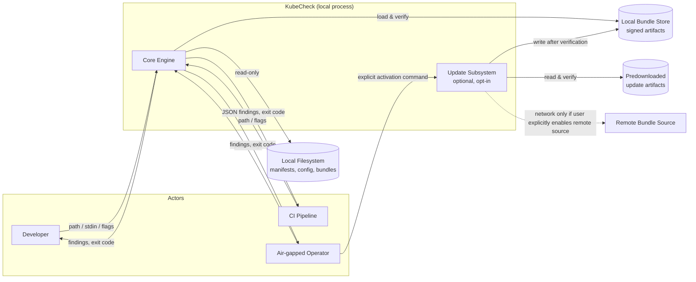
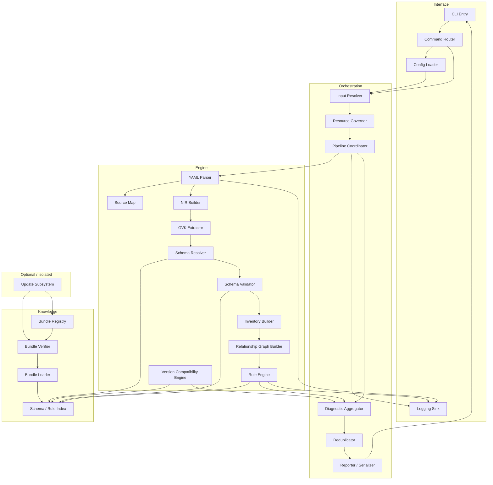
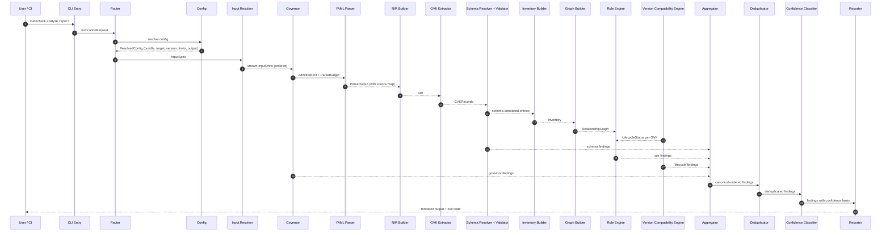
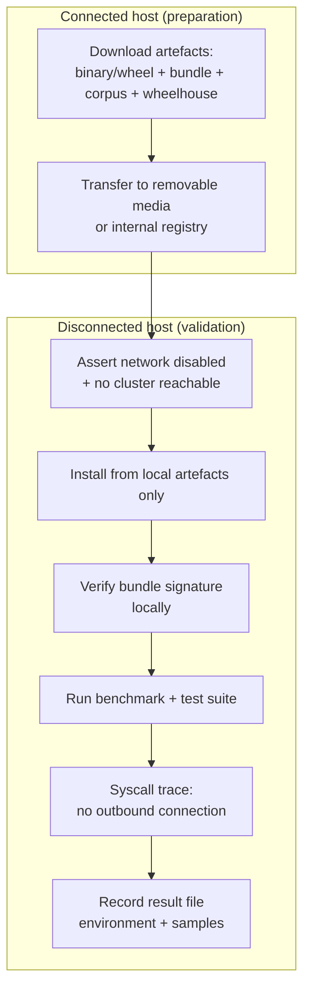
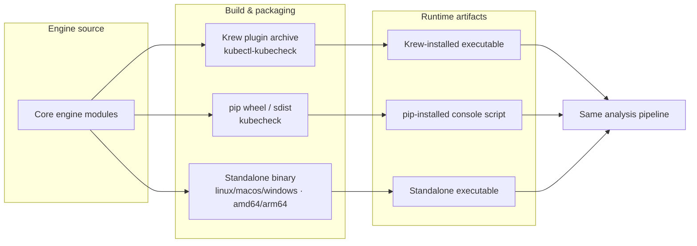

# KubeCheck — System Architecture

**Document ID:** SARCH-001  
**File:** `docs/architecture/SYSTEM_ARCHITECTURE.md`  
**Status:** Normative — Approved  
**Version:** 1.0.0  
**Product:** KubeCheck  
**Owner:** Software Architecture  
**Last reviewed:** 2026-10-31  

**Related documents:**
- `docs/architecture/PRODUCT_VISION.md`
- `docs/architecture/OFFLINE_KNOWLEDGE_BUNDLES.md`
- `docs/architecture/ADR/ADR-001-implementation-language.md`
- `docs/architecture/ADR/ADR-002-yaml-parser-selection.md`
- `docs/architecture/ADR/ADR-003-knowledge-bundle-format.md`
- `docs/architecture/ADR/ADR-004-plugin-boundary.md`
- `docs/diagnostics/DIAGNOSTIC_TAXONOMY.md`
- `docs/diagnostics/RULE_MODEL.md`
- `docs/security/SECURITY_MODEL.md`
- `docs/security/THREAT_MODEL.md`
- `docs/cli/COMMAND_REFERENCE.md`
- `docs/cli/EXIT_CODE_CONTRACT.md`
- `docs/cli/CONFIGURATION.md`
- `docs/output/JSON_SCHEMA.md`
- `docs/distribution/KREW_PACKAGING.md`
- `docs/distribution/PIP_PACKAGING.md`
- `docs/distribution/STANDALONE_BINARIES.md`
- `docs/testing/ACCURACY_BENCHMARK_PROTOCOL.md`
- `docs/testing/DETERMINISM_TESTS.md`

---

## 1. Purpose and scope

This document specifies the **complete system architecture** of KubeCheck: the components, their interfaces, data structures, dependency direction, error propagation, processing order, concurrency model, and isolation guarantees. It is the normative blueprint that implementation documents, diagnostic specifications, security documents, and distribution packaging documents must conform to.

**In scope**

- Component decomposition and interface contracts.
- End-to-end processing pipeline with deterministic ordering.
- Data structures: normalized internal representation (NIR), source maps, resource inventory, relationship graph, diagnostic records, knowledge bundle descriptors.
- Error propagation and partial-failure semantics.
- Concurrency, cancellation, and bounded resource usage.
- Isolation guarantees: no mandatory network, no hidden global state, no unsafe input processing, packaging-consistent behavior.
- Plugin/extension boundaries and their constraints.
- Reference to architectural decision records (ADRs) covering rejected alternatives.

**Out of scope**

- Concrete rule implementations (see `docs/diagnostics/`).
- Knowledge-bundle binary format details (see `docs/architecture/OFFLINE_KNOWLEDGE_BUNDLES.md` and ADR-003).
- Output JSON field-by-field schema (see `docs/output/JSON_SCHEMA.md`).
- Distribution packaging mechanics (see `docs/distribution/`).
- Choice of implementation language (governed by ADR-001, which is **OPEN** at the time of this writing; this document specifies a **language-neutral** architecture and does not select or preclude any language).

**Normative convention:** Requirements use IDs of the form `SARCH-REQ-NNN`. Component interface identifiers use `IF-<COMPONENT>-NNN`. Data structure identifiers use `DS-<NAME>`. Each requirement maps to at least one test in `docs/testing/`.

---

## 2. Terminology

| Term | Definition |
|---|---|
| **Component** | A named unit of responsibility with a stable interface (e.g., `YamlParser`, `SchemaResolver`). |
| **Pipeline stage** | A deterministic processing phase in the analysis pipeline (e.g., Stage 1: Syntax). |
| **NIR** (Normalized Internal Representation) | The language- and schema-neutral data structure produced by the YAML parser and consumed by every downstream component. |
| **Source map** | A structure mapping every NIR node and every diagnostic location to the original byte offset, line, column, and document index in the input. |
| **Resource inventory** | The collection of Kubernetes objects extracted from the NIR, keyed by `group/version/kind/namespace/name`. |
| **Relationship graph** | A directed graph over the resource inventory encoding typed edges (e.g., Service→Workload via selector, Pod→ConfigMap via `configMapRef`). |
| **Bundle** | A signed, versioned knowledge artifact containing schemas, rule definitions, lifecycle metadata, and provenance. |
| **Finding** | A single diagnostic record emitted by the pipeline, conforming to `DS-Finding`. |
| **Evidence class** | `deterministic` \| `probable` \| `context-dependent` (see `docs/diagnostics/RULE_MODEL.md`). |
| **Context** | The set of documents supplied in a single invocation, treated as one analysis unit. |

**Assumptions**

- **ASSUMPTION-SARCH-01:** The concrete implementation language (ADR-001) provides a memory-safe runtime or an equivalent safety contract. The architecture is designed so that language choice does not alter externally observable behavior.
- **ASSUMPTION-SARCH-02:** The selected YAML parser (ADR-002) exposes source locations for every parsed scalar, mapping key, and sequence element. If it does not, a source-map augmentation layer is required, and that layer is treated as part of the parser component.
- **ASSUMPTION-SARCH-03:** The knowledge bundle is fully resident and verifiable on local storage before any analysis begins. The architecture assumes no streaming bundle delivery over a network.

---

## 3. Architectural principles

The architecture enforces the following principles. Each is traceable to a requirement in this document.

| Principle | Enforcement requirement |
|---|---|
| **P1. Offline by construction** | Core analysis path performs no network I/O; network capability exists only in an explicit, isolated, opt-in update subsystem. |
| **P2. Deterministic execution** | Processing order, concurrency schedules, output ordering, and deduplication rules are fixed; no wall-clock or randomness influences finding content. |
| **P3. No hidden mutable global state** | All state is passed through explicit interfaces; process-wide singletons are prohibited except for the logging sink and the cancellation token. |
| **P4. Untrusted input by default** | Every byte of input (manifests, paths, archives, bundles, rules) is treated as adversarial; parsing is safe-mode only; resource limits are enforced before and during processing. |
| **P5. Separation of engine and knowledge** | The engine binary is independent of any particular schema set or rule set; knowledge is loaded from versioned bundles. |
| **P6. Packaging equivalence** | All three distribution channels (Krew, pip, standalone) execute the same engine code path and load the same bundle schema version, so observable behavior is identical. |
| **P7. Explainability of every finding** | Every finding carries a rule ID, evidence anchor, severity, confidence basis, and remediation field. |
| **P8. Bounded resource usage** | Every stage is subject to the resource governor's limits; no unbounded recursion, alias expansion, or memory growth is permitted. |

---

## 4. System context

The system context diagram shows KubeCheck's boundary with external actors and systems.



**SARCH-REQ-001 (offline boundary):** In the default analysis path, the process MUST NOT attempt any outbound network connection. This is enforced by (a) absence of network-capable components in the core pipeline, (b) an integration test that runs analysis with network interfaces disabled, and (c) a static-analysis gate that rejects network APIs in core-engine source modules.

**SARCH-REQ-002 (update isolation):** The update subsystem MUST be a separate module invoked only through explicit user commands. No automatic background update checks are permitted.

**SARCH-REQ-003 (bundle residency):** Before analysis begins, the active bundle MUST be verified and fully loaded into memory or into a local index. Streaming bundle delivery over any channel is prohibited in the analysis path.

---

## 5. Component architecture

### 5.1 Layered view

KubeCheck is organized into four layers with strict, one-directional dependency:

```
┌───────────────────────────────────────────────────────────────┐
│ Interface Layer                                               │
│ CLI Entry · Command Router · Config Loader · Logging Sink     │
├───────────────────────────────────────────────────────────────┤
│ Orchestration Layer                                           │
│ Input Resolver · Resource Governor · Pipeline Coordinator     │
│ Diagnostic Aggregator · Deduplicator · Reporter/Serializer    │
├───────────────────────────────────────────────────────────────┤
│ Diagnostic Engine Layer                                       │
│ YAML Parser · Source Map · NIR Builder · GVK Extractor        │
│ Schema Resolver · Schema Validator                            │
│ Inventory Builder · Relationship Graph Builder                │
│ Rule Engine · Version Compatibility Engine                    │
├───────────────────────────────────────────────────────────────┤
│ Knowledge Layer                                               │
│ Bundle Loader · Bundle Verifier · Bundle Registry · Index     │
└───────────────────────────────────────────────────────────────┘
```

**Dependency rule:** A layer MAY depend only on layers below it. The Interface layer must not contain diagnostic logic; the Diagnostic Engine layer must not read environment variables or open files directly; the Knowledge layer must not depend on the Diagnostic Engine.

**SARCH-REQ-004 (layering):** Any import or call from a higher layer to a lower layer is permitted; any call from a lower layer to a higher layer is a build-breaking violation.

### 5.2 Component diagram



**SARCH-REQ-005 (no bypass):** No component may obtain the active bundle, the parsed input, or the finding set by any route other than its declared interface. Environment variables, global variables, and filesystem scans outside the declared input are prohibited as side channels.

---

## 6. Component specifications

Each subsection specifies the component's responsibility, inputs, outputs, interfaces, failure modes, and ownership constraints.

### 6.1 CLI Entry (`IF-CLI`)

**Responsibility:** Receive the process invocation, perform minimal argument tokenization, and hand off to the Command Router. The CLI entry MUST NOT perform analysis, read manifests, or load bundles.

**Interface:**

```
IF-CLI-001  argv -> InvocationRequest | InvocationError
IF-CLI-002  exit_code: i32
```

**Data structures:**

```
DS-InvocationRequest {
  command: Command,
  args: [Arg],
  stdin_available: bool,
  env_snapshot: RestrictedEnv,  // only documented keys
}
```

**Failure modes:** malformed argv → `InvocationError` with exit code `2` (usage error, see `docs/cli/EXIT_CODE_CONTRACT.md`).

**Ownership:** Interface layer. Must remain free of diagnostic logic. Must not open files.

### 6.2 Command Router (`IF-ROUTER`)

**Responsibility:** Map `Command` to a handler: `analyze`, `config`, `bundle` (subcommands: `list`, `verify`, `activate`, `export`, `import`), `version`, `help`, and (if ADR-004 approves) `plugin`.

**Interface:**

```
IF-ROUTER-001  InvocationRequest -> CommandHandler
IF-ROUTER-002  CommandHandler::execute(Config, InputResolver, BundleContext, Logger) -> CommandResult
```

**SARCH-REQ-006 (routing isolation):** The `analyze` command MUST be the only command that invokes the diagnostic pipeline. Bundle-management commands must not trigger manifest analysis, and analysis must not trigger bundle mutation.

**SARCH-REQ-007 (command stability):** Command names, flags, and exit-code semantics are defined in `docs/cli/COMMAND_REFERENCE.md`. The router must reject unknown commands and unknown flags with a structured usage error and exit code `2`.

### 6.3 Config Loader (`IF-CONFIG`)

**Responsibility:** Merge configuration from (in precedence order) command-line flags, an explicit `--config` file, a project-level configuration file discovered per documented discovery rules, and documented defaults. Configuration keys are enumerated and versioned.

**Interface:**

```
IF-CONFIG-001  InvocationRequest -> Config | ConfigError
IF-CONFIG-002  Config::effective() -> ResolvedConfig
```

**Constraints:**

- **SARCH-REQ-008:** Configuration files are themselves untrusted input; they are parsed with the same safe YAML parser as manifests.
- **SARCH-REQ-009:** No configuration value may re-enable network I/O in the analysis path. Attempts to configure a remote schema source for the `analyze` command are rejected with exit code `2`.
- **SARCH-REQ-010:** Configuration resolution is deterministic; no implicit reads from ambient environment variables beyond the explicitly documented set (e.g., `HOME` for XDG path resolution).

### 6.4 Input Resolver (`IF-INRES`)

**Responsibility:** Turn the invocation's input specification (paths, `-` for stdin, or an archive) into a stream of `(origin, byte_chunks)` units with a stable, deterministic order.

**Interface:**

```
IF-INRES-001  InputSpec -> InputStream
IF-INRES-002  InputStream::next() -> Option<InputUnit>
DS-InputUnit  { origin: Origin, bytes: Bytes, kind: File | Stdin | ArchiveEntry }
DS-Origin     { logical_path: String, source_kind: SourceKind }
```

**Rules:**

- **SARCH-REQ-011:** Directory traversal order is deterministic: normalized path, byte-wise lexicographic. Symbolic links are not followed by default. Symlink following is an explicit opt-in flag documented in `docs/cli/COMMAND_REFERENCE.md`.
- **SARCH-REQ-012:** Archive entries (if archives are supported by the `analyze` command) are subject to path-traversal and zip-slip protections documented in `docs/security/THREAT_MODEL.md`. Only regular files with accepted extensions are admitted.
- **SARCH-REQ-013:** The resolver MUST NOT read any file outside the explicitly supplied roots except for the documented configuration files.
- **SARCH-REQ-014:** The resolver performs no parsing; it yields opaque byte units to the governor.

### 6.5 Resource Governor (`IF-GOV`)

**Responsibility:** Enforce limits on input size, document count, nesting depth, alias expansion, per-unit processing time, and aggregate memory. The governor wraps each `InputUnit` and provides metered reading and metered parsing callbacks to downstream components.

**Interface:**

```
IF-GOV-001  InputUnit -> AdmittedUnit | GovernorError
IF-GOV-002  AdmittedUnit::read(n) -> Bytes (metered)
IF-GOV-003  Governor::meter_parse() -> ParseBudget
DS-Limits { max_input_bytes, max_documents, max_depth, max_aliases, max_time_ms, max_memory_mb }
```

**SARCH-REQ-015:** Limits are configurable but have non-zero safe defaults that cannot be disabled entirely; setting a limit to unlimited requires an explicit flag documented in `docs/security/SECURITY_MODEL.md`.

**SARCH-REQ-016:** Exceeding a limit produces a structured finding of category `resource`, severity `error`, evidence class `deterministic`, and terminates the affected input unit's processing. Other units continue processing unless aggregate limits are also exceeded.

### 6.6 YAML Parser (`IF-PARSER`)

**Responsibility:** Parse admitted bytes into a parsed document tree in **safe mode**, preserving source locations and rejecting unsafe tags.

**Interface:**

```
IF-PARSER-001  (AdmittedUnit, ParseBudget) -> ParseOutput
DS-ParseOutput { documents: [ParsedDoc], events: [ParseEvent], errors: [ParseError] }
DS-ParsedDoc   { root: NodeRef, doc_index: usize }
DS-ParseError  { doc_index, line, column, code, message }
```

**Constraints:**

- **SARCH-REQ-017:** The parser MUST be configured to prohibit arbitrary object construction and implicit code execution. Specifically, YAML tags that resolve to host-language constructors or invocable code (e.g., the `!!python/*` family in Python ecosystems, or equivalent constructs in other runtimes) MUST be rejected or sanitized to plain strings and reported.
- **SARCH-REQ-018:** Duplicate mapping keys MUST be detected and reported as a deterministic finding; the resolution rule (first-wins, last-wins, or reject) is fixed by ADR-002 and documented.
- **SARCH-REQ-019:** Alias expansion MUST be metered; the governor's `max_aliases` limit is enforced during parsing, not after.
- **SARCH-REQ-020:** YAML 1.2.2 conformance is targeted. Any deviation, including handling of the boolean-like `on`/`off`/`yes`/`no` scalars under 1.1 compatibility, MUST be recorded in ADR-002 and reflected in a documented compatibility note.
- **SARCH-REQ-021:** Parse errors do not abort the entire invocation. Each document's parse status is independent; the pipeline records parse failure for that document and continues with other documents.

### 6.7 Source Map (`IF-SMAP`)

**Responsibility:** Provide a bidirectional map between NIR node identifiers and original byte offsets, line numbers, columns, and document indices. Every downstream diagnostic anchors its evidence through the source map.

**Interface:**

```
IF-SMAP-001  NodeRef -> SourceLocation
DS-SourceLocation { origin: Origin, doc_index: usize, byte_offset: usize, line: u32, column: u32 }
```

**SARCH-REQ-022:** Every finding that references a manifest location MUST resolve through the source map. Findings that cannot resolve a location (e.g., cross-document findings on missing references) use the closest available anchor and state the limitation in the evidence field.

### 6.8 NIR Builder (`IF-NIR`)

**Responsibility:** Convert the `ParseOutput` into a **Normalized Internal Representation** — a plain, schema-neutral, language-agnostic tree of mappings, sequences, scalars, and aliases — with stable node IDs referencing the source map.

**Interface:**

```
IF-NIR-001  ParseOutput -> NIR | NIRError
DS-NIR { root: NodeId, nodes: NodeTable, doc_index: usize }
DS-NodeTable { id -> NodeKind }
DS-NodeKind = Mapping{entries}, Sequence{items}, Scalar{value, tag}, Null
```

**SARCH-REQ-023:** The NIR MUST NOT contain host-language objects, classes, or resolved types beyond scalar/string/bool/null representations defined by ADR-002. There is no path from NIR content to code execution.

**SARCH-REQ-024:** NIR node identity is stable and deterministic for a given input byte sequence and parser version; downstream caching (if any) may key on input digest plus parser version.

### 6.9 GVK Extractor (`IF-GVK`)

**Responsibility:** For each NIR document, extract `apiVersion`, `kind`, `metadata.name`, `metadata.namespace`, and `metadata.generateName` when present. Missing or malformed GVK produces a deterministic `syntax`/`schema` finding at the appropriate category, per `docs/diagnostics/DIAGNOSTIC_TAXONOMY.md`.

**Interface:**

```
IF-GVK-001  NIR -> GVKRecord | GVKError
DS-GVKRecord { api_version: String, group: String, version: String, kind: String,
               namespace: Option<String>, name: Option<String>, generate_name: Option<String>,
               anchor: NodeRef }
```

**SARCH-REQ-025:** A document lacking a valid GVK is not admitted to the resource inventory; it is reported as a deterministic finding and excluded from schema and semantic stages for that document.

### 6.10 Schema Resolver (`IF-SCHRES`)

**Responsibility:** Given a `GVKRecord` and a target Kubernetes version, select the correct schema from the active bundle's index. For CRDs, select the schema supplied by the local CRD input or the bundle's CRD catalog.

**Interface:**

```
IF-SCHRES-001  (GVKRecord, TargetVersion, BundleIndex, CrdCatalog) -> SchemaRef | SchemaNotFound
DS-SchemaRef   { schema_id: String, source_kind: BuiltIn | CRD | UserProvided }
```

**SARCH-REQ-026:** The resolver MUST NOT fetch schemas over any network. Schema availability is determined exclusively by the active bundle and the explicitly supplied local CRD inputs.

**SARCH-REQ-027:** If no schema is found for a GVK, the resolver emits a `schema` finding of severity `info` (or as specified in `docs/diagnostics/DIAGNOSTIC_TAXONOMY.md`), labels the document as `schema-unchecked`, and continues. It must not silently skip the document.

### 6.11 Schema Validator (`IF-SCHVAL`)

**Responsibility:** Validate the NIR document against the resolved schema, producing a set of schema findings anchored to NIR node references.

**Interface:**

```
IF-SCHVAL-001  (NIR, SchemaRef, TargetVersion) -> [Finding]
```

**SARCH-REQ-028:** Schema validation is deterministic for a fixed schema bundle version and target version.

**SARCH-REQ-029:** Each schema finding carries: the JSON path to the offending node, the schema keyword that failed (e.g., `additionalProperties`, `type`, `enum`), the expected value/type, the actual value summary, and a remediation hint. Format is specified in `docs/output/JSON_SCHEMA.md`.

**SARCH-REQ-030:** If schema validation produces any `error`-severity finding, the document is marked `schema-invalid` and is excluded from downstream semantic, security, and operational stages **only if** the diagnostic taxonomy specifies exclusion. Otherwise, downstream checks must respect the schema status and avoid cascading findings.

### 6.12 Inventory Builder (`IF-INV`)

**Responsibility:** Assemble the set of admitted resources into an inventory keyed by `(group, version, kind, namespace, name)`. Detect duplicates within a single invocation.

**Interface:**

```
IF-INV-001  [GVKRecord x NIR] -> Inventory
DS-Inventory { entries: Map<ResourceKey, InventoryEntry> }
DS-InventoryEntry { key: ResourceKey, document: NIR, anchor: NodeRef, schema_status: SchemaStatus }
```

**SARCH-REQ-031:** Duplicate resource identities within one invocation produce a `maintainability` finding (advisory). Both documents remain in the inventory; downstream checks operate on both, and the finding records both anchors.

### 6.13 Relationship Graph Builder (`IF-GRAPH`)

**Responsibility:** Construct a directed typed graph over the inventory that encodes relationships required for semantic consistency checks: Service→Workload (selector match), Pod→ConfigMap/Secret (volume/ref), Deployment→ReplicaSet→Pod template, RBAC Subject→Role/ClusterRole→Verbs, PDB→Workload, NetworkPolicy→Workload (podSelector).

**Interface:**

```
IF-GRAPH-001  Inventory -> RelationshipGraph
DS-RelationshipGraph { nodes: [ResourceKey], edges: [TypedEdge] }
DS-TypedEdge { from: ResourceKey, to: ResourceKey | Unresolved, kind: EdgeKind, anchor: NodeRef }
DS-EdgeKind = ServiceSelectorMatch | ConfigMapRef | SecretRef | RoleBindingSubject | ...
```

**SARCH-REQ-032:** Graph construction is deterministic and does not depend on iteration order of any unordered container. Edges are sorted by `(from, kind, to)` before being emitted to downstream consumers.

**SARCH-REQ-033:** An edge with no matching target (e.g., a `Service` whose selector matches no workload in the supplied set) yields an `Unresolved` edge. Consumers of the graph decide whether `Unresolved` is a finding, a context-dependent warning, or informational, as specified by the diagnostic taxonomy. The graph itself does not decide severity.

**SARCH-REQ-034:** Graph construction uses only the inventory supplied in the current invocation. It MUST NOT read cluster state or consult external sources.

### 6.14 Rule Engine (`IF-RULES`)

**Responsibility:** Execute declarative rule definitions loaded from the bundle against the NIR, inventory, and relationship graph. Each rule declares: category, evidence class, severity default, input binding (which graph/field it consumes), and a finding template.

**Interface:**

```
IF-RULES-001  (RuleSet, RuleInputs) -> [Finding]
DS-RuleInputs { nir_by_doc: Map<DocIndex, NIR>, inventory: Inventory, graph: RelationshipGraph,
                target_version: TargetVersion, schema_status_by_doc: Map<DocIndex, SchemaStatus> }
DS-Rule { rule_id, category, evidence_class, severity_default, inputs, template }
```

**SARCH-REQ-035:** Rules are **declarative** and **data-driven**: the rule definition is a versioned artifact in the bundle, not compiled code. The engine that evaluates rules is a generic evaluator. This separation allows bundle-only updates to change rules without changing the engine binary.

**SARCH-REQ-036:** Every rule execution is independently testable via a fixture containing positive and negative cases (see `docs/testing/`).

**SARCH-REQ-037:** Rule execution is deterministic. For rules that iterate over collections, the iteration order is fixed and documented. Rules MUST NOT consult wall-clock time, randomness, or ambient environment.

**SARCH-REQ-038:** A rule MUST NOT emit a finding whose evidence class differs from the class declared in its metadata. Deterministic rules cannot emit context-dependent findings and vice versa.

**SARCH-REQ-039:** Rule failures (malformed rule metadata, unevaluable input) are isolated per rule: a rule failure produces a single internal-error finding for that rule ID and does not abort the pipeline for other rules.

### 6.15 Version Compatibility Engine (`IF-VCE`)

**Responsibility:** Evaluate API-version lifecycle status for each GVK against the selected target Kubernetes version, using the bundle's lifecycle metadata.

**Interface:**

```
IF-VCE-001  (GVKRecord, TargetVersion, LifecycleMetadata) -> LifecycleStatus
DS-LifecycleStatus = GA | Beta{support_min_release, deprecation_release} | Alpha | Deprecated{removal_release} | Removed{removal_release}
```

**SARCH-REQ-040:** Lifecycle data is a first-class artifact in the bundle, versioned alongside schemas. The VCE MUST NOT derive lifecycle status from hard-coded release assumptions in engine code.

**SARCH-REQ-041:** A `Removed` status for the selected target version yields an `error`-severity finding. A `Deprecated` status yields a `warning`. A `Beta` status yields an `info`-severity finding only when the manifest does not explicitly opt in to prerelease APIs (opt-in semantics documented in `docs/diagnostics/DIAGNOSTIC_TAXONOMY.md`).

**SARCH-REQ-042:** If the target version is not covered by the active bundle's lifecycle metadata, the VCE MUST emit a structured finding explaining the coverage gap and MUST NOT guess.

### 6.16 Diagnostic Aggregator (`IF-AGG`)

**Responsibility:** Collect findings from all stages into a single ordered list with stable canonical ordering. The aggregator does not mutate findings, other than to attach provenance metadata (originating stage, rule ID).

**Interface:**

```
IF-AGG-001  [Finding] from all stages -> OrderedFindings
DS-OrderedFindings { findings: [Finding] }   // canonical sort defined below
```

**SARCH-REQ-043:** Canonical ordering is: `(origin.logical_path, doc_index, line, column, category_rank, rule_id, evidence_class_rank)`. This ordering is stable and reproducible across platforms.

### 6.17 Deduplicator (`IF-DEDUP`)

**Responsibility:** Collapse findings that are logically equivalent (same rule ID, same evidence anchor, same target) into a single finding with an extended evidence set. Deduplication is **conservative**: distinct evidence anchors are never merged.

**Interface:**

```
IF-DEDUP-001  OrderedFindings -> OrderedFindings
DS-FindingKey = (rule_id, category, evidence_anchor_canonical, target_key)
```

**SARCH-REQ-044:** Deduplication does not alter ordering except by removing duplicate entries. The retained finding is the first occurrence in canonical order; additional evidence anchors are aggregated into the retained finding in canonical order.

**SARCH-REQ-045:** Deduplication MUST NOT collapse deterministic and context-dependent findings even when their anchors coincide; they remain distinct findings.

### 6.18 Confidence Classifier (`IF-CONF`)

**Responsibility:** Attach the confidence basis field to each finding. The classifier does not compute a probability score; it records the evidence class and the specific evidence names supporting the finding.

**Interface:**

```
IF-CONF-001  Finding -> Finding (with confidence_basis populated)
DS-ConfidenceBasis { evidence_class: deterministic | probable | context-dependent,
                     evidence_names: [String] }
```

**SARCH-REQ-046:** The classifier MUST NOT introduce calibrated probabilities. The output schema MUST NOT expose a numeric confidence score for heuristic findings. The only numeric ordinals permitted are documented rank ordinals for sorting, not probabilities.

### 6.19 Reporter / Serializer (`IF-REP`)

**Responsibility:** Serialize the finalized findings to the selected output format (human-readable text by default; JSON optionally; additional formats per `docs/output/`). Compute the exit code from the finding set per the documented contract.

**Interface:**

```
IF-REP-001  (OrderedFindings, OutputFormat, ExitPolicy) -> (RenderedOutput, ExitCode)
```

**SARCH-REQ-047:** Output serialization is deterministic. JSON field ordering is canonicalized per `docs/output/JSON_SCHEMA.md`; textual output uses fixed formatting.

**SARCH-REQ-048:** The exit code is computed from the finding set according to `docs/cli/EXIT_CODE_CONTRACT.md`. Exit codes are identical across all three distribution channels.

**SARCH-REQ-049:** The report header MUST include the engine version, active bundle ID and schema version, target Kubernetes version, and the resource-limit profile in effect. This makes each report reproducible from its metadata.

### 6.20 Bundle Loader, Verifier, Registry (`IF-BUNDLE`)

**Responsibility:** Locate, verify, load, and expose the active knowledge bundle. Details are normative in `docs/architecture/OFFLINE_KNOWLEDGE_BUNDLES.md`; this section specifies the interface contract.

**Interfaces:**

```
IF-BLOAD-001  BundlePath -> LoadedBundle | BundleLoadError
IF-BVER-001   LoadedBundle, TrustAnchors -> VerifiedBundle | BundleVerifyError
IF-BREG-001   ActiveBundleRef -> LoadedBundle
DS-LoadedBundle { manifest: BundleManifest, schema_index: SchemaIndex, rule_set: RuleSet,
                  lifecycle_metadata: LifecycleMetadata, provenance: BundleProvenance }
```

**SARCH-REQ-050:** The active bundle is verified before use. If verification fails, the process MUST fail closed: the analysis MUST NOT proceed with an unverified bundle.

**SARCH-REQ-051:** The verifier MUST NOT require network access to verify signatures. Trust anchors are locally resident and versioned.

**SARCH-REQ-052:** The bundle loader MUST reject bundles whose declared compatible engine version range does not include the running engine version. Rejection is a structured error with a clear remediation.

**SARCH-REQ-053:** The bundle loader exposes only immutable views. Once loaded, the bundle's data structures are not mutated during a single invocation. Cross-invocation state does not exist (each CLI process starts fresh).

### 6.21 Update Subsystem (`IF-UPD`) — optional, opt-in

**Responsibility:** Support bundle activation, export, and import from predownloaded artifacts. Network fetches may occur only when the user explicitly requests them with a documented flag, and such fetches are outside the analysis path.

**Interfaces:**

```
IF-UPD-001  ActivateCommand -> ActivationResult
IF-UPD-002  ExportCommand -> ExportArtifact
IF-UPD-003  ImportCommand -> ActivationResult
```

**SARCH-REQ-054:** The update subsystem MUST verify each imported or fetched artifact using the bundle verifier before activation. Failed verification leaves the prior active bundle unchanged.

**SARCH-REQ-055:** The update subsystem MUST be excluded from the analysis-path binary linkage in a way that a build-configuration audit confirms no network APIs are reachable from the analysis entry point. The implementation may be in the same binary but must be gated behind the command router.

**SARCH-REQ-056:** Any network access performed by the update subsystem is governed by `docs/security/THREAT_MODEL.md`. The update subsystem is the only component permitted to perform network I/O.

### 6.22 Logging Sink (`IF-LOG`)

**Responsibility:** Emit structured diagnostic traces to `stderr` (never `stdout`) at a configurable level. Logs do not influence analysis results.

**Interface:**

```
IF-LOG-001  LogEvent -> ()
DS-LogEvent { level, timestamp_utc, component, message, fields: Map<String,String> }
```

**SARCH-REQ-057:** Logs MUST NOT contain manifest content by default. When `--debug` is enabled, logs may include structural paths and node identifiers, but not scalar values from the manifest unless the user explicitly requests it and the values are not classified as secret-bearing fields (see `docs/security/THREAT_MODEL.md`).

**SARCH-REQ-058:** Logging to `stdout` is prohibited; `stdout` is reserved for report output.

---

## 7. Data flow

The end-to-end analysis data flow is shown below.



**SARCH-REQ-059 (single-pass input materialization):** The pipeline reads each input unit exactly once from the underlying source. Re-reads (for a second validation pass) are prohibited unless the unit is fully buffered, in which case the re-read is from the buffer, not the source.

**SARCH-REQ-060 (deterministic stage ordering):** Stages execute in the order shown in the sequence diagram. Out-of-order execution is prohibited. Independent per-document processing may proceed concurrently, but the aggregation stage produces results in the canonical order defined in `SARCH-REQ-043`, which is independent of concurrency scheduling.

---

## 8. Error propagation model

Findings and internal errors are distinct concepts. The architecture treats them as separate channels.

### 8.1 Error taxonomy

| Class | Definition | Surfaces as | Example |
|---|---|---|---|
| **Finding** | A diagnostic statement about the manifest or the input set. | A `DS-Finding` record; contributes to exit code per `docs/cli/EXIT_CODE_CONTRACT.md`. | Schema violation, deprecated API. |
| **Usage error** | Malformed command invocation or configuration. | Structured `stderr` message; exit code `2`. | Unknown flag, unknown command. |
| **Operational error** | The tool cannot proceed due to environment (e.g., missing active bundle, unreadable file). | Structured `stderr` message; exit code `3`. | Bundle verification failure, permission denied. |
| **Internal error** | A defect in KubeCheck (e.g., malformed rule metadata in a bundle). | Structured `stderr` message with a diagnostic code; exit code `4`. | A bundle declares a rule with missing `category`. |

**SARCH-REQ-061:** Findings and errors MUST NOT be conflated. A manifest defect is a finding, not an error. An internal error never causes the process to silently claim the manifest is valid.

**SARCH-REQ-062:** When an internal error occurs, the reporter still emits the findings collected so far, plus a structured internal-error entry, and the exit code reflects the highest severity among (a) the highest finding severity and (b) the internal-error severity.

### 8.2 Propagation rules

- **SARCH-REQ-063:** Errors are propagated as values (e.g., `Result`/`Either` in the implementation language) rather than thrown exceptions or panics, except where the language runtime mandates otherwise for catastrophic conditions. Panics are caught at component boundaries, converted to internal errors, and logged.
- **SARCH-REQ-064:** Each component declares its failure modes in its interface specification. A component that fails must return a structured error or a finding; it must not return a partially-populated result without an error or a finding explaining the gap.
- **SARCH-REQ-065:** The pipeline coordinator records, for every input unit, whether it completed all applicable stages. Units that did not complete all stages are marked `partial` in the report; the exit code accounts for this per `docs/cli/EXIT_CODE_CONTRACT.md`.

### 8.3 Partial-failure handling

- **SARCH-REQ-066:** A parse failure in one document does not abort other documents in the same multi-document stream.
- **SARCH-REQ-067:** A schema resolution failure for one GVK does not abort other GVKs.
- **SARCH-REQ-068:** A rule evaluation error for one rule does not abort other rules.
- **SARCH-REQ-069:** Aggregate limits (total memory, total time) are the only conditions that halt the invocation as a whole. When they are reached, the pipeline stops admitting new input units, emits findings for admitted units processed to completion, emits a governor finding for the halt, and exits with the appropriate code.

---

## 9. Concurrency, cancellation, and determinism

### 9.1 Concurrency model

- **SARCH-REQ-070:** The pipeline is designed to permit bounded concurrency at two points: (a) per-input-unit processing, and (b) per-rule evaluation within a unit, when rules are provably independent. Concurrency is bounded by a documented default (e.g., `min(num_cpus, K)` where `K` is a fixed constant) and is configurable.
- **SARCH-REQ-071:** Concurrency MUST NOT be required for correctness. The pipeline's output for a given input is identical whether executed with concurrency level 1 or with the maximum configured level. This is validated by the determinism test suite (`docs/testing/DETERMINISM_TESTS.md`).
- **SARCH-REQ-072:** Shared mutable state across concurrent workers is prohibited, except for thread-safe accumulators whose iteration order does not influence output ordering. All cross-worker aggregation passes through the aggregator's canonical-ordering phase.

### 9.2 Cancellation

- **SARCH-REQ-073:** Every stage accepts a cancellation signal. When cancelled, a stage returns promptly with a `Cancelled` status and does not produce further findings. The reporter emits the findings collected before cancellation and exits with a defined cancellation exit code.
- **SARCH-REQ-074:** SIGINT and SIGTERM trigger cancellation. The process exits within a documented grace period; incomplete input units are marked `partial`.

### 9.3 Determinism

- **SARCH-REQ-075:** For a fixed (input byte sequence, active bundle ID and version, target Kubernetes version, engine version, resource-limit profile, platform), the finding set, canonical ordering, and rendered output are byte-identical across repeated runs. This is validated by the determinism test suite.
- **SARCH-REQ-076:** Sources of nondeterminism (map iteration order, concurrency scheduling, filesystem `readdir` order, timestamps embedded in findings) MUST be eliminated from finding content. Timestamps are permitted only in the report header as diagnostic metadata and are excluded from the finding-set comparison.

---

## 10. Isolation guarantees

The architecture satisfies four critical isolation requirements.

### 10.1 No mandatory runtime network access




- The core pipeline components (`IF-INRES` through `IF-REP`, excluding `IF-UPD`) have no network interfaces.
- The bundle subsystem verifies signatures using locally resident trust anchors.
- The `analyze` command's code path is validated by a static-analysis gate and an integration test to make no network calls.
- The update subsystem is the sole component with network capability, and only on explicit user command.

### 10.2 No hidden mutable global state

- All state is passed through explicit interface parameters.
- Process-wide singletons are limited to: the logging sink, the cancellation token, and the read-only global configuration produced by `IF-CONFIG`.
- The bundle loaded by `IF-BREG` is immutable for the process lifetime.
- Environment variables are read only in `IF-CONFIG` and only for the documented key set.

### 10.3 No unsafe input processing

- Every input unit passes through `IF-GOV` before `IF-PARSER`.
- The parser is configured in safe mode; unsafe tags are rejected or sanitized and reported.
- No component executes shell commands derived from input.
- File paths are validated by `IF-INRES`; traversal outside supplied roots is prohibited.
- Bundle loading treats the bundle as untrusted until verified.

### 10.4 Packaging-consistent behavior

- The same engine source produces all three channels' execution paths.
- The same bundle schema version is accepted by all channels.
- The determinism test suite executes the full finding-set comparison against the same corpus installed through each channel and compares normalized output hashes.
- Channel-specific startup code is limited to entry-point resolution and path discovery; it does not alter the analysis path.

---

## 11. Packaging separation



**SARCH-REQ-077:** The core engine MUST be buildable as a self-contained executable with no network-dependent runtime dependency. Packaging wrappers (Krew plugin shell-out, pip console-script entry point) must not modify behavior.

**SARCH-REQ-078:** Each release artifact MUST embed or reference a bundle whose declared bundle-schema version is identical across channels for the same release.

**SARCH-REQ-079:** The Krew plugin's executable name MUST be `kubectl-kubecheck` so that `kubectl kubecheck` resolves through kubectl's PATH plugin discovery. The plugin archive must declare its compatible `kubectl` version range in its Krew manifest.

**SARCH-REQ-080:** The pip package MUST install without network access when installed from a locally-populated wheelhouse. Optional dependencies that require network access at install time are prohibited for the default install.

**SARCH-REQ-081:** Standalone binaries MUST be reproducible: given the same source commit and build toolchain version, the binary content (modulo documented nondeterministic build metadata) is identical.

---

## 12. Plugin and extension boundaries

**Status:** OPEN, pending ADR-004.

The architecture provisionally defines the following constraints that any future plugin mechanism MUST satisfy. No plugin mechanism is approved by this document; ADR-004 will decide whether one is adopted.

- **SARCH-REQ-082:** Any plugin mechanism MUST preserve the offline boundary: no plugin may cause the core pipeline to require network access.
- **SARCH-REQ-083:** Plugins MUST receive only the NIR, inventory, and relationship graph, or explicit projections thereof. They MUST NOT receive raw bytes, file paths, or bundle internals unless explicitly required and documented.
- **SARCH-REQ-084:** Plugin outputs MUST be validated against the finding schema and MUST be constrained to evidence classes the plugin is authorized to emit. Plugins cannot elevate findings to higher evidence classes than their authorization.
- **SARCH-REQ-085:** Plugins MUST NOT alter the exit-code contract for the base tool unless the user has explicitly enabled the plugin and its severity contributions.
- **SARCH-REQ-086:** Plugin discovery MUST NOT introduce non-determinism: plugin loading order is canonical, and plugin failure is isolated.

---

## 13. Architectural decisions, rejected alternatives, and trade-offs

Each decision references an ADR in `docs/architecture/ADR/`.

### ADR-001 — Implementation language

- **Status:** OPEN.
- **Context:** The architecture is language-neutral. Language selection affects runtime, dependency surface, and standalone binary characteristics.
- **Candidate trade-offs:** A memory-safe language with native concurrency (e.g., Rust, Go) favors standalone binaries and predictable determinism. A Python implementation favors pip-channel reuse but requires careful dependency pinning and a bundled parser; distribution as a standalone binary requires freezing.
- **Constraint on this document:** No language choice is asserted. Component interfaces are expressed language-neutrally.

### ADR-002 — YAML parser selection

- **Status:** OPEN, with a normative safe-mode requirement (`SARCH-REQ-017`).
- **Constraint:** The parser must expose source locations for every node (Assumption SARCH-02), or a source-map augmentation layer is required. The parser must not resolve unsafe tags. YAML 1.2.2 conformance is targeted; any 1.1 compatibility (boolean-like scalars) must be recorded.

### ADR-003 — Knowledge bundle format and verification

- **Status:** OPEN, with normative requirements SARCH-REQ-050 through SARCH-REQ-056.
- **Constraint:** Verification uses locally resident trust anchors. Bundles are immutable during a process lifetime. Lifecycle metadata is a first-class artifact alongside schemas.

### ADR-004 — Plugin boundary

- **Status:** OPEN, provisional constraints in §12.

### Additional trade-offs (documented here for traceability)

| Decision | Alternative rejected | Reason |
|---|---|---|
| Separate YAML parse stage from NIR construction | Combined parse+normalize in one component | Separation allows parser replacement, enforces safe-mode parsing, and keeps the source map independent of downstream evolution. |
| Aggregator performs canonical ordering | Reporter sorts at output time | Ordering must be identical across output formats; a central ordering stage prevents divergence between human-readable and JSON serializers. |
| Deduplication in a distinct stage | Deduplication within the rule engine | Centralizing dedup prevents rule authors from re-implementing dedup inconsistently and simplifies determinism verification. |
| Rules are declarative artifacts in the bundle | Rules compiled into the engine binary | Declarative rules enable bundle-only updates (SARCH-REQ-035) and avoid shipping a new engine binary for each rule change. |
| Relationship graph separate from rule engine | Rules compute their own graph traversals | A single graph construction prevents subtle inconsistencies between rules and keeps graph-building logic under one test harness. |
| Update subsystem in the same process, gated by command router | Separate binary | A single shipped binary simplifies distribution; the gate is enforced by static-analysis and integration tests. A future ADR may split this if isolation requirements increase. |

---

## 14. Interfaces and ownership summary

| Component | Layer | Interface IDs | Owns | Must not |
|---|---|---|---|---|
| CLI Entry | Interface | IF-CLI-001..002 | argv tokenization, stdin availability detection | Parse manifests, load bundles |
| Command Router | Interface | IF-ROUTER-001..002 | command dispatch, usage error surface | Diagnostic logic |
| Config Loader | Interface | IF-CONFIG-001..002 | configuration precedence, effective config | Read manifests, load bundles |
| Logging Sink | Interface | IF-LOG-001 | log emission to `stderr` | Emit reports, mutate pipeline state |
| Input Resolver | Orchestration | IF-INRES-001..002 | input unit stream, path safety | Parse YAML, evaluate rules |
| Resource Governor | Orchestration | IF-GOV-001..003 | limits and metering | Alter finding content |
| Pipeline Coordinator | Orchestration | (implicit) | stage sequencing, cancellation, partial tracking | Own diagnostic logic |
| Diagnostic Aggregator | Orchestration | IF-AGG-001 | canonical ordering | Compute severities |
| Deduplicator | Orchestration | IF-DEDUP-001 | conservative dedup | Merge distinct evidence |
| Reporter / Serializer | Orchestration | IF-REP-001 | rendering, exit-code computation | Alter findings |
| YAML Parser | Engine | IF-PARSER-001 | safe parsing, source preservation | Construct arbitrary objects |
| Source Map | Engine | IF-SMAP-001 | location resolution | Serialize to output |
| NIR Builder | Engine | IF-NIR-001 | normalization | Evaluate rules |
| GVK Extractor | Engine | IF-GVK-001 | GVK extraction | Validate schemas |
| Schema Resolver | Engine | IF-SCHRES-001 | schema selection | Fetch over network |
| Schema Validator | Engine | IF-SCHVAL-001 | schema finding production | Alter NIR |
| Inventory Builder | Engine | IF-INV-001 | resource inventory | Build graph edges |
| Relationship Graph Builder | Engine | IF-GRAPH-001 | graph construction | Assign severities |
| Rule Engine | Engine | IF-RULES-001 | rule evaluation | Add non-declarative behavior |
| Version Compatibility Engine | Engine | IF-VCE-001 | lifecycle findings | Guess unspecified versions |
| Confidence Classifier | Orchestration | IF-CONF-001 | confidence basis attachment | Introduce probabilities |
| Bundle Loader | Knowledge | IF-BLOAD-001 | bundle loading | Activate unverified bundles |
| Bundle Verifier | Knowledge | IF-BVER-001 | signature verification | Network I/O |
| Bundle Registry | Knowledge | IF-BREG-001 | active bundle resolution | Serve mutable views |
| Update Subsystem | Optional | IF-UPD-001..003 | activation, export, import | Run in analysis path |

---

## 15. Dependencies on other KubeCheck documents

This architecture document defers the following specifications to downstream documents. It does not duplicate their normative content.

| Topic | Document |
|---|---|
| Diagnostic taxonomy and category semantics | `docs/diagnostics/DIAGNOSTIC_TAXONOMY.md` |
| Rule model, metadata, evidence classes | `docs/diagnostics/RULE_MODEL.md` |
| Bundle binary format and verification algorithm | `docs/architecture/OFFLINE_KNOWLEDGE_BUNDLES.md`, ADR-003 |
| Security model, threat model, trust anchors | `docs/security/SECURITY_MODEL.md`, `docs/security/THREAT_MODEL.md` |
| CLI command reference and flags | `docs/cli/COMMAND_REFERENCE.md` |
| Exit-code contract | `docs/cli/EXIT_CODE_CONTRACT.md` |
| Configuration schema and precedence | `docs/cli/CONFIGURATION.md` |
| JSON output schema | `docs/output/JSON_SCHEMA.md` |
| Krew packaging | `docs/distribution/KREW_PACKAGING.md` |
| pip packaging | `docs/distribution/PIP_PACKAGING.md` |
| Standalone binary packaging | `docs/distribution/STANDALONE_BINARIES.md` |
| Accuracy benchmark protocol | `docs/testing/ACCURACY_BENCHMARK_PROTOCOL.md` |
| Determinism test suite | `docs/testing/DETERMINISM_TESTS.md` |

---

## 16. Authoritative references

| Reference | Scope | Type | Retrieved |
|---|---|---|---|
| YAML 1.2.2 specification | Parser conformance, safe-mode behavior, alias semantics | Specification | 2026-10-31 |
| Kubernetes API conventions and deprecation policy | GVK semantics, lifecycle rules | Official documentation | 2026-10-31 |
| Kubernetes Krew documentation | Plugin mechanism and `kubectl-*` executable naming | Official documentation | 2026-10-31 |
| `docs/architecture/ADR/` (internal) | ADRs referenced throughout | Internal | 2026-10-31 |
| `docs/diagnostics/RULE_MODEL.md` (internal) | Rule declaration contract | Internal | 2026-10-31 |

No implementation status, benchmark result, or line number is asserted beyond what the cited sources state. License information for any third-party parser or schema artifact is recorded in the corresponding ADR.

---

## 17. Open questions and unresolved decisions

| ID | Question | Status | Owner |
|---|---|---|---|
| OPEN-ARCH-01 | Implementation language selection (ADR-001). | **OPEN** | Software Architecture |
| OPEN-ARCH-02 | YAML parser selection and duplicate-key resolution policy (ADR-002). | **OPEN** | Software Architecture |
| OPEN-ARCH-03 | Bundle format and signature scheme (ADR-003). | **OPEN** | Security Architecture |
| OPEN-ARCH-04 | Plugin mechanism approval and constraints (ADR-004). | **OPEN** | Software Architecture |
| OPEN-ARCH-05 | Concurrency default constant `K` and whether per-rule concurrency is enabled by default. | **OPEN** | Software Architecture |
| OPEN-ARCH-06 | Whether the update subsystem is co-located in the analysis binary (as provisionally designed) or split into a separate binary. | **OPEN** | Software Architecture / Distribution |
| OPEN-ARCH-07 | Exact config file discovery precedence beyond the documented roots. | **OPEN** | CLI Architecture |
| OPEN-ARCH-08 | Whether `analyze` supports archive inputs in the MVP or only in a later release. | **OPEN** | Product Architecture |

---

## 18. Definition of done

This document is complete when the following conditions hold.

1. Every component in §6 has a named responsibility, declared interface, inputs, outputs, and failure modes.
2. Every requirement ID (`SARCH-REQ-NNN`) is traceable to at least one test in `docs/testing/`.
3. The system-context, component, and data-flow diagrams are present and consistent with the component table in §14.
4. The four isolation guarantees in §10 are each backed by concrete requirements.
5. The packaging separation in §11 is expressed with concrete requirements that apply to all three channels.
6. The plugin boundary is explicitly marked OPEN with provisional constraints pending ADR-004.
7. Every referenced ADR is either present or explicitly marked OPEN.
8. The document does not select an implementation language and does not contradict ADR-001, ADR-002, ADR-003, or ADR-004 status.
9. Error propagation (§8) distinguishes findings, usage errors, operational errors, and internal errors.
10. Concurrency, cancellation, and determinism (§9) are specified with requirements that forbid concurrency from influencing observable output.
11. No section duplicates normative content of downstream documents; references are used instead.
12. No achieved benchmark, latency, or accuracy figure is claimed in this document.

---

## 19. Consistency and completeness review

A review was performed against the requested scope before finalization.

- **CLI entry and routing:** specified (§6.1–6.2) with usage-error semantics.
- **File discovery and secure input:** specified (§6.4) with deterministic traversal, symlink policy, and zip-slip defenses.
- **YAML parsing and source-location preservation:** specified (§6.6–6.7) with safe-mode requirements and source map.
- **Normalized internal representation:** specified (§6.8) as language-neutral, schema-neutral, and free of code-execution risk.
- **Schema selection and validation:** specified (§6.10–6.11) with no-network guarantee and deterministic behavior.
- **Resource inventory and relationship graph:** specified (§6.12–6.13) with deterministic ordering and unresolved-edge semantics.
- **Rule engine:** specified (§6.14) with declarative rules, evidence-class constraints, and isolated failure.
- **Version-aware compatibility:** specified (§6.15) with bundle-sourced lifecycle metadata and no guessing.
- **Aggregation, dedup, confidence, reporting:** specified (§6.16–6.19) with canonical ordering and no numeric probabilities.
- **Bundle loader and verification:** specified (§6.20) with fail-closed behavior and local trust anchors.
- **Update/import/export subsystem:** specified (§6.21) as opt-in and network-isolated.
- **Logging, configuration, exit codes, serialization:** specified (§6.3, §6.19, §6.22) with `stderr`-only logs and deterministic serialization.
- **Cancellation, bounded concurrency, determinism, partial failure:** specified (§8.3, §9).
- **Plugin boundary:** specified provisionally (§12), pending ADR-004.
- **Packaging separation:** specified (§11) with cross-channel equivalence requirements.
- **No mandatory network, no global state, no unsafe input, consistent behavior:** each addressed as a normative isolation guarantee (§10).
- **ADRs, alternatives, trade-offs:** enumerated (§13) with rejected alternatives and rationale.

No empty boilerplate section was added solely to satisfy a checklist. The document is complete for its assigned responsibility.
