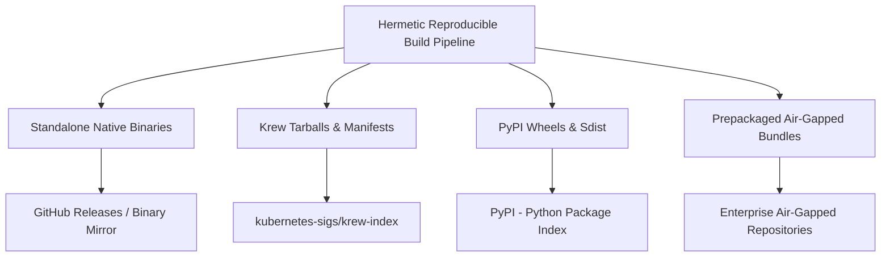

# KubeCheck — Installation Channels and Release Engineering Specification

**Document ID:** DIST-REL-001  
**File:** `docs/distribution/INSTALLATION_AND_RELEASES.md`  
**Status:** Normative — Approved  
**Version:** 1.0.0  
**Product:** KubeCheck  
**Owner:** Cross-Platform Release Engineering  
**Last reviewed:** 2026-10-31  

**Related documents:**
- `docs/architecture/PRODUCT_VISION.md`
- `docs/architecture/ROADMAP_AND_DECISIONS.md`
- `docs/architecture/SYSTEM_ARCHITECTURE.md`
- `docs/quality/TEST_STRATEGY.md`
- `docs/quality/RELEASE_ACCEPTANCE_CRITERIA.md`
- `docs/security/SAFE_EXECUTION_POLICY.md`
- `docs/knowledge/OFFLINE_UPDATE_AND_SIGNING.md`
- `docs/distribution/CLI_UX_AND_EXIT_CODES.md`

---

## 1. Executive Summary and Architecture Overview

KubeCheck is distributed across three distinct installation channels to serve diverse user environments:
1. **Krew Plugin Channel:** For Kubernetes operators and cluster administrators integrating directly into standard `kubectl` workflows (`kubectl check`).
2. **Python / Pip Channel:** For DevOps, SRE, and Python-centric CI/CD pipelines integrating KubeCheck alongside Python tooling (`pip install kubecheck`).
3. **Standalone Binary Channel:** For air-gapped environments, minimal container images, and developers requiring a zero-dependency executable (`kubecheck`).



### 1.1 The Cross-Channel Parity Mandate

Under `GATE-REL-REQ-020` and `ACC-REQ-002`, **all three installation channels must produce bit-for-bit identical diagnostic findings, identical exit codes, and identical schema evaluations when presented with identical manifests and knowledge bundles.** Channel-specific differences are restricted strictly to installation mechanics and wrapper packaging.

---

## 2. Multi-Channel Implementation Architecture (ADR-001 Trade-offs)

Per `ADR-001` (`docs/architecture/SYSTEM_ARCHITECTURE.md` §13), KubeCheck's architecture is language-neutral, evaluating native compiled languages (Go, Rust) versus interpreted languages (Python). Supporting all three channels requires specific packaging architectures depending on the chosen runtime.

### 2.1 Scenario A: Core Engine Implemented in Compiled Native Language (Go / Rust)

If the core engine is implemented in Go or Rust:
* **Standalone Binaries & Krew:** Native, statically compiled binaries (statically linked with `musl` on Linux or minimal dynamic linking on macOS/Windows). Zero runtime dependencies, instant startup (< 15 ms).
* **Pip Channel Architecture:**
  - Python packages are built as **platform-specific binary wheels** (`manylinux2014_x86_64`, `manylinux2014_aarch64`, `macosx_11_0_arm64`, `macosx_10_9_x86_64`, `win_amd64`).
  - The native executable is packaged inside the wheel's `data/scripts` or managed via a thin Python entry-point shim (`kubecheck/cli.py`) that delegates execution via `os.execv` to the bundled native binary.
  - An accompanying pure source distribution (`sdist`) contains the source code and build hooks to compile natively if an unlisted platform is encountered.

### 2.2 Scenario B: Core Engine Implemented in Python

If the core engine is implemented in Python:
* **Pip Channel:** Native distribution of pure Python wheels (`py3-none-any.whl`) and `sdist`. All dependencies pinned strictly in `pyproject.toml`.
* **Standalone Binaries & Krew Architecture:**
  - To meet the NFR startup latency constraint ($\le 50 \text{ ms}$) and zero-dependency offline guarantee, standalone binaries must be packaged using a hermetic single-file freeze toolchain (such as PyOxidizer or PyInstaller with a stripped, statically linked CPython interpreter).
  - Standalone archives unpack into a self-contained runtime directory without querying system Python or external dynamic libraries.

### 2.3 Selected Release Artifact Guarantee

Regardless of the underlying language implementation, the release pipeline publishes identical, self-contained artifacts for all three channels. Users never need to install external compilers, runtimes, or language interpreters to execute standalone or Krew releases.

---

## 3. Canonical Versioning and Compatibility Contracts

### 3.1 Version Schemes

KubeCheck enforces two decoupled, explicit versioning contracts:

```
+---------------------------------------------------------------------------------+
| ENGINE VERSION: vX.Y.Z (Semantic Versioning 2.0.0)                              |
| - Major (X): Breaking CLI flag changes, schema contract breaks, rule syntax.   |
| - Minor (Y): Backward-compatible rule additions, new k8s version support.       |
| - Patch (Z): Bug fixes, parser security patches, performance optimizations.     |
+---------------------------------------------------------------------------------+
| KNOWLEDGE BUNDLE VERSION: YYYY.MM.N (Calendar Versioning)                       |
| - Year.Month.Increment (e.g., 2026.10.1)                                        |
| - Represents out-of-band schema definitions, lifecycle dates, and rule updates. |
+---------------------------------------------------------------------------------+
```

### 3.2 Engine and Knowledge Bundle Compatibility Contract

The engine and knowledge bundle interact across a versioned boundary:
* Every knowledge bundle defines a `bundle_schema_version` (e.g., `1.0.0`).
* Every engine binary embeds:
  - `SUPPORTED_BUNDLE_SCHEMA_MIN`
  - `SUPPORTED_BUNDLE_SCHEMA_MAX`
  - An **embedded default knowledge bundle** (providing out-of-the-box offline functionality without requiring an external bundle download).

An engine release `v1.2.0` can load any bundle whose `bundle_schema_version` satisfies:
$$\text{SUPPORTED\_BUNDLE\_SCHEMA\_MIN} \le \text{bundle.schema\_version} \le \text{SUPPORTED\_BUNDLE\_SCHEMA\_MAX}$$

If an incompatible bundle is imported, the engine rejects it with Exit Code `6` and an actionable error:
`error: bundle schema version 2.1.0 is unsupported by engine v1.2.0 (maximum supported schema: 1.x.x). Please upgrade KubeCheck.`

---

## 4. Channel Specifications and Artifact Naming

### 4.1 Channel 1: Standalone Compiled Binaries

Standalone binaries are distributed as compressed archives containing the executable, baseline knowledge bundle, and legal notices.

#### Artifact Naming Convention
`kubecheck-<version>-<os>-<arch>.<ext>`

| Target Platform | Operating System | Architecture | Binary Archive File | Archive Format |
|---|---|---|---|---|
| Linux AMD64 (glibc) | Linux 3.10+ (glibc 2.28+) | `x86_64` | `kubecheck-v1.0.0-linux-amd64.tar.gz` | `.tar.gz` |
| Linux ARM64 | Linux 4.2+ | `aarch64` | `kubecheck-v1.0.0-linux-arm64.tar.gz` | `.tar.gz` |
| Linux Musl (Alpine) | Alpine Linux / Musl | `x86_64` | `kubecheck-v1.0.0-linux-musl-amd64.tar.gz` | `.tar.gz` |
| macOS Apple Silicon | Darwin 21.0+ (macOS 12+) | `arm64` | `kubecheck-v1.0.0-darwin-arm64.tar.gz` | `.tar.gz` |
| macOS Intel | Darwin 19.0+ (macOS 10.15+) | `x86_64` | `kubecheck-v1.0.0-darwin-amd64.tar.gz` | `.tar.gz` |
| Windows AMD64 | Windows 10/11 / Server 2019+ | `x86_64` | `kubecheck-v1.0.0-windows-amd64.zip` | `.zip` |

#### Archive Directory Contents
```
kubecheck-v1.0.0-linux-amd64/
├── kubecheck                  # Executable binary (with executable bit set 0755)
├── README.md                  # Quickstart documentation
├── LICENSE                    # Apache-2.0 / Permissive license text
└── NOTICE                     # Third-party dependency copyright notices
```

---

### 4.2 Channel 2: Krew Plugin Packaging

Krew (`kubectl krew`) is the standard plugin manager for `kubectl`. KubeCheck integrates seamlessly as `kubectl check`.

#### Plugin Executable Name
Under Krew specifications, the extracted binary must be named `kubectl-check` (or `kubectl-check.exe` on Windows).

#### Krew Plugin Manifest (`plugins/check.yaml`)
```yaml
apiVersion: krew.googlecontainertools.github.com/v1alpha2
kind: Plugin
metadata:
  name: check
spec:
  version: "v1.0.0"
  homepage: "https://github.com/kubecheck/kubecheck"
  shortDescription: "Static analysis and diagnostic engine for Kubernetes manifests"
  description: |
    KubeCheck is an offline diagnostic engine that validates Kubernetes manifests
    for syntax errors, OpenAPI schema violations, semantic misalignments,
    security misconfigurations, and version deprecations with high precision.
  caveats: |
    KubeCheck runs completely offline by default. To update schema bundles,
    use 'kubectl check bundle update' or import offline bundles manually.
  platforms:
    - selector:
        matchLabels:
          os: linux
          arch: amd64
      uri: "https://github.com/kubecheck/kubecheck/releases/download/v1.0.0/kubecheck-v1.0.0-krew-linux-amd64.tar.gz"
      sha256: "e3b0c44298fc1c149afbf4c8996fb92427ae41e4649b934ca495991b7852b855"
      bin: "kubectl-check"
    - selector:
        matchLabels:
          os: linux
          arch: arm64
      uri: "https://github.com/kubecheck/kubecheck/releases/download/v1.0.0/kubecheck-v1.0.0-krew-linux-arm64.tar.gz"
      sha256: "ca978112ca1bbdcafac231b39a23dc4da786eff8147c4e72b9807785afee48bb"
      bin: "kubectl-check"
    - selector:
        matchLabels:
          os: darwin
          arch: arm64
      uri: "https://github.com/kubecheck/kubecheck/releases/download/v1.0.0/kubecheck-v1.0.0-krew-darwin-arm64.tar.gz"
      sha256: "ba7816bf8f01cfea414140de5dae2223b00361a396177a9cb410ff61f20015ad"
      bin: "kubectl-check"
    - selector:
        matchLabels:
          os: darwin
          arch: amd64
      uri: "https://github.com/kubecheck/kubecheck/releases/download/v1.0.0/kubecheck-v1.0.0-krew-darwin-amd64.tar.gz"
      sha256: "88d4266fd4e6338d13b845fcf289579d209c897823b9217da3e161936f031589"
      bin: "kubectl-check"
    - selector:
        matchLabels:
          os: windows
          arch: amd64
      uri: "https://github.com/kubecheck/kubecheck/releases/download/v1.0.0/kubecheck-v1.0.0-krew-windows-amd64.zip"
      sha256: "36a92cc94a9e0faadd89061386b41453716bf942e5047ecd03f46f69f53d4235"
      bin: "kubectl-check.exe"
```

---

### 4.3 Channel 3: Python / Pip Package Distribution

KubeCheck is published to PyPI as `kubecheck`, built adhering to PEP 517, PEP 518, and PEP 621 standards.

#### Package Metadata (`pyproject.toml`)
```toml
[build-system]
requires = ["setuptools>=68.0.0", "wheel>=0.40.0"]
build-backend = "setuptools.build_meta"

[project]
name = "kubecheck"
version = "1.0.0"
description = "Diagnostic static analysis engine for Kubernetes manifests"
readme = "README.md"
authors = [{ name = "KubeCheck Core Team", email = "maintainers@kubecheck.io" }]
license = { text = "Apache-2.0" }
classifiers = [
    "Development Status :: 5 - Production/Stable",
    "Environment :: Console",
    "Intended Audience :: Developers",
    "Intended Audience :: System Administrators",
    "License :: OSI Approved :: Apache Software License",
    "Operating System :: POSIX :: Linux",
    "Operating System :: MacOS",
    "Operating System :: Microsoft :: Windows",
    "Programming Language :: Python :: 3",
    "Programming Language :: Python :: 3.10",
    "Programming Language :: Python :: 3.11",
    "Programming Language :: Python :: 3.12",
    "Topic :: Software Development :: Quality Assurance",
]
requires-python = ">=3.10"
dependencies = [] # Zero runtime dependencies required

[project.scripts]
kubecheck = "kubecheck.cli:main"
kubectl-check = "kubecheck.cli:kubectl_plugin_main"

[project.urls]
Homepage = "https://github.com/kubecheck/kubecheck"
Documentation = "https://github.com/kubecheck/kubecheck/docs"
Changelog = "https://github.com/kubecheck/kubecheck/releases"
```

#### Package Artifacts
* `kubecheck-1.0.0-py3-none-any.whl` (or platform binary wheels)
* `kubecheck-1.0.0.tar.gz` (Source distribution)

---

## 5. Prepackaged Offline Installation Bundles

For high-security, air-gapped environments (classified enclaves, defense networks, isolated industrial subnets), KubeCheck provides self-contained offline media tarballs.

### 5.1 Offline Bundle Composition

`kubecheck-offline-linux-amd64-v1.0.0.tar.gz` contains:
```
kubecheck-offline-v1.0.0/
├── bin/
│   └── kubecheck                             # Standalone executable
├── bundle/
│   ├── kubecheck-bundle-2026.10.1.tar.gz     # Complete validated schema bundle
│   └── kubecheck-bundle-2026.10.1.tar.gz.minisig # Cryptographic signature
├── trust/
│   ├── root-of-trust.pub                     # Root public key
│   └── release-signing.pub                   # Release signing key
├── wheels/                                   # Offline Python wheels cache (if using pip)
│   ├── kubecheck-1.0.0-py3-none-any.whl
│   └── pip-wheels-cache...
├── krew/
│   ├── check.yaml                            # Local Krew manifest
│   └── kubecheck-v1.0.0-krew-linux-amd64.tar.gz
├── security/
│   ├── checksums.txt                         # Cryptographic checksums
│   ├── checksums.txt.sig                     # Cosign signature
│   ├── sbom-cyclonedx.json                   # Complete CycloneDX SBOM
│   └── provenance.intoto.jsonl               # SLSA Level 3 build attestation
├── install.sh                                # Automated air-gapped install script
└── README-OFFLINE.md                         # Air-gapped deployment runbook
```

### 5.2 Offline Installation Procedure

```bash
# 1. Transfer archive to air-gapped host via approved media
tar -xzf kubecheck-offline-linux-amd64-v1.0.0.tar.gz
cd kubecheck-offline-v1.0.0/

# 2. Verify archive checksums using locally resident shasum
sha256sum -c security/checksums.txt

# 3. Execute hermetic installer
./install.sh --prefix=/usr/local

# 4. Verify installation operates in strict network isolation
unshare -n /usr/local/bin/kubecheck version
```

---

## 6. Supply Chain Security, Provenance, and Signing

### 6.1 Cryptographic Hash Ledger (`checksums.txt`)

Every release publishes a canonical `checksums.txt` containing SHA-256 hashes of all release assets:
```
e3b0c44298fc1c149afbf4c8996fb92427ae41e4649b934ca495991b7852b855  kubecheck-v1.0.0-linux-amd64.tar.gz
ca978112ca1bbdcafac231b39a23dc4da786eff8147c4e72b9807785afee48bb  kubecheck-v1.0.0-linux-arm64.tar.gz
ba7816bf8f01cfea414140de5dae2223b00361a396177a9cb410ff61f20015ad  kubecheck-v1.0.0-darwin-arm64.tar.gz
88d4266fd4e6338d13b845fcf289579d209c897823b9217da3e161936f031589  kubecheck-v1.0.0-darwin-amd64.tar.gz
36a92cc94a9e0faadd89061386b41453716bf942e5047ecd03f46f69f53d4235  kubecheck-v1.0.0-windows-amd64.zip
4f53cda18c2baa0c0354bb5f9a3ecbe5ed12ab4d8e11ba873c2f11161202b945  kubecheck-1.0.0-py3-none-any.whl
78546b5a76bc...                                                    kubecheck-bundle-2026.10.1.tar.gz
```

### 6.2 Keyless Signing and SLSA Level 3 Provenance

Under `GATE-REL-REQ-017`:
1. **Cosign / Sigstore Keyless Signatures:** Assets are signed via GitHub Actions OIDC identity with Sigstore transparency logs.
   ```bash
   cosign verify-blob \
     --certificate-identity-regexp="https://github.com/kubecheck/kubecheck/.*" \
     --certificate-oidc-issuer="https://token.actions.githubusercontent.com" \
     --signature checksums.txt.sig \
     checksums.txt
   ```
2. **SLSA Level 3 Provenance:** The release generates `provenance.intoto.jsonl` using the GitHub Actions SLSA generator, establishing non-falsifiable build origin tracking back to the source commit.
3. **Knowledge Bundle Signatures:** Bundles are signed using **Minisign (Ed25519)** with offline release keys per `docs/knowledge/OFFLINE_UPDATE_AND_SIGNING.md`.

### 6.3 Reproducible Builds

Under `GATE-REL-REQ-015`:
* Environment variable `SOURCE_DATE_EPOCH` is pinned to the Unix epoch timestamp of the release git commit.
* Compilers are instructed to omit machine hostnames, absolute directory paths, and random build IDs (`-trimpath` in Go, `--remap-path-prefix` in Rust).
* Archive tar headers are sorted lexicographically with fixed user/group IDs (`root:root`) and timestamp clamping.

---

## 7. Platform Support Matrix and Lifecycle Policy

### 7.1 Platform Support Tiers

| Platform / Target | Operating System Baseline | Runtime / Libc | Support Tier | Automated CI Smoke Testing |
|---|---|---|---|---|
| **Linux AMD64** | Ubuntu 20.04+, RHEL 8+, Debian 11+ | glibc 2.28+ | **Tier 1 (Core)** | Native VM on every PR & Release |
| **Linux ARM64** | Ubuntu 22.04+, Amazon Linux 2023 | glibc 2.34+ | **Tier 1 (Core)** | Native ARM64 runner on Release |
| **Linux Alpine** | Alpine 3.16+ | musl 1.2+ | **Tier 1 (Core)** | Containerized musl runner |
| **macOS Apple Silicon**| macOS 12 (Monterey) through 15 (Sequoia)| Darwin 21+ | **Tier 1 (Core)** | Native M1/M2 GitHub runner |
| **macOS Intel** | macOS 10.15 (Catalina) through 14 | Darwin 19+ | **Tier 1 (Core)** | Native x86_64 runner |
| **Windows AMD64** | Windows 10/11, Windows Server 2019/2022| MSVC / Win32 | **Tier 1 (Core)** | Windows Server 2022 runner |
| **Linux ARMv7** | Debian Buster (Raspberry Pi OS) | glibc 2.28+ | **Tier 2 (Best-effort)**| Cross-compiled; release smoke only |
| **Windows ARM64** | Windows 11 ARM64 | MSVC / Win32 | **Tier 2 (Best-effort)**| Emulated / Community verified |

### 7.2 End-of-Support (EOL) Policy

1. **Engine Support Horizon:** An engine minor release (e.g., `v1.2.0`) is supported with security patches for **12 months** following initial publication, or until two subsequent minor versions have shipped (whichever is longer).
2. **Kubernetes API Target Horizon:** KubeCheck supports validation for all upstream actively supported Kubernetes minor releases (currently $N-3$, roughly 14 months) plus the prior 4 deprecated releases (providing a minimum 8-release historical validation window: e.g., v1.24 through v1.31).
3. **Deprecation Notice:** CLI flags, configuration fields, or rule categories slated for removal must remain deprecated and operational for at least two minor releases before removal, producing clear warnings on `stderr`.

---

## 8. Verification, Parity Smoke Tests, and Rollback

### 8.1 Post-Packaging Automated Smoke Test Matrix

Before publication, the release orchestrator spins up isolated test environments to execute the verification matrix:

```
[Release Candidate Artifacts]
       |
       +---> [Clean Ubuntu VM] ---> Install Standalone Binary ---> Run CAT-SMOKE
       |
       +---> [Clean Alpine VM] ---> Install Musl Binary     ---> Run CAT-SMOKE
       |
       +---> [Clean macOS VM]  ---> Install Darwin Binary   ---> Run CAT-SMOKE
       |
       +---> [Clean Windows VM]---> Install Windows Zip     ---> Run CAT-SMOKE
       |
       +---> [Clean Python 3.11 venv] ---> pip install wheel ---> Run CAT-SMOKE
       |
       +---> [Krew Test Harness] ---> krew install check.yaml -> Run CAT-SMOKE
```

#### Smoke Test Sequence (`CAT-SMOKE`)
1. `--help` and `version` commands return clean exit code `0`.
2. Analyze standard clean Pod manifest: Returns exit code `0` with zero findings.
3. Analyze known invalid manifest (schema type error): Returns exit code `1` with exact expected `KCHK-SCH-002` finding.
4. Verify execution completes in $< 25 \text{ ms}$ with memory $< 30 \text{ MiB}$.
5. Run cross-channel parity diff (`evidence/channel-parity-audit.json`): Verify JSON findings match 100% across Standalone, Pip, and Krew runs.

### 8.2 Upgrade, Rollback, and Recovery

* **Atomic Upgrades:** Upgrading KubeCheck in standalone mode replaces the binary atomically via temporary file rename (`renameat2` syscall), ensuring existing running processes are not corrupted.
* **Bundle Rollback Protection:** If an imported knowledge bundle fails signature verification or triggers runtime crashes, the engine automatically rolls back to the built-in embedded fallback bundle and emits an alert on `stderr`.
* **Krew Rollback:** Users can immediately revert to prior versions using standard Krew semantics:
  `kubectl krew install check --version=v0.9.0`
* **Pip Rollback:** Users can pin to prior versions:
  `pip install kubecheck==0.9.0`
