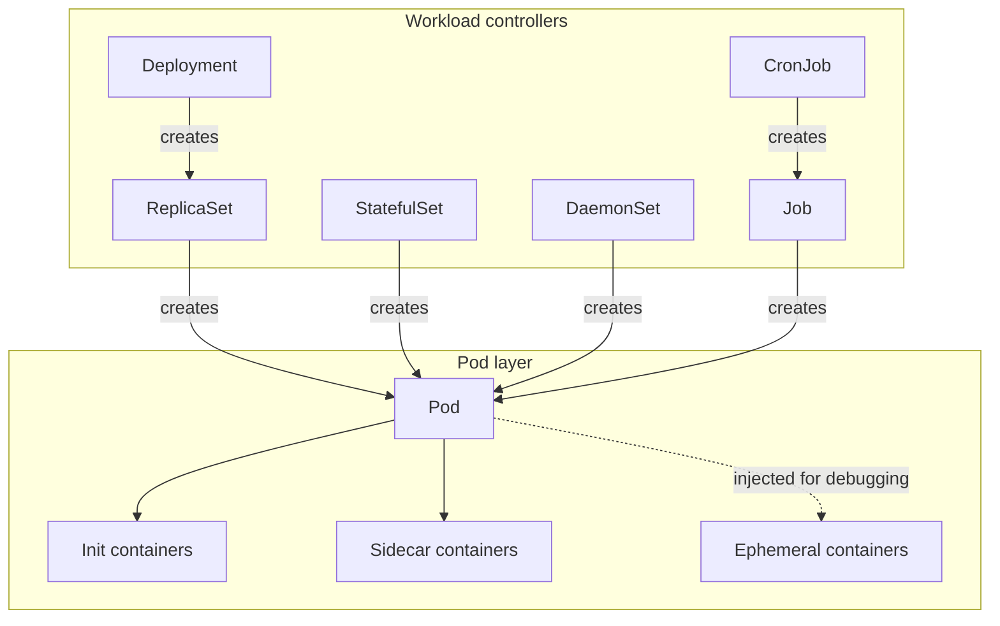

# KubeCheck — Workloads and Pods

**Document ID:** K8S-WORKLOAD-001  
**File:** `docs/kubernetes/WORKLOADS_AND_PODS.md`  
**Status:** Normative — Approved  
**Version:** 1.0.0  
**Product:** KubeCheck  
**Owner:** Kubernetes Workload Diagnostics  
**Last reviewed:** 2026-10-31  

**Related documents:**
- `docs/kubernetes/KUBERNETES_API_FUNDAMENTALS.md`
- `docs/kubernetes/KUBERNETES_SCHEMA_VALIDATION.md`
- `docs/kubernetes/KUBERNETES_API_VERSION_LIFECYCLE.md`
- `docs/diagnostics/DIAGNOSTIC_TAXONOMY.md`
- `docs/diagnostics/RULE_MODEL.md`
- `docs/yaml/YAML_VALIDATION_AND_NORMALIZATION.md`
- `docs/architecture/SYSTEM_ARCHITECTURE.md`
- `docs/architecture/REQUIREMENTS_AND_NFRS.md`
- `docs/security/THREAT_MODEL.md`
- `docs/testing/DETERMINISM_TESTS.md`

---

## 1. Purpose and scope

This document is the authoritative reference for diagnosing **workload manifest defects** in KubeCheck. It covers Pods, ReplicaSets, Deployments, StatefulSets, DaemonSets, Jobs, CronJobs, init containers, sidecar containers, and ephemeral-container-related schema behavior. For every diagnostic family it identifies:

- **Deterministic checks** that can be established from the manifest alone.
- **Heuristic checks** whose outcome depends on operational intent or cluster context.
- **Required evidence** for each finding.
- **Likely false positives** and the conditions under which a finding may be benign.
- **Remediation guidance** that can be rendered from the finding.
- **Regression tests** that must exist in the KubeCheck test suite.

**Governing distinction:**

> **K8S-WORKLOAD-REQ-001 — KubeCheck MUST clearly separate manifest defects from failures that require live Pod or controller status.** A manifest can be structurally correct and still produce a runtime failure (image pull error, crash loop, scheduling failure). KubeCheck validates the manifest, not the running workload.

**In scope:** workload controller schemas and their relationships; container configuration; probes; resource requests and limits; image references and pull policies; volumes and mounts; service accounts and security contexts; scheduling fields; update strategies; Job and CronJob semantics; StatefulSet identity and storage.

**Out of scope:** live Pod status interpretation (see `docs/kubernetes/KUBERNETES_API_FUNDAMENTALS.md` §13), admission controller behavior, cluster policy, and custom resource controller semantics.

---

## 2. Terminology and conventions

| Term | Definition |
|---|---|
| **Pod template** | A `PodTemplateSpec` embedded in a workload controller (`Deployment`, `StatefulSet`, `DaemonSet`, `Job`, `CronJob`) that describes the Pods the controller creates. |
| **Selector** | A label selector that determines which Pods a controller manages. |
| **Deterministic check** | A check whose verdict depends only on the manifest and the schema, with no heuristic weighting. |
| **Heuristic check** | A check supported by strong evidence but capable of being a false positive in valid configurations. |
| **Live-status failure** | A failure observable only from a running Pod or controller (e.g., `ImagePullBackOff`, `CrashLoopBackOff`, `Pending` due to insufficient node capacity). |
| **Manifest defect** | A defect detectable from the manifest alone, independent of cluster state. |

**Requirement IDs** use `K8S-WORKLOAD-REQ-NNN`. Finding IDs use `WL-<FAMILY>-NNN`. The mapping to executable tests is maintained in `docs/testing/REQUIREMENT_TRACEABILITY.md`.

---

## 3. Workload controller taxonomy and schema relationships

### 3.1 Controller hierarchy

A **Deployment** manages **ReplicaSets**, which manage Pods. A **StatefulSet** manages Pods directly with stable identity. A **DaemonSet** manages one Pod per eligible node. A **Job** manages Pods until a completion condition is met. A **CronJob** creates **Jobs** on a schedule.

**K8S-WORKLOAD-REQ-002:** KubeCheck MUST validate the `spec` of each controller against the schema for its GVK and target version. It MUST NOT validate a `Deployment` against a `ReplicaSet` schema or a `StatefulSet` against a `Deployment` schema, because the fields differ even when names coincide.

### 3.2 Pod template and selector consistency

The most common and most deterministic workload defect is a **selector/template mismatch**. The Kubernetes API server rejects a `Deployment` whose `spec.selector.matchLabels` does not match `spec.template.metadata.labels` with the error "selector does not match template labels". The selector is **immutable** after creation in `apps/v1`, so a mismatch cannot be corrected by editing the Deployment; the Deployment must be deleted and recreated.

**Deterministic check (WL-SELECTOR-001):** For `Deployment`, `ReplicaSet`, `StatefulSet`, and `DaemonSet`, `spec.selector` MUST be present and MUST match a subset of `spec.template.metadata.labels`.

| Attribute | Detail |
|---|---|
| **Evidence** | The `spec.selector.matchLabels` map and the `spec.template.metadata.labels` map, with their JSON paths. |
| **Severity** | `error` |
| **False positives** | None for the subset requirement. A selector with `matchExpressions` that is satisfied by the template labels is valid; the check must evaluate both `matchLabels` and `matchExpressions` against the template labels, not only `matchLabels`. |
| **Remediation** | Add the missing labels to `spec.template.metadata.labels`, or correct `spec.selector` to match the intended labels. Note that the selector is immutable after creation. |
| **Regression test** | A Deployment with `matchLabels: {app: web}` and template labels `{app: api}` MUST produce `WL-SELECTOR-001`; a Deployment with matching labels MUST NOT. A selector with `matchExpressions` satisfied by the template MUST NOT produce the finding. |

**K8S-WORKLOAD-REQ-003:** The selector check MUST evaluate `matchExpressions` (In, NotIn, Exists, DoesNotExist) against the template labels, not only `matchLabels`. A selector that matches via expressions is valid.

### 3.3 Pod template vs standalone Pod

A standalone `Pod` has no selector. A `Pod` in a controller's template is **not** validated as a top-level resource; it is validated as part of the controller's `spec.template`. KubeCheck MUST apply the Pod schema to the template's `spec` but MUST NOT require the template to have its own `apiVersion`, `kind`, or `metadata.name`.

**K8S-WORKLOAD-REQ-004:** KubeCheck MUST validate the `spec.template.spec` against the Pod specification schema and MUST NOT emit a `MISSING_API_VERSION` or `MISSING_KIND` finding for a Pod template, because a template is not a standalone object.

---

## 4. Containers, images, commands, and environment

### 4.1 Container list requirements

Every Pod must have at least one container in `spec.containers`. Container names must be unique within the Pod and must be DNS-label-conforming. `image` is required for each container.

| Finding ID | Check | Severity | Evidence | False-positive conditions |
|---|---|---|---|---|
| **WL-CONTAINER-001** | `spec.containers` is empty or absent | `error` | JSON path `/spec/containers` | None |
| **WL-CONTAINER-002** | Two containers share the same `name` | `error` | Both JSON paths and names | None |
| **WL-CONTAINER-003** | `image` is absent or empty | `error` | JSON path `/spec/containers[i]/image` | None |
| **WL-CONTAINER-004** | `name` is not a valid DNS label | `error` | The invalid name and path | None |

### 4.2 Image reference syntax

Kubernetes image references follow the OCI reference grammar: `[registry/][namespace/]repository[:tag][@digest]`. The tag is optional; if omitted and no digest is supplied, the image is treated as `:latest` for pull-policy purposes. A digest reference (`image@sha256:...`) is immutable and is the recommended form for reproducible deployments.

**Deterministic checks:**

| Finding ID | Check | Severity | Rationale |
|---|---|---|---|
| **WL-IMAGE-001** | Image reference contains an uppercase character in the repository name | `error` | OCI repository names must be lowercase. |
| **WL-IMAGE-002** | Image reference uses `:latest` or omits both tag and digest | `warning` | `:latest` is mutable and prevents reproducible rollbacks. |
| **WL-IMAGE-003** | Image reference contains a malformed digest (not `sha256:<64 hex>`) | `error` | The digest will be rejected by the kubelet. |
| **WL-IMAGE-004** | Image reference has an empty repository segment (`registry//image`) | `error` | Invalid reference syntax. |

**K8S-WORKLOAD-REQ-005:** KubeCheck MUST validate image reference syntax deterministically. A syntactically invalid reference is an `error`; a mutable reference (`:latest` or no tag) is a `warning`; a digest reference is `info` only if the digest is malformed.

### 4.3 Image pull policy

The default `imagePullPolicy` is `IfNotPresent` when a tag other than `:latest` is specified, and `Always` when the tag is `:latest` or omitted. A digest reference with no explicit policy defaults to `IfNotPresent`.

**Heuristic check (WL-IMAGE-005):** An explicit `imagePullPolicy: Always` with a digest reference is redundant but not harmful; emit `info`. An explicit `IfNotPresent` with a `:latest` tag contradicts the default and may cause stale images to run; emit `warning`.

| Attribute | Detail |
|---|---|
| **Evidence** | The `image` value, the `imagePullPolicy` value, and the inferred default. |
| **False positives** | A user may deliberately pin `IfNotPresent` with `:latest` in an air-gapped environment where the image is preloaded. The finding is a `warning`, not an `error`. |
| **Remediation** | Use a digest reference, or align the pull policy with the tag mutability. |
| **Regression test** | `image: nginx:latest` with no policy → `info` noting the inferred `Always`. `image: nginx:latest` with `imagePullPolicy: IfNotPresent` → `warning`. |

### 4.4 Commands and arguments

`command` overrides the image's `ENTRYPOINT`; `args` overrides `CMD`. The two interact: if `command` is set and `args` is not, the image's `CMD` is used as arguments to the overridden entrypoint. If `args` is set and `command` is not, the image's `ENTRYPOINT` is used.

**Deterministic checks:**

| Finding ID | Check | Severity | Rationale |
|---|---|---|---|
| **WL-CMD-001** | `command` and `args` are both empty while the image's entrypoint is unknown offline | `info` | KubeCheck cannot verify that the image has a default entrypoint; the user should confirm. |
| **WL-CMD-002** | `args` is set without `command` and the image's entrypoint is unknown offline | `info` | The arguments may not be interpreted as intended if the entrypoint differs. |

**K8S-WORKLOAD-REQ-006:** KubeCheck MUST NOT attempt to inspect container images offline. It MUST report command/argument ambiguity as `info` and state that image-entrypoint verification requires a registry or runtime.

### 4.5 Environment variables

`env` is a list of `EnvVar` objects with `name` and one of `value`, `valueFrom.configMapKeyRef`, `valueFrom.secretKeyRef`, `valueFrom.fieldRef`, or `valueFrom.resourceFieldRef`. `envFrom` imports all keys from a ConfigMap or Secret.

**Deterministic checks:**

| Finding ID | Check | Severity | Rationale |
|---|---|---|---|
| **WL-ENV-001** | Duplicate `env` names within one container | `error` | The API server rejects duplicate env names. |
| **WL-ENV-002** | `env` name is not a valid C_IDENTIFIER | `error` | Invalid environment variable name. |
| **WL-ENV-003** | Both `value` and `valueFrom` are set | `error` | Mutually exclusive fields. |
| **WL-ENV-004** | `valueFrom.secretKeyRef` references a Secret not in the input set | `info` | Existence is cluster-dependent; the reference is structurally valid. |
| **WL-ENV-005** | `valueFrom.configMapKeyRef` references a ConfigMap not in the input set | `info` | Same as above. |

**K8S-WORKLOAD-REQ-007:** A missing ConfigMap or Secret referenced by `env` MUST be reported as `info` when the target is not in the input set, because KubeCheck cannot verify cluster state (`K8S-API-REQ-023`). It MUST NOT be reported as `error`.

### 4.6 Ports

`ports` is a list of `ContainerPort` objects with `containerPort` (required), `hostPort`, `hostIP`, `name`, and `protocol`. Port names must be unique within the Pod and must be IANA_SVC_NAME-conforming.

**Deterministic checks:**

| Finding ID | Check | Severity | Rationale |
|---|---|---|---|
| **WL-PORT-001** | `containerPort` is outside 1–65535 | `error` | Invalid port number. |
| **WL-PORT-002** | Duplicate `name` across container ports in the same Pod | `error` | Port names must be unique per Pod. |
| **WL-PORT-003** | `hostPort` is set without a corresponding `hostIP` or with a conflicting `hostPort` on the same node | `warning` | `hostPort` scheduling is node-dependent and may cause port conflicts; the manifest alone cannot detect the conflict. |

**K8S-WORKLOAD-REQ-008:** A `hostPort` conflict with another Pod is a **cluster-dependent** failure and MUST NOT be reported as a manifest defect. The manifest-level check is limited to syntax and to the presence of `hostPort` as a scheduling constraint.

### 4.7 Lifecycle hooks

`lifecycle.postStart` and `lifecycle.preStop` support `exec`, `httpGet`, `tcpSocket`, and `sleep`. A `preStop` hook with `sleep` requires the `PodLifecycleSleepAction` feature gate (beta and enabled by default as of Kubernetes v1.30).

**Deterministic checks:**

| Finding ID | Check | Severity | Rationale |
|---|---|---|---|
| **WL-HOOK-001** | `postStart` or `preStop` has more than one handler | `error` | Only one handler is permitted per hook. |
| **WL-HOOK-002** | `preStop` uses `sleep` and the target version predates the feature gate | `error` | The field is not recognized in older versions. |
| **WL-HOOK-003** | `preStop` duration exceeds `terminationGracePeriodSeconds` | `warning` | The hook may be interrupted before completion. |

---

## 5. Probes: startup, readiness, liveness

### 5.1 Probe semantics

Kubernetes defines three probe types:

| Probe | Purpose | Failure consequence |
|---|---|---|
| **startupProbe** | Determines when the container has started. While it runs, liveness and readiness probes are disabled. | The kubelet kills the container if the startup probe fails. |
| **readinessProbe** | Determines whether the container is ready to receive traffic. | The Pod is removed from Service endpoints. |
| **livenessProbe** | Determines whether the container is alive. | The kubelet restarts the container. |

A probe has `initialDelaySeconds`, `periodSeconds`, `timeoutSeconds`, `successThreshold`, and `failureThreshold`. The `startupProbe` is particularly important for slow-starting applications: it prevents the liveness probe from killing a container that is still initializing.

### 5.2 Deterministic checks

| Finding ID | Check | Severity | Rationale |
|---|---|---|---|
| **WL-PROBE-001** | `livenessProbe` and `readinessProbe` are identical (same handler and timings) | `warning` | Identical probes defeat the purpose of distinguishing liveness from readiness; a transient dependency failure may trigger restarts when only endpoint removal is warranted. |
| **WL-PROBE-002** | `startupProbe` is absent on a container with a `livenessProbe` and a slow-starting image (heuristic) | `info` | Without a startup probe, a slow start can trigger a liveness restart loop. |
| **WL-PROBE-003** | `timeoutSeconds` is greater than `periodSeconds` | `warning` | The probe may time out and overlap the next probe, producing confusing results. |
| **WL-PROBE-004** | `failureThreshold × periodSeconds` exceeds a documented threshold for a liveness probe | `info` | A long failure window delays recovery from a hung process. |

**K8S-WORKLOAD-REQ-009:** The identical-probe check (`WL-PROBE-001`) MUST compare the full probe specification, including `httpGet.path`, `port`, `exec.command`, `tcpSocket.port`, and all timing fields. A difference in any field means the probes are not identical.

### 5.3 Heuristic checks

| Finding ID | Check | Severity | False-positive conditions |
|---|---|---|---|
| **WL-PROBE-005** | `livenessProbe` targets the same endpoint as `readinessProbe` | `info` | Some applications legitimately expose a single health endpoint for both; the finding is `info`, not `warning`. |
| **WL-PROBE-006** | `livenessProbe` uses `exec` with a shell pipeline that requires a shell in the image | `info` | The image may include a shell; KubeCheck cannot inspect the image. |
| **WL-PROBE-007** | `readinessProbe` has `initialDelaySeconds: 0` and `periodSeconds` shorter than the application's documented startup time | `info` | The application may start quickly; KubeCheck cannot know the startup time. |

**K8S-WORKLOAD-REQ-010:** Heuristic probe findings MUST be `info` or `warning`, never `error`. They MUST include the evidence that triggered the heuristic and a statement that the finding depends on application behavior not visible in the manifest.

### 5.4 Remediation and regression tests

**Remediation:** For `WL-PROBE-001`, distinguish liveness (is the process healthy?) from readiness (is it ready to serve?). For `WL-PROBE-003`, set `timeoutSeconds` ≤ `periodSeconds`. For `WL-PROBE-002`, add a `startupProbe` with a `failureThreshold` sized to the worst-case startup time.

**Regression tests:** A Pod with identical liveness and readiness probes MUST produce `WL-PROBE-001`. A Pod with a `timeoutSeconds` greater than `periodSeconds` MUST produce `WL-PROBE-003`. A Pod with a startup probe and a liveness probe MUST NOT produce `WL-PROBE-002`.

---

## 6. Resource requests and limits

### 6.1 QoS classes

Kubernetes derives a Pod's **Quality of Service (QoS)** class from the CPU and memory requests and limits of its containers. The three classes are:

| QoS class | Condition |
|---|---|
| **Guaranteed** | Every container has both a memory limit and a memory request, and the limit equals the request for every resource. |
| **Burstable** | At least one container has a request or limit, but the Guaranteed condition is not met. |
| **BestEffort** | No container has any request or limit. |

The QoS class affects eviction order when a node is under pressure.

### 6.2 Deterministic checks

| Finding ID | Check | Severity | Rationale |
|---|---|---|---|
| **WL-RES-001** | A container has a `limits` but no `requests` for the same resource | `warning` | The request defaults to the limit, which may over-reserve capacity and reduce schedulability. |
| **WL-RES-002** | `requests` exceeds `limits` for the same resource | `error` | The API server rejects a Pod whose request exceeds its limit. |
| **WL-RES-003** | A container has neither `requests` nor `limits` | `info` | BestEffort QoS; the container is most likely to be evicted under pressure. |
| **WL-RES-004** | `cpu` or `memory` value is not a valid quantity (`500m`, `1Gi`, etc.) | `error` | Invalid resource quantity syntax. |
| **WL-RES-005** | `ephemeral-storage` request or limit is absent on a container that writes to an `emptyDir` volume | `info` | Ephemeral storage exhaustion can evict the Pod; the check is heuristic. |

**K8S-WORKLOAD-REQ-011:** The request/limit comparison (`WL-RES-002`) MUST be performed per resource and per container. A request that exceeds its limit is an `error` because the API server rejects it; the check is deterministic.

**K8S-WORKLOAD-REQ-012:** A container with a limit but no request (`WL-RES-001`) MUST be a `warning`, not an `error`, because the API server accepts it and defaults the request to the limit. The finding exists because the default may be operationally undesirable, not because the manifest is invalid.

### 6.3 Heuristic checks

| Finding ID | Check | Severity | False-positive conditions |
|---|---|---|---|
| **WL-RES-006** | A `Guaranteed` Pod has a single replica and no PodDisruptionBudget | `info` | The workload may be intentionally non-disruptible. |
| **WL-RES-007** | A memory limit is set but a memory request is absent on a `Burstable` Pod | `info` | The default request may be intentional. |
| **WL-RES-008** | CPU limit is set to a value that implies throttling under the documented workload profile | `info` | KubeCheck cannot know the workload profile. |

**Remediation:** For `WL-RES-002`, lower the request or raise the limit. For `WL-RES-001`, set an explicit request that reflects the expected steady-state usage. For `WL-RES-003`, add requests and limits to move the Pod toward `Burstable` or `Guaranteed`.

**Regression tests:** A container with `requests.cpu: 500m` and `limits.cpu: 250m` MUST produce `WL-RES-002`. A container with a limit and no request MUST produce `WL-RES-001`. A container with no resources MUST produce `WL-RES-003`.

---

## 7. Volumes, mounts, service accounts, security contexts, scheduling

### 7.1 Volumes and mounts

A Pod declares `volumes` at the Pod level and mounts them via `volumeMounts` in each container. A volume name must be unique within the Pod. A `volumeMount` must reference a declared volume.

**Deterministic checks:**

| Finding ID | Check | Severity | Rationale |
|---|---|---|---|
| **WL-VOL-001** | `volumeMounts` references a volume not declared in `spec.volumes` | `error` | The kubelet rejects the Pod. |
| **WL-VOL-002** | A declared volume is not mounted by any container | `warning` | The volume is unused; likely a configuration error. |
| **WL-VOL-003** | `mountPath` is not absolute | `error` | The API server requires an absolute path. |
| **WL-VOL-004** | Two `volumeMounts` in the same container share a `mountPath` | `error` | The kubelet rejects duplicate mount paths. |
| **WL-VOL-005** | `configMap` or `secret` volume references a name not in the input set | `info` | Existence is cluster-dependent (`K8S-API-REQ-023`). |

**K8S-WORKLOAD-REQ-013:** A `volumeMount` that references an undeclared volume is a deterministic `error`. A reference to a ConfigMap or Secret that is not in the input set is an `info`, not an `error`, because the object may exist in the cluster.

### 7.2 Service accounts

`spec.serviceAccountName` (or the deprecated `serviceAccount`) selects the ServiceAccount used by the Pod. `automountServiceAccountToken` controls whether the token is mounted. The Pod-level `automountServiceAccountToken` overrides the ServiceAccount-level setting.

**Deterministic checks:**

| Finding ID | Check | Severity | Rationale |
|---|---|---|---|
| **WL-SA-001** | `serviceAccountName` is set but `automountServiceAccountToken` is `false` | `info` | The token is not mounted; the application may not need it. |
| **WL-SA-002** | Both `serviceAccount` (deprecated) and `serviceAccountName` are set to different values | `warning` | The deprecated field is ignored when `serviceAccountName` is set; the mismatch may confuse readers. |
| **WL-SA-003** | `automountServiceAccountToken` is `true` on a Pod that does not need API access (heuristic) | `info` | The Pod carries a token it may not need; a security-hygiene observation. |

### 7.3 Security contexts

`securityContext` exists at both the Pod level (`spec.securityContext`) and the container level (`spec.containers[i].securityContext`). Container-level settings override Pod-level settings for fields present in both. Key fields include `runAsUser`, `runAsGroup`, `runAsNonRoot`, `fsGroup`, `capabilities`, `readOnlyRootFilesystem`, `allowPrivilegeEscalation`, and `privileged`.

**Deterministic checks:**

| Finding ID | Check | Severity | Rationale |
|---|---|---|---|
| **WL-SEC-001** | `runAsNonRoot: true` but `runAsUser: 0` at the container level | `error` | The kubelet rejects the container if the user is root. |
| **WL-SEC-002** | `privileged: true` | `warning` | A privileged container has full host access; the finding is a security-hygiene warning unless a project policy elevates it. |
| **WL-SEC-003** | `capabilities.add` includes `ALL` | `warning` | The container has all capabilities; least-privilege violation. |
| **WL-SEC-004** | `readOnlyRootFilesystem` is `false` or unset | `info` | The container can write to its root filesystem; a hardening opportunity. |
| **WL-SEC-005** | `allowPrivilegeEscalation` is `true` or unset | `info` | The container may escalate privileges; a hardening opportunity. |
| **WL-SEC-006** | `fsGroup` is set but no volume supports group ownership changes | `info` | The `fsGroup` has no effect on the mounted volumes. |

**K8S-WORKLOAD-REQ-014:** Security-context findings MUST distinguish deterministic contradictions (`WL-SEC-001`) from hardening opportunities (`WL-SEC-002` through `WL-SEC-006`). Contradictions are `error`; hardening opportunities are `warning` or `info` unless a project policy elevates them (`SARCH-REQ-038`).

### 7.4 Scheduling fields

Scheduling fields include `nodeSelector`, `affinity` (`nodeAffinity`, `podAffinity`, `podAntiAffinity`), `tolerations`, `topologySpreadConstraints`, `priorityClassName`, `schedulerName`, and `runtimeClassName`.

**Deterministic checks:**

| Finding ID | Check | Severity | Rationale |
|---|---|---|---|
| **WL-SCHED-001** | `nodeSelector` contains a key that is not a valid label key | `error` | Invalid selector syntax. |
| **WL-SCHED-002** | `tolerations` has an effect other than `NoSchedule`, `PreferNoSchedule`, or `NoExecute` | `error` | Invalid toleration effect. |
| **WL-SCHED-003** | `topologySpreadConstraints` has `maxSkew` of `0` | `error` | `maxSkew` must be greater than zero. |
| **WL-SCHED-004** | `podAffinity` and `podAntiAffinity` reference a `topologyKey` that is empty | `error` | The `topologyKey` is required. |

**Heuristic checks:**

| Finding ID | Check | Severity | False-positive conditions |
|---|---|---|---|
| **WL-SCHED-005** | A DaemonSet has no `tolerations` for control-plane taints | `info` | The DaemonSet may be intentionally excluded from control-plane nodes. |
| **WL-SCHED-006** | A Pod requests a `nodeSelector` that matches no node in the documented cluster profile | `info` | The cluster profile may not reflect the target cluster. |
| **WL-SCHED-007** | `topologySpreadConstraints` uses `whenUnsatisfiable: DoNotSchedule` and `maxSkew: 1` with `minDomains` unset on a cluster with fewer domains than replicas | `info` | The scheduler may not be able to satisfy the constraint; the finding is advisory. |

**Remediation:** For `WL-SCHED-001`, correct the label key syntax. For `WL-SCHED-003`, set `maxSkew` to `1` or greater. For `WL-SCHED-005`, add a toleration for the control-plane taint if the DaemonSet should run there.

---

## 8. Rolling-update settings and workload-specific constraints

### 8.1 Deployment strategy

A Deployment's `spec.strategy` is `RollingUpdate` (default) or `Recreate`. `RollingUpdate` has `maxSurge` and `maxUnavailable`, both `IntOrString`, defaulting to `25%`. `maxSurge` and `maxUnavailable` cannot both be `0`.

**Deterministic checks:**

| Finding ID | Check | Severity | Rationale |
|---|---|---|---|
| **WL-DEP-001** | `maxSurge` and `maxUnavailable` are both `0` | `error` | The API server rejects the Deployment. |
| **WL-DEP-002** | `maxSurge` or `maxUnavailable` is a negative number | `error` | Negative values are invalid. |
| **WL-DEP-003** | `strategy.type` is `Recreate` and the Deployment has multiple replicas | `warning` | A `Recreate` strategy causes downtime; the finding is a warning. |
| **WL-DEP-004** | `progressDeadlineSeconds` is less than `minReadySeconds` | `warning` | The Deployment may report a false progress failure. |

**K8S-WORKLOAD-REQ-015:** The `maxSurge`/`maxUnavailable` zero-sum check is deterministic: the API server rejects the configuration. The `Recreate` warning is heuristic: the user may accept downtime.

### 8.2 StatefulSet specifics

A StatefulSet requires `spec.serviceName` (the headless Service that governs the Pods' network identity) and supports `spec.volumeClaimTemplates`. The `volumeClaimTemplates` is a list of claims; the StatefulSet controller maps network identities to claims to maintain Pod identity. Every claim in the list must have at least one matching `volumeMount` in one container in the template.

**Deterministic checks:**

| Finding ID | Check | Severity | Rationale |
|---|---|---|---|
| **WL-STS-001** | `spec.serviceName` is absent | `error` | Required for network identity. |
| **WL-STS-002** | A `volumeClaimTemplates` claim name has no matching `volumeMount` in any container | `error` | The claim is unused and the StatefulSet cannot satisfy the identity requirement. |
| **WL-STS-003** | `podManagementPolicy` is `OrderedReady` (default) and `replicas` is greater than 1 with no readiness probe | `warning` | `OrderedReady` waits for each Pod to be ready before starting the next; without a readiness probe, "ready" is the container-running condition, which may be too permissive. |
| **WL-STS-004** | `updateStrategy.type` is `OnDelete` and no `partition` is set | `info` | Pods are not updated automatically; the user must delete them. |

### 8.3 DaemonSet specifics

A DaemonSet runs one Pod per eligible node. It uses `spec.template` and `spec.selector` with the same selector-consistency requirement as Deployments (`WL-SELECTOR-001`). `updateStrategy.type` is `RollingUpdate` (default) or `OnDelete`; `rollingUpdate.maxUnavailable` defaults to `1`.

**Deterministic checks:**

| Finding ID | Check | Severity | Rationale |
|---|---|---|---|
| **WL-DS-001** | `spec.selector` does not match `spec.template.metadata.labels` | `error` | Same as `WL-SELECTOR-001`. |
| **WL-DS-002** | `rollingUpdate.maxUnavailable` is `0` | `error` | The API server rejects it; a DaemonSet update must be able to take at least one Pod down. |
| **WL-DS-003** | The DaemonSet has no `tolerations` and the cluster has tainted nodes | `info` | The DaemonSet will not run on tainted nodes; the finding is advisory. |

### 8.4 Job and CronJob specifics

A **Job** has `spec.completions` (default `1`), `spec.parallelism` (default `1`), `spec.backoffLimit` (default `6`), and `spec.activeDeadlineSeconds` (optional). A **CronJob** has `spec.schedule` (required, cron format), `spec.concurrencyPolicy` (`Allow` default, `Forbid`, `Replace`), `spec.startingDeadlineSeconds`, `spec.successfulJobsHistoryLimit`, and `spec.failedJobsHistoryLimit`.

**Deterministic checks:**

| Finding ID | Check | Severity | Rationale |
|---|---|---|---|
| **WL-JOB-001** | `completions` or `parallelism` is negative | `error` | Invalid value. |
| **WL-JOB-002** | `parallelism` is greater than `completions` on a non-indexed Job | `warning` | Excess parallelism is wasted; the Job will not use more than `completions` Pods. |
| **WL-JOB-003** | `activeDeadlineSeconds` is less than the Pod's `terminationGracePeriodSeconds` | `warning` | The Job may be terminated before a Pod can shut down gracefully. |
| **WL-CRON-001** | `schedule` is not a valid cron expression | `error` | The API server rejects an invalid schedule. |
| **WL-CRON-002** | `concurrencyPolicy` is `Allow` and the Job's expected duration exceeds the schedule interval | `warning` | Concurrent Jobs may overlap; the finding is a warning. |
| **WL-CRON-003** | `startingDeadlineSeconds` is set to a very small value relative to the schedule interval | `info` | The CronJob may miss schedules; the finding is advisory. |

**K8S-WORKLOAD-REQ-016:** Cron expression validation MUST use the standard five-field cron syntax (minute, hour, day-of-month, month, day-of-week) with the documented aliases (`@hourly`, `@daily`, `@weekly`, `@monthly`, `@yearly`). A six-field expression with seconds is not valid for a Kubernetes CronJob and MUST be rejected.

---

## 9. Init containers, sidecars, and ephemeral containers

### 9.1 Init containers

Init containers run before application containers in a Pod and must complete successfully for the Pod to start. They may have `restartPolicy: Always` only when the `SidecarContainers` feature gate is enabled (default since Kubernetes v1.29).

**Deterministic checks:**

| Finding ID | Check | Severity | Rationale |
|---|---|---|---|
| **WL-INIT-001** | An init container has a `lifecycle` hook | `error` | Init containers do not support lifecycle hooks. |
| **WL-INIT-002** | An init container has a `readinessProbe` | `error` | Init containers do not support readiness probes. |
| **WL-INIT-003** | An init container has `restartPolicy: Always` without the `SidecarContainers` feature gate | `error` | The API server rejects it in clusters without the gate. |
| **WL-INIT-004** | An init container name collides with an application container name | `error` | Container names must be unique across the Pod. |

### 9.2 Sidecar containers

Native sidecar containers are init containers with `restartPolicy: Always` and the `SidecarContainers` feature gate enabled. They start before the application containers and continue running alongside them. On Pod termination, the kubelet postpones terminating sidecar containers until the main application containers have stopped; sidecars are then shut down in reverse order.

**Heuristic checks:**

| Finding ID | Check | Severity | Rationale |
|---|---|---|---|
| **WL-SIDECAR-001** | An init container with `restartPolicy: Always` has no `startupProbe` | `info` | A sidecar that never becomes ready may block the Pod; a startup probe improves diagnosis. |
| **WL-SIDECAR-002** | A sidecar container's `resources.requests` are not counted in the Pod's effective resource calculation | `info` | Sidecars consume resources; the Pod's total is the sum of all containers' requests. |

### 9.3 Ephemeral containers

Ephemeral containers are injected into a running Pod for debugging and cannot be added to a manifest as part of a workload template. They are represented in the Pod's `status.ephemeralContainerStatuses` and in the `ephemeralContainers` field of a running Pod, but a manifest that declares `ephemeralContainers` at creation time is invalid.

**Deterministic check (WL-EPHEMERAL-001):** A manifest that sets `spec.ephemeralContainers` on a Pod or Pod template MUST produce an `error` finding stating that ephemeral containers are injected into running Pods and cannot be declared at creation time.

---

## 10. Common configuration mistakes and symptoms

| Mistake | Manifest finding | Runtime symptom | Live-status check |
|---|---|---|---|
| Selector does not match template labels | `WL-SELECTOR-001` | Deployment is rejected | — |
| Image tag typo or nonexistent tag | `WL-IMAGE-002` (warning only) | `ImagePullBackOff` / `ErrImagePull` | **Cluster-dependent** |
| Private registry without `imagePullSecrets` | — (KubeCheck cannot see registry auth) | `ImagePullBackOff` | **Cluster-dependent** |
| Memory limit too low | `WL-RES-002` only if request > limit | `OOMKilled` (exit code 137) | **Cluster-dependent** |
| Liveness probe misconfigured | `WL-PROBE-003`, `WL-PROBE-001` | `CrashLoopBackOff` | **Cluster-dependent** |
| Missing readiness probe | `WL-PROBE-002` (info) | Service endpoints empty; traffic sent to unready Pods | **Cluster-dependent** |
| Service selector mismatch | Separate Service diagnostic (not in this document) | Empty endpoints | **Cluster-dependent** |
| `hostPort` conflict | `WL-PORT-003` (warning) | Pending or port conflict | **Cluster-dependent** |
| PVC not bound | — (KubeCheck cannot verify binding) | Pod stuck `Pending` | **Cluster-dependent** |
| ServiceAccount lacks RBAC | — (KubeCheck cannot verify authorization) | `Forbidden` errors in logs | **Cluster-dependent** |

**K8S-WORKLOAD-REQ-017:** Every row in §10 MUST distinguish the manifest finding from the runtime symptom. A manifest finding is something KubeCheck can report; a runtime symptom is something that requires live status and MUST NOT be claimed as a KubeCheck finding.

---

## 11. Version-specific fields and deprecations

| Field | Change | KubeCheck handling |
|---|---|---|
| `spec.template.spec.containers[*].resources.requests` / `limits` | Stable across versions. | Validate against the target version's schema. |
| `spec.template.spec.containers[*].startupProbe` | Stable since v1.20. | Validate; if target version < 1.20, emit `error`. |
| `spec.template.spec.containers[*].lifecycle.preStop.sleep` | Requires `PodLifecycleSleepAction` (beta, default on in v1.30). | Validate; if target version < 1.30, emit `warning` that the field may not be recognized. |
| `spec.template.spec.initContainers[*].restartPolicy` | `SidecarContainers` gate (default on since v1.29). | Validate; if target version < 1.29, emit `error` for `Always`. |
| `spec.template.spec.serviceAccount` | Deprecated alias for `serviceAccountName`. | `warning` if both are set differently (`WL-SA-002`). |
| `spec.strategy.rollingUpdate.maxSurge` / `maxUnavailable` | Stable. | Validate `IntOrString` and the zero-sum constraint. |
| `spec.volumeClaimTemplates[*].apiVersion` | `v1` (core) in current StatefulSet schema. | Validate against the core PVC schema. |
| `spec.concurrencyPolicy` (CronJob) | `Allow`, `Forbid`, `Replace`. | Validate enum; `Forbid` and `Replace` are stable. |
| `spec.schedule` (CronJob) | Five-field cron with aliases. | Validate; six-field (seconds) is `error`. |

**K8S-WORKLOAD-REQ-018:** Version-specific field findings MUST cite the target Kubernetes version and the version in which the field became stable, beta, or deprecated. The lifecycle engine (`SARCH-REQ-040` through `SARCH-REQ-042`) provides the metadata.

---

## 12. Diagnostic family summary

### 12.1 Deterministic families

| Family | Finding IDs | Established from |
|---|---|---|
| Selector/template consistency | `WL-SELECTOR-001`, `WL-DS-001` | Manifest + schema |
| Container list integrity | `WL-CONTAINER-001`–`004` | Manifest + schema |
| Image reference syntax | `WL-IMAGE-001`, `WL-IMAGE-003`, `WL-IMAGE-004` | Manifest |
| Command/argument ambiguity | `WL-CMD-001`, `WL-CMD-002` | Manifest (info) |
| Environment variables | `WL-ENV-001`–`003` | Manifest + schema |
| Ports | `WL-PORT-001`, `WL-PORT-002` | Manifest + schema |
| Lifecycle hooks | `WL-HOOK-001`–`003` | Manifest + target version |
| Probe structure | `WL-PROBE-001`, `WL-PROBE-003` | Manifest + schema |
| Resource request/limit contradiction | `WL-RES-002`, `WL-RES-004` | Manifest + schema |
| Volume/mount integrity | `WL-VOL-001`, `WL-VOL-003`, `WL-VOL-004` | Manifest + schema |
| Service account contradictions | `WL-SA-002` | Manifest |
| Security context contradictions | `WL-SEC-001` | Manifest + schema |
| Scheduling syntax | `WL-SCHED-001`–`004` | Manifest + schema |
| Deployment strategy constraints | `WL-DEP-001`, `WL-DEP-002` | Manifest + schema |
| StatefulSet requirements | `WL-STS-001`, `WL-STS-002` | Manifest + schema |
| DaemonSet strategy constraints | `WL-DS-002` | Manifest + schema |
| Job/CronJob syntax | `WL-JOB-001`, `WL-CRON-001` | Manifest + schema |
| Init container restrictions | `WL-INIT-001`–`004` | Manifest + target version |
| Ephemeral container misuse | `WL-EPHEMERAL-001` | Manifest + schema |

### 12.2 Heuristic families

| Family | Finding IDs | Depends on |
|---|---|---|
| Mutable image references | `WL-IMAGE-002`, `WL-IMAGE-005` | Registry policy and deployment practice |
| Probe identity and timing | `WL-PROBE-002`, `WL-PROBE-004`–`007` | Application startup behavior |
| Resource sizing | `WL-RES-001`, `WL-RES-003`, `WL-RES-005`–`008` | Workload profile and node capacity |
| Security hardening | `WL-SEC-002`–`006` | Organizational policy |
| Scheduling intent | `WL-SCHED-005`–`007` | Cluster topology and taints |
| Deployment availability | `WL-DEP-003`, `WL-DEP-004` | Availability requirements |
| StatefulSet readiness | `WL-STS-003`, `WL-STS-004` | Ordering requirements |
| Job/CronJob overlap | `WL-CRON-002`, `WL-CRON-003`, `WL-JOB-002`, `WL-JOB-003` | Job duration and schedule |
| Sidecar readiness | `WL-SIDECAR-001`, `WL-SIDECAR-002` | Sidecar role and resource needs |

**K8S-WORKLOAD-REQ-019:** Every heuristic finding MUST be `warning` or `info` and MUST include a statement that the finding depends on operational context not visible in the manifest. A heuristic finding MUST NOT be `error` severity.

---

## 13. Authoritative references

| Reference | Scope | Type | Retrieved |
|---|---|---|---|
| Kubernetes Documentation — Pods | Pod lifecycle, init containers, sidecar containers, ephemeral containers | Official documentation | 2026-10-31 |
| Kubernetes Documentation — Init Containers | Init container behavior, sidecar containers and `restartPolicy` | Official documentation | 2026-10-31 |
| Kubernetes Documentation — Deployments | Selector immutability, template consistency, rolling update | Official documentation | 2026-10-31 |
| Kubernetes Documentation — StatefulSets | `volumeClaimTemplates`, `serviceName`, identity | Official documentation | 2026-10-31 |
| Kubernetes Documentation — DaemonSets | Update strategy, node selection, tolerations | Official documentation | 2026-10-31 |
| Kubernetes Documentation — Jobs | `completions`, `parallelism`, `backoffLimit`, `activeDeadlineSeconds` | Official documentation | 2026-10-31 |
| Kubernetes Documentation — CronJobs | `schedule`, `concurrencyPolicy`, history limits | Official documentation | 2026-10-31 |
| Kubernetes Documentation — Liveness, Readiness, and Startup Probes | Probe semantics and configuration fields | Official documentation | 2026-10-31 |
| Kubernetes Documentation — Resource Management for Pods and Containers | Requests, limits, QoS classes | Official documentation | 2026-10-31 |
| Kubernetes Documentation — Images | Image reference syntax, pull policy defaults | Official documentation | 2026-10-31 |
| Kubernetes Documentation — Security Contexts | `runAsNonRoot`, `fsGroup`, `capabilities` | Official documentation | 2026-10-31 |
| Kubernetes Documentation — Assigning Pods to Nodes | `nodeSelector`, affinity, tolerations, topology spread | Official documentation | 2026-10-31 |
| Kubernetes Documentation — Owners and Dependents | `ownerReferences` and controller relationships | Official documentation | 2026-10-31 |
| `docs/kubernetes/KUBERNETES_API_FUNDAMENTALS.md` (internal) | GVK, metadata, offline limitations | Internal | 2026-10-31 |

**Licensing note:** Kubernetes documentation is licensed under CC BY 4.0. No line numbers, benchmark results, or implementation status are asserted beyond what the cited sources state.

---

## 14. Open questions and unresolved decisions

| ID | Question | Status | Owner |
|---|---|---|---|
| OPEN-WL-01 | Exact severity policy for `WL-SEC-002` (`privileged: true`): `warning` by default, or configurable elevation by project policy. | **OPEN** | Diagnostics Architecture |
| OPEN-WL-02 | Whether `WL-RES-006` (Guaranteed single replica without PDB) should be `info` or omitted until the cross-resource graph is available. | **OPEN** | Diagnostics Architecture |
| OPEN-WL-03 | Whether the DaemonSet control-plane toleration check (`WL-SCHED-005`) should use a documented cluster profile or only report that tolerations are absent. | **OPEN** | Kubernetes Workload Diagnostics |
| OPEN-WL-04 | Cron expression validation library/algorithm and whether timezone-qualified expressions (`CRON_TZ=`) are accepted. | **OPEN** | Software Architecture |
| OPEN-WL-05 | Whether `WL-PROBE-002` (startup probe advisory) should be `info` unconditionally or only when the image reference suggests a known slow-starting image. | **OPEN** | Diagnostics Architecture |
| OPEN-WL-06 | Whether ephemeral container misuse (`WL-EPHEMERAL-001`) should be `error` or `warning`, given that some tooling may generate manifests with this field for debugging purposes. | **OPEN** | Diagnostics Architecture |

---

## 15. Definition of done

This document is complete when the following conditions hold:

1. Every workload type in §1 is covered with its schema-specific checks and constraints.
2. The selector/template consistency requirement is stated with `matchExpressions` handling and immutability noted.
3. Container, image, command, environment, port, and lifecycle-hook checks are enumerated with finding IDs, severity, evidence, false-positive conditions, remediation, and regression tests.
4. Startup, readiness, and liveness probes are covered with deterministic and heuristic checks distinguished.
5. Resource requests and limits are covered with QoS-class implications and request/limit contradiction checks.
6. Volumes, mounts, service accounts, security contexts, and scheduling fields are covered with deterministic and heuristic checks.
7. Rolling-update settings for Deployment, StatefulSet, and DaemonSet are covered with strategy constraints.
8. Job and CronJob semantics are covered with parallelism, completion, deadline, and concurrency checks.
9. StatefulSet identity and storage relationships are covered with `volumeClaimTemplates` matching.
10. Init, sidecar, and ephemeral container schema behavior is covered.
11. Common configuration mistakes are tabulated with the manifest finding, runtime symptom, and live-status caveat.
12. Version-specific fields and deprecations are enumerated with target-version handling.
13. Every diagnostic family clearly separates manifest defects from live-status failures (`K8S-WORKLOAD-REQ-001`, `K8S-WORKLOAD-REQ-017`).
14. Heuristic findings are never `error` severity (`K8S-WORKLOAD-REQ-019`).

---

## 16. Consistency and completeness review

A review was performed against the requested scope before finalization.

- **Pods, ReplicaSets, Deployments, StatefulSets, DaemonSets, Jobs, CronJobs, init containers, sidecars, ephemeral containers:** §3, §8.2–§8.4, §9.
- **Pod templates and selector consistency:** §3.2, with `matchExpressions` handling and immutability.
- **Containers, images, commands, arguments, environment, ports, lifecycle hooks:** §4.
- **Startup, readiness, liveness probes:** §5.
- **Resource requests and limits:** §6.
- **Image pull policies and image reference syntax:** §4.2–§4.3.
- **Volumes, mounts, service accounts, security contexts, scheduling fields:** §7.
- **Rolling-update settings and workload-specific constraints:** §8.
- **Job parallelism, completion, deadlines, retry behavior:** §8.4.
- **StatefulSet identity and storage relationships:** §8.2.
- **Common configuration mistakes and symptoms:** §10.
- **Version-specific fields and deprecations:** §11.
- **Deterministic vs heuristic, evidence, false positives, remediation, regression tests:** each finding table and §12.
- **Separation of manifest defects from live-status failures:** `K8S-WORKLOAD-REQ-001`, `K8S-WORKLOAD-REQ-017`, §10.

No empty boilerplate section was added solely to satisfy a checklist. The document is complete for its assigned responsibility.
