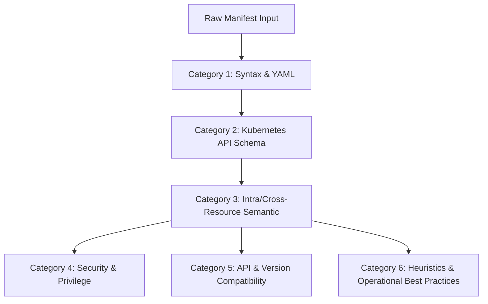
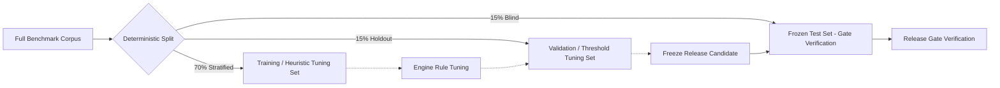

# KubeCheck — Diagnostic Accuracy Benchmark Specification

**Document ID:** ACC-BENCH-001  
**File:** `docs/quality/ACCURACY_BENCHMARKS.md`  
**Status:** Normative — Approved  
**Version:** 1.0.0  
**Product:** KubeCheck  
**Owner:** Statistical Evaluation & Quality Engineering  
**Last reviewed:** 2026-10-31  

**Related documents:**
- `docs/architecture/PRODUCT_VISION.md`
- `docs/architecture/REQUIREMENTS_AND_NFRS.md`
- `docs/architecture/ROADMAP_AND_DECISIONS.md`
- `docs/quality/TEST_STRATEGY.md`
- `docs/quality/RELEASE_ACCEPTANCE_CRITERIA.md`
- `docs/engine/STATIC_ANALYSIS_RULES.md`
- `docs/engine/DIAGNOSTIC_CONFIDENCE_AND_LIMITATIONS.md`
- `docs/engine/DIAGNOSTIC_RULE_SPEC.md`
- `docs/engine/CROSS_RESOURCE_ANALYSIS.md`
- `docs/engine/ROOT_CAUSE_AND_REMEDIATION.md`
- `docs/kubernetes/KUBERNETES_VERSION_COMPATIBILITY.md`
- `docs/distribution/CLI_UX_AND_EXIT_CODES.md`

---

## 1. Executive Summary and Methodological Foundations

Static analysis tools in infrastructure-as-code ecosystems frequently suffer from high false-alarm rates, ambiguous diagnostics, and unverified correctness claims. In Kubernetes manifest analysis, a false positive erodes engineering trust and causes alert fatigue, while a false negative allows invalid, insecure, or incompatible configurations to reach production clusters.

This document defines the normative, reproducible evaluation benchmark for measuring KubeCheck's diagnostic accuracy. It establishes:
1. **An independently labeled ground-truth corpus** completely isolated from development and unit test fixtures.
2. **A formal evaluation taxonomy** covering six diagnostic categories (Syntax, Schema, Semantic, Security, Compatibility, Heuristic) across positive, negative, and adversarial misleading cases.
3. **Statistical evaluation procedures**, including unweighted and severity-weighted Precision, Recall, False-Positive Rate ($FPR$), False-Negative Rate ($FNR$), and $F_\beta$ scores, supported by exact binomial confidence intervals.
4. **Rigorous measurement of the $\ge 99.0\%$ precision gate** for deterministic diagnostic categories, establishing mathematical bounds without making misleading claims of universal correctness across context-dependent heuristics.
5. **Confidence calibration metrics** (Brier score, Expected Calibration Error) for optional probabilistic outputs.
6. **Data governance**, provenance, licensing, deduplication, contamination prevention, and multi-annotator adjudication protocols.
7. **Performance and resource-profiling benchmarks** that measure execution time, memory footprints, and scalability under varying manifest topologies.

---

## 2. Normative Requirement Identifiers

Requirements in this document are identified using the formal prefix `ACC-REQ-NNN`. Benchmark categories and evaluation metrics use `BENCH-CAT-*` and `BENCH-METRIC-*` respectively.

| Requirement ID | Domain | Summary | Priority |
|---|---|---|---|
| `ACC-REQ-001` | Determinism | Repeated runs over identical inputs and bundles MUST produce bit-for-bit identical findings. | P0 |
| `ACC-REQ-002` | Channel Parity | Benchmark results MUST be invariant across CLI standalone, Krew, and pip distributions. | P0 |
| `ACC-REQ-003` | Corpus Independence | Ground-truth benchmark manifests MUST NOT overlap with unit or rule development fixtures. | P0 |
| `ACC-REQ-004` | Taxonomical Granularity | Findings MUST be adjudicated at the specific resource, document index, and source-span level. | P0 |
| `ACC-REQ-005` | Deterministic Precision Gate | Deterministic categories (Syntax, Schema, Semantic) MUST achieve $\ge 99.0\%$ precision at 95% confidence. | P0 |
| `ACC-REQ-006` | Semantic Recall Floor | Specification-mandated semantic rules MUST achieve $\ge 95.0\%$ recall. | P0 |
| `ACC-REQ-007` | Context-Dependent FPR Ceiling | Heuristic and operational checks MUST maintain $FPR \le 5.0\%$ across negative corpora. | P1 |
| `ACC-REQ-008` | Severity-Weighted Scoring | Reports MUST provide severity-weighted precision and recall alongside unweighted counts. | P1 |
| `ACC-REQ-009` | Confidence Calibration | Numeric confidence scores (if generated) MUST report Expected Calibration Error (ECE) $\le 0.05$. | P1 |
| `ACC-REQ-010` | License Compliance | Benchmark manifests MUST be licensed under permissive open-source terms (MIT, Apache 2.0, BSD). | P0 |
| `ACC-REQ-011` | Deduplication Integrity | Corpora MUST be structurally deduplicated using AST and NIR content hashes. | P0 |
| `ACC-REQ-012` | Contamination Safeguards | Checksums of benchmark manifests MUST be cryptographically quarantined from build pipelines. | P0 |
| `ACC-REQ-013` | Dual-Reviewer Adjudication | Ground-truth labels MUST require independent agreement from two reviewers with Cohen's $\kappa \ge 0.85$. | P1 |
| `ACC-REQ-014` | Version Matrix Coverage | The corpus MUST contain version-differentiated fixtures for Kubernetes v1.24 through v1.31+. | P0 |
| `ACC-REQ-015` | CRD and Extension Coverage | Benchmarks MUST validate CRDs across full OpenAPI schemas, incomplete schemas, and missing schemas. | P1 |
| `ACC-REQ-016` | Performance Floor | Engine throughput MUST exceed 1,000 resources/second with peak memory $\le 128$ MiB on reference hardware. | P1 |
| `ACC-REQ-017` | Non-Regression Enforcement | No GA engine or bundle release may degrade any category precision or recall by $> 0.1\%$ without an ADR waiver. | P0 |

---

## 3. Diagnostic Taxonomy and Evaluation Categories

The benchmark evaluates KubeCheck across six functional diagnostic categories, reflecting different layers of manifest construction, API server requirements, and cluster operations.



### 3.1 Taxonomy Definitions

| Category ID | Category Name | Underlying Scope | Primary Source of Truth | Evidence Class |
|---|---|---|---|---|
| `BENCH-CAT-SYN` | Syntax & Structure | YAML 1.2.2 conformance, document delimiters, lexical tokens, merge keys, anchor expansion, byte stream decoding. | YAML 1.2.2 Spec, Parser Governor Policy | `deterministic` |
| `BENCH-CAT-SCH` | Schema Validation | OpenAPI v2/v3 structural compliance, data types, required fields, enum values, unrecognized keys, format constraints. | Kubernetes API OpenAPI schemas | `deterministic` |
| `BENCH-CAT-SEM` | Semantic Relationships | Cross-resource references, selector-to-label matches, port alignment, container probe consistency, volume mounts. | Kubernetes API Controller contracts | `deterministic` / `probable` |
| `BENCH-CAT-SEC` | Security & Hardening | Privilege escalation, Linux capabilities, host namespaces, secret exposures, Pod Security Standards (PSS). | CIS Kubernetes Benchmark, PSS specs | `deterministic` / `probable` |
| `BENCH-CAT-CMP` | Version Compatibility | Deprecated APIs, removed fields, version-tightened constraints, feature gate dependencies across k8s releases. | Upstream K8s release lifecycle notes | `deterministic` |
| `BENCH-CAT-HEU` | Operational Heuristics | Resource quota sizing, missing readiness/liveness probes, anti-affinity recommendations, disruption budgets. | SRE best practices, operational runbooks | `context-dependent` |

---

## 4. Ground-Truth Corpus Design

### 4.1 Stratified Manifest Corpus Composition

To prevent bias toward trivial syntax errors or monolithic Helm templates, the benchmark corpus is divided into three distinct manifestation types:

```
benchmark-corpus/
├── positive/               # Manifests with confirmed, independently labeled defects
│   ├── syntax/             # Parser bombs, tab indentation, malformed scalar types
│   ├── schema/             # Missing required fields, illegal types, unknown properties
│   ├── semantic/           # Selector mismatch, dangling ServiceAccount, broken mounts
│   ├── security/           # Privileged containers, root execution, hostPID/hostNetwork
│   ├── compatibility/      # Ingress extensions/v1beta1, removed API fields in v1.25+
│   └── heuristic/          # Missing probe on multi-replica web service, zero limits
├── negative/               # 100% valid, compliant production-grade manifests
│   ├── standard-workloads/ # Production Deployments, StatefulSets, DaemonSets, Jobs
│   ├── complex-topologies/ # Multi-ingress, complex RBAC, NetworkPolicies, Mesh
│   └── crds-custom/        # Valid CustomResources conforming to CRD schemas
└── adversarial/            # Misleading near-matches designed to trigger false alarms
    ├── deceptive-names/    # Annotations containing "password" or "secret"
    ├── custom-controllers/ # CRDs with field names matching core workloads
    ├── dual-purpose-ports/ # Shared named ports in multi-container pods
    └── version-boundaries/ # Manifests valid in v1.28, boundary-valid in v1.29
```

### 4.2 Adversarial and Misleading Near-Matches

False alarms occur most frequently on edge-case manifests that resemble defects but are intentionally valid under Kubernetes specification nuances. The benchmark mandates inclusion of:

1. **Deceptive Annotations and Metadata:** Manifests containing keys such as `app.kubernetes.io/managed-by: "helm"`, `security.istio.io/secret: "none"`, or `vault.hashicorp.com/agent-inject-secret: "config"` to ensure security rules do not flag literal strings via primitive substring matching.
2. **Multi-Port and TargetPort Resolution:** Services referencing `targetPort: http` where only one container in a multi-container Pod defines the named port `http` (valid Kubernetes behavior).
3. **Headless Services with Selector-less Endpoints:** StatefulSet headless services without selectors, populated by custom endpoint controllers.
4. **Valid Shared Volume Projections:** Multiple containers mounting the same `emptyDir` or `ConfigMap` at different path sub-keys.
5. **CRD Near-Matches:** Custom resources with `kind: Deployment` in group `custom.enterprise.io/v1`, verifying that the schema validator does not misapply `apps/v1` rules to third-party kinds.

### 4.3 Version-Specific Fixtures and CRD Scenarios

The corpus explicitly benchmarks multi-version awareness:

* **v1.24 $\rightarrow$ v1.25 Boundary:** Removal of `policy/v1beta1` `PodSecurityPolicy`; transition to `pod-security.kubernetes.io` namespace labels.
* **v1.26 Boundary:** Removal of `flowcontrol.apiserver.k8s.io/v1beta1`; tightening of `HorizontalPodAutoscaler` metrics spec.
* **v1.27 Boundary:** Promotion of `FileMode` in `configMap` and CEL admission rules.
* **v1.29 $\rightarrow$ v1.31 Boundary:** Deprecation of legacy Service account token secrets; modern `BoundServiceAccountTokenVolume` validation.
* **CRD Scenarios:**
  - **Scenario CRD-A (Embedded Structural Schema):** CustomResource evaluated against complete OpenAPI v3 schema with validation rules.
  - **Scenario CRD-B (Unchecked CRD):** Manifest referencing unknown CRD with engine reporting `schema-unchecked` (`VER-013`) without crashing or raising spurious schema errors.
  - **Scenario CRD-C (Preserve-Unknown-Fields):** Manifest referencing CRD with `x-kubernetes-preserve-unknown-fields: true`, verifying that unregistered nested fields do not trigger unknown-property errors.

---

## 5. Statistical Evaluation Metrics and Mathematical Formulations

### 5.1 Unit of Evaluation

Diagnostic accuracy is evaluated at the **finding-level**, not merely the document or file level. A file containing 3 real defects where the engine reports 2 correct findings, 1 incorrect finding, and misses 1 real defect is not scored as a binary success.

A reported diagnostic finding $f_{rep}$ matches an annotated ground-truth finding $f_{gt}$ if and only if:
$$\text{Match}(f_{rep}, f_{gt}) \iff \begin{cases} 
\text{ResourceKey}(f_{rep}) = \text{ResourceKey}(f_{gt}) \\
\text{RuleID}(f_{rep}) = \text{RuleID}(f_{gt}) \lor \text{EquivalentClass}(f_{rep}, f_{gt}) \\
\text{SourceOverlap}(\text{Span}(f_{rep}), \text{Span}(f_{gt})) \ge 0.80
\end{cases}$$

### 5.2 Basic Confusion Matrix

For each diagnostic category $c \in \text{Categories}$:
* **True Positive ($TP_c$):** A real defect correctly identified by the engine with matching rule and source anchor.
* **False Positive ($FP_c$):** A finding emitted by the engine where no defect exists in the ground truth.
* **False Negative ($FN_c$):** A ground-truth defect missed by the engine.
* **True Negative ($TN_c$):** A verified-clean manifest segment where no finding is emitted. (For negative files, $TN_c$ is calculated based on candidate evaluation nodes across the manifest AST).

### 5.3 Metric Formulas

#### Precision ($P$)
The fraction of emitted findings that are genuine defects:
$$\text{Precision} = \frac{TP}{TP + FP}$$

#### Recall ($R$) / Sensitivity
The fraction of genuine defects detected by the engine:
$$\text{Recall} = \frac{TP}{TP + FN}$$

#### False-Positive Rate ($FPR$) / Fall-out
The probability of a false alarm given a compliant configuration:
$$\text{FPR} = \frac{FP}{FP + TN}$$

#### False-Negative Rate ($FNR$) / Miss Rate
The probability of failing to detect a defect:
$$\text{FNR} = \frac{FN}{TP + FN} = 1 - \text{Recall}$$

#### $F_\beta$ Score
The weighted harmonic mean of precision and recall. KubeCheck prioritizes precision to eliminate alert fatigue in CI pipelines; therefore, the benchmark calculates both $F_1$ and $F_{0.5}$ (which gives twice as much weight to precision as recall):
$$F_\beta = (1 + \beta^2) \frac{\text{Precision} \cdot \text{Recall}}{(\beta^2 \cdot \text{Precision}) + \text{Recall}}$$
$$F_{0.5} = 1.25 \cdot \frac{\text{Precision} \cdot \text{Recall}}{(0.25 \cdot \text{Precision}) + \text{Recall}}$$

---

## 6. Severity-Weighted Metrics

Ordinary unweighted accuracy treats a trivial missing label warning identically to a critical root privilege escalation defect. Severity-weighted metrics assign impact weights $w(s)$ to findings based on their operational and security risk.

### 6.1 Severity Weights

| Severity Level ($s$) | Finding Impact | Severity Weight ($w_s$) | False-Negative Penalty ($\lambda_{FN}$) | False-Positive Penalty ($\lambda_{FP}$) |
|---|---|---|---|---|
| **CRITICAL / ERROR** | Schema violation, API rejection, root exploit, broken selector. | $5.0$ | $10.0$ | $5.0$ |
| **WARNING** | Missing readiness probe, deprecated API, sub-optimal security. | $2.0$ | $3.0$ | $2.0$ |
| **INFO** | Documentation hint, cosmetic convention, optional label. | $1.0$ | $1.0$ | $1.0$ |

### 6.2 Severity-Weighted Formulations

Let $\mathcal{F}_{TP}$, $\mathcal{F}_{FP}$, and $\mathcal{F}_{FN}$ be the sets of true positive, false positive, and false negative findings:

$$\text{Weighted } TP = \sum_{i \in \mathcal{F}_{TP}} w(\text{severity}(i))$$
$$\text{Weighted } FP = \sum_{j \in \mathcal{F}_{FP}} w(\text{severity}(j))$$
$$\text{Weighted } FN = \sum_{k \in \mathcal{F}_{FN}} w(\text{severity}(k))$$

The **Severity-Weighted Precision ($SWP$)** is:
$$\text{SWP} = \frac{\sum_{i \in \mathcal{F}_{TP}} w(\text{severity}(i))}{\sum_{i \in \mathcal{F}_{TP}} w(\text{severity}(i)) + \sum_{j \in \mathcal{F}_{FP}} w(\text{severity}(j))}$$

The **Severity-Weighted Recall ($SWR$)** is:
$$\text{SWR} = \frac{\sum_{i \in \mathcal{F}_{TP}} w(\text{severity}(i))}{\sum_{i \in \mathcal{F}_{TP}} w(\text{severity}(i)) + \sum_{k \in \mathcal{F}_{FN}} w(\text{severity}(k))}$$

The **Total Cost Loss ($\mathcal{L}_{Total}$)**:
$$\mathcal{L}_{Total} = \sum_{j \in \mathcal{F}_{FP}} \lambda_{FP}(\text{sev}(j)) + \sum_{k \in \mathcal{F}_{FN}} \lambda_{FN}(\text{sev}(k))$$

A release gate fails if the severity-weighted precision drops below the gate threshold, even if unweighted precision appears acceptable due to high numbers of low-severity true positives.

---

## 7. Confidence Calibration and Probabilistic Evaluation

Per `CONF-LIMITS-REQ-001`, KubeCheck defaults to categorical evidence classes (`deterministic`, `probable`, `context-dependent`). If future experimental modules or statistical heuristic scorers emit numeric confidence values $\hat{p} \in [0.0, 1.0]$, they must be calibrated against actual empirical outcomes.

### 7.1 Reliability and Expected Calibration Error (ECE)

To measure calibration, findings are partitioned into $M = 10$ confidence bins $B_1, B_2, \dots, B_M$ where $B_m = \left( \frac{m-1}{M}, \frac{m}{M} \right]$.

For each bin $B_m$:
* **Accuracy ($acc(B_m)$):** The proportion of true positives in bin $B_m$:
  $$acc(B_m) = \frac{1}{|B_m|} \sum_{i \in B_m} \mathbf{1}(\text{IsRealDefect}(i))$$
* **Confidence ($conf(B_m)$):** The average predicted probability in bin $B_m$:
  $$conf(B_m) = \frac{1}{|B_m|} \sum_{i \in B_m} \hat{p}_i$$

The **Expected Calibration Error (ECE)** is the weighted average absolute difference between confidence and accuracy:
$$\text{ECE} = \sum_{m=1}^{M} \frac{|B_m|}{N} \left| acc(B_m) - conf(B_m) \right|$$

The **Maximum Calibration Error (MCE)** bounds the worst-case divergence:
$$\text{MCE} = \max_{m \in \{1, \dots, M\}} \left| acc(B_m) - conf(B_m) \right|$$

The **Brier Score** measures mean squared probability error:
$$\text{BS} = \frac{1}{N} \sum_{i=1}^{N} (\hat{p}_i - y_i)^2 \quad \text{where } y_i \in \{0, 1\}$$

```
Calibration Curve (Reliability Diagram Target)
Acc
1.0 |                                      ./
    |                                   ./
0.5 |                             ./
    |                       ./
    |                 ./
0.0 +---------------------------------------
    0.0              0.5                 1.0 Conf
         [Ideal calibrated diagonal: ECE <= 0.05]
```

Under `ACC-REQ-009`, any feature emitting numeric probabilities must demonstrate $\text{ECE} \le 0.05$ across the benchmark suite before leaving experimental status.

---

## 8. Confidence Intervals and Sample Size Determination

### 8.1 Exact Binomial Confidence Intervals (Wilson Score)

Point estimates of precision and recall can be deceptive on small sample sizes. KubeCheck calculates the two-sided $100(1-\alpha)\%$ confidence interval using the **Wilson Score Interval** with continuity correction.

For an observed metric $\hat{p} = \frac{X}{n}$ (e.g., $X = TP$, $n = TP + FP$ for precision) at confidence level $1-\alpha$ with critical standard normal value $z = \Phi^{-1}(1 - \alpha/2)$ (where $z = 1.95996$ for 95% confidence):

$$p_{\text{lower}}, p_{\text{upper}} = \frac{2n\hat{p} + z^2 \pm \left( z \sqrt{z^2 - \frac{1}{n} + 4n\hat{p}(1-\hat{p}) + (4\hat{p}-2)} + 1 \right)}{2(n + z^2)}$$

### 8.2 Statistical Power and Minimum Sample Considerations

To statistically guarantee that the measured precision is at least $99.0\%$ with a margin of error $E \le 0.008$ at a 95% confidence level, the minimum sample size $n$ of positive findings must satisfy:
$$n \ge \frac{z^2 \cdot p(1-p)}{E^2} = \frac{(1.96)^2 \cdot (0.99)(0.01)}{(0.008)^2} \approx \frac{3.8416 \cdot 0.0099}{0.000064} \approx 594 \text{ findings}$$

Therefore, each diagnostic category must contain a minimum number of ground-truth test points:
* Minimum total manifests in corpus: $N \ge 2,500$ distinct documents.
* Minimum positive defect instances per category: $n_c \ge 600$ findings.
* Minimum clean negative manifests: $N_{\text{neg}} \ge 1,000$ documents.

---

## 9. Defining and Measuring the 99% Precision Target

A central claim in static analysis is precision: false positives erode trust faster than any other failure mode. KubeCheck mandates a $\ge 99.0\%$ precision target on specific, clearly bounded scopes.

### 9.1 Scope of the 99% Precision Target

The 99% precision target applies **strictly** to:
1. `BENCH-CAT-SYN` (Syntax and YAML structure)
2. `BENCH-CAT-SCH` (OpenAPI and API Schema validation)
3. Deterministic rules within `BENCH-CAT-SEM` and `BENCH-CAT-SEC` where the check relies solely on manifest content and immutable bundle schemas.

The 99% target **explicitly does not apply** to heuristic, operational, or context-dependent rules (`BENCH-CAT-HEU`), where true defects depend on out-of-band operational intent, cluster-specific controller logic, or dynamic runtime admission webhooks. Applying a 99% precision target to heuristics would force the engine to suppress all proactive advice.

```
+------------------------------------------------------------------------------------+
|                                KUBECHECK PRECISION SCOPES                          |
+---------------------------------------------------+--------------------------------+
| DETERMINISTIC CATEGORIES (Syntax, Schema, Exact)  | HEURISTIC CATEGORIES (Probes,  |
| Target: Precision >= 99.0% (Lower CI >= 98.2%)    | Target: FPR <= 5.0%, P >= 85%  |
| False alarms: Strictly bounded, near-zero.        | False alarms: Tolerated within |
| Claim: "If flagged as Error, it IS invalid."      | context-dependent boundaries.  |
+---------------------------------------------------+--------------------------------+
```

### 9.2 Precision Verification Protocol

For each release candidate:
1. Execute KubeCheck across the entire deterministic benchmark suite.
2. Tabulate $TP_{\text{det}}$ and $FP_{\text{det}}$.
3. Compute $\hat{P}_{\text{det}} = \frac{TP_{\text{det}}}{TP_{\text{det}} + FP_{\text{det}}}$.
4. Compute the 95% Wilson Score Lower Bound $P_{\text{lower}}$.
5. **Release Gate Condition:** The release candidate passes if and only if:
   $$\hat{P}_{\text{det}} \ge 0.990 \quad \text{AND} \quad P_{\text{lower}} \ge 0.982$$

If $\hat{P}_{\text{det}} = 0.991$ but $n = 100$ (resulting in $P_{\text{lower}} = 0.948$), the gate **fails** due to insufficient sample power.

---

## 10. Dataset Provenance, Deduplication, and Contamination Safeguards

### 10.1 Provenance and Sourcing

The benchmark dataset is constructed from diverse, documented sources:

1. **Curated Open-Source Repositories (60%):** Manifests harvested from top-tier CNCF graduated and incubating projects, production Helm charts, and public Kubernetes repositories.
2. **Adversarial / CVE Reproduction Fixtures (20%):** Manifests reconstructed from published Kubernetes security advisories (e.g., CVE-2021-25741, CVE-2020-8554), misconfigured RBAC escalate vectors, and known parser vulnerabilities.
3. **Synthetic / Boundary Generators (20%):** Systematically generated permutations covering schema edge cases, boundary values, null values, and unicode stress scenarios.

### 10.2 Licensing Compliance

Under `ACC-REQ-010`:
* All included manifests must carry verified permissive open-source licenses (MIT, Apache 2.0, BSD-2/3-Clause, ISC, or CC0).
* Copyleft (GPL, AGPL) or proprietary licensed manifests are strictly prohibited from the benchmark corpus to prevent legal contamination of test artifacts.
* Each manifest in the corpus must maintain an accompanying metadata file `manifest.meta.yaml` recording original upstream commit hash, license, author attribution, and extraction date.

### 10.3 Deduplication Protocol

Public repositories frequently duplicate identical manifest files (e.g., boilerplate `service.yaml` or copies of standard Ingress definitions). Direct duplication skews benchmark statistics.

Corpus deduplication executes in three stages:
1. **Raw Byte Deduplication:** Direct SHA-256 hash matching of files.
2. **Syntactic AST Deduplication:** YAML AST normalization stripping comments and whitespace.
3. **Normalized Intermediate Representation (NIR) Semantic Hashing:** AST hashing excluding metadata names, namespaces, and timestamps. Manifests with NIR semantic similarity $\ge 0.95$ are clustered, and only one representative instance is retained per cluster.

### 10.4 Contamination and Leakage Prevention

Under `ACC-REQ-012`, to prevent overfitting:
* The benchmark repository `kubecheck-benchmarks` is stored in an independent versioned repository, distinct from the core engine source code repository.
* Core engine developers are prohibited from viewing raw benchmark failure fixtures during rule development; development must rely solely on the explicit rule specification (`DIAGNOSTIC_RULE_SPEC.md`).
* CI build pipelines run unit tests using local fixtures (`tests/fixtures/`), but full benchmark evaluations run in a dedicated, isolated CI evaluation job.

---

## 11. Train / Test Separation for Machine Learning Components

While KubeCheck's core engine is rule-based and deterministic, any future statistical component (such as automated log-cluster correlation or heuristic ranking) must adhere to rigorous train/test separation:



* **Holdout Set Integrity:** The 15% Blind Test Set is encrypted and only unlocked by the automated Release CI runner.
* **Leakage Checks:** Feature extraction must not include dataset-wide statistics (e.g., global mean frequencies) computed before splitting.
* **Periodic Rotation:** 20% of the blind test set is refreshed annually from newly harvested open-source projects to detect statistical drift.

---

## 12. Human Review and Disagreement Resolution

Ground-truth annotation accuracy determines the validity of the benchmark. An erroneous label in the benchmark produces erroneous accuracy metrics.

### 12.1 Dual-Reviewer Blind Annotation

Every manifest in the benchmark is independently labeled by two qualified reviewers (Kubernetes Certified Administrators or Security Specialists):

```
Manifest Input -> Reviewer 1 -> Label Set A \
                                              -> Comparison Engine -> [Agreement Check]
Manifest Input -> Reviewer 2 -> Label Set B /
```

Each reviewer independently records:
* Exact source range (`start_line`, `start_col`, `end_line`, `end_col`).
* Target resource GVK.
* Assigned defect classification (Category, Rule ID).
* Defect validity (`TRUE_DEFECT`, `COMPLIANT`, `INTENTIONAL_HEURISTIC`).

### 12.2 Inter-Rater Reliability Metric

Inter-annotator agreement is calculated using **Cohen's Kappa ($\kappa$)**:
$$\kappa = \frac{p_o - p_e}{1 - p_e}$$
Where $p_o$ is relative observed agreement among reviewers, and $p_e$ is hypothetical probability of chance agreement.

* If $\kappa < 0.85$, the category annotations are rejected as ambiguous, and the labeling guideline for that category must be clarified.
* Label sets are approved only when $\kappa \ge 0.85$.

### 12.3 Adjudication and Tie-Breaking

Where Reviewer 1 and Reviewer 2 disagree:
1. The case is escalated to the **Three-Party Adjudication Board** (consisting of the Lead Static Analysis Specialist, Kubernetes API Domain Specialist, and Quality Engineering Lead).
2. The board analyzes the discrepancy against the authoritative upstream Kubernetes source code, OpenAPI specs, or API server validation handlers.
3. If the behavior is an upstream ambiguity or vendor-specific quirk, the fixture is re-classified as `AMBIGUOUS_UPSTREAM` and tagged with an explanatory rationale. It is excluded from strict 99% precision gates but tracked in cross-version compatibility tests.
4. The final resolution is signed off by all three members and committed to the corpus version control log.

---

## 13. Benchmark Versioning and Historical Regression Tracking

### 13.1 Benchmark Corpus Versioning

The benchmark corpus follows calendar-linked semantic versioning:
$$\text{BENCH-YYYY.MM.<patch>} \quad (\text{e.g., } \text{BENCH-2026.10.1})$$

A benchmark release manifest includes:
* Git SHA of the benchmark repository.
* Merkle root hash of all corpus manifests and annotation files.
* List of supported Kubernetes API target versions (e.g., `v1.24` - `v1.31`).
* Baseline performance and accuracy metrics from the prior engine release.

### 13.2 Non-Regression Policy

Under `ACC-REQ-017`:
* **Zero Regression on Deterministic Accuracy:** A release candidate must not introduce any false positive on previously verified negative manifests in deterministic categories ($FP_{\text{new}} = 0$).
* **Recall Degradation Ceiling:** Overall recall for deterministic rules must not regress by more than $0.1\%$ ($R_{\text{new}} \ge R_{\text{prior}} - 0.001$), and any drop must be accompanied by an approved ADR documenting bug fixes where previous "true positives" were determined to be invalid rules.
* **Regression Dashboard:** CI produces automated diff reports comparing release candidates against the baseline release.

---

## 14. Performance and Resource-Consumption Benchmarking

Diagnostic accuracy is unviable in CI pipelines if the analysis is unacceptably slow or exhausts system memory. The benchmark suite defines explicit profiling harnesses.

### 14.1 Hardware Reference Baseline

Performance metrics are normalized against standard reference CI hardware:
* **CPU:** 4 vCPU (x86_64, modern AMD64/ARM64 architecture, 2.5 GHz+).
* **RAM:** 8 GiB available memory.
* **Storage:** Standard NVMe SSD.
* **Operating System:** Linux (Kernel 5.15+), network-isolated (`unshare -n`).

### 14.2 Throughput and Latency Benchmarks

| Metric ID | Scenario Description | Target Threshold | Hard Failure Ceiling |
|---|---|---|---|
| `PERF-METRIC-01` | Single small manifest (< 100 lines, 1 Pod) | $\le 15 \text{ ms}$ | $> 50 \text{ ms}$ |
| `PERF-METRIC-02` | Large multi-document manifest (1,000 resources) | $\le 600 \text{ ms}$ | $> 1,200 \text{ ms}$ |
| `PERF-METRIC-03` | Throughput on massive repository (10,000 resources) | $\ge 1,500 \text{ res/sec}$ | $< 800 \text{ res/sec}$ |
| `PERF-METRIC-04` | Parser bomb / Deep alias nest rejection latency | $\le 50 \text{ ms}$ | $> 200 \text{ ms}$ |

### 14.3 Memory Consumption Profiling

| Metric ID | Target Profile | Target Ceiling | Release Blocking Limit |
|---|---|---|---|
| `MEM-METRIC-01` | Peak RSS (1,000 resources) | $\le 45 \text{ MiB}$ | $> 80 \text{ MiB}$ |
| `MEM-METRIC-02` | Peak RSS (10,000 resources) | $\le 120 \text{ MiB}$ | $> 256 \text{ MiB}$ |
| `MEM-METRIC-03` | Memory leak check (100 sequential runs) | $\Delta \text{RSS} \le 1 \text{ MiB}$ | $\Delta \text{RSS} > 5 \text{ MiB}$ |

Memory profiling is captured using operating-system-level metrics (`/usr/bin/time -v`, Valgrind massif, or native runtime allocators).

---

## 15. Summary of Acceptance Thresholds and Approval Matrix

To authorize an engine or bundle release, the automated evaluation pipeline must output passing results for all gates below. A gate marked **Mandatory** cannot be waived.

| Gate ID | Metric Name | Applicable Category | Mandatory Threshold | Waiver Policy |
|---|---|---|---|---|
| `GATE-ACC-01` | Unweighted Precision ($P$) | `BENCH-CAT-SYN`, `SCH`, Deterministic `SEM` | $\ge 99.0\%$ ($P_{\text{lower}} \ge 98.2\%$) | **NO WAIVER** |
| `GATE-ACC-02` | Severity-Weighted Precision ($SWP$) | `BENCH-CAT-SEC`, `SEM` (Critical/Error) | $\ge 99.5\%$ | **NO WAIVER** |
| `GATE-ACC-03` | Recall ($R$) | `BENCH-CAT-SYN`, `SCH` | $\ge 98.0\%$ | Quality Lead Review |
| `GATE-ACC-04` | Recall ($R$) | Deterministic `SEM`, `SEC` | $\ge 95.0\%$ | Quality Lead Review |
| `GATE-ACC-05` | False-Positive Rate ($FPR$) | `BENCH-CAT-HEU` (Operational Heuristics) | $\le 5.0\%$ | Architecture Review |
| `GATE-ACC-06` | Expected Calibration Error | Probabilistic outputs (if enabled) | $\text{ECE} \le 0.05$ | Feature Freeze |
| `GATE-ACC-07` | Execution Determinism | Entire Corpus (repeated $10\times$ runs) | $100\%$ byte-for-byte identical | **NO WAIVER** |
| `GATE-ACC-08` | Throughput Floor | Reference Benchmark Corpus | $\ge 1,000 \text{ resources/sec}$ | Perf Lead Review |
| `GATE-ACC-09` | Peak Memory Ceiling | 10,000 resource stress manifest | $\le 256 \text{ MiB}$ | Perf Lead Review |

### 15.1 Formal Sign-Off

Publication of any KubeCheck engine version or knowledge bundle requires signed cryptographic attestation from:
1. **Lead Statistical Evaluation Specialist:** Certifying benchmark corpus integrity, sample power, and metric accuracy.
2. **Quality Engineering Lead:** Verifying test harness isolation, non-regression gates, and deterministic repeatability.
3. **Security Architecture Lead:** Confirming security rule precision, adversarial case defenses, and zero secret leakage during benchmark execution.
