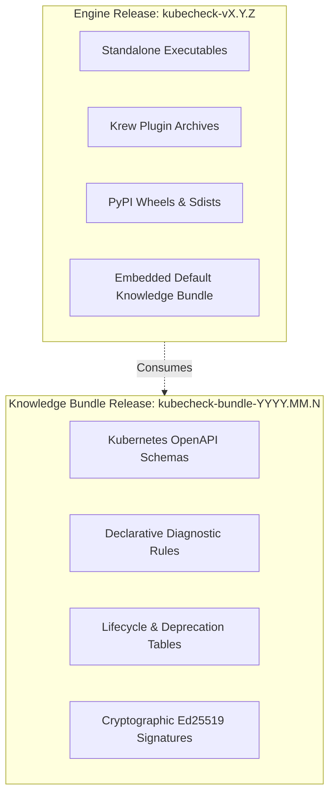

# KubeCheck — Release Acceptance Criteria and Gate Specifications

**Document ID:** REL-CRIT-001  
**File:** `docs/quality/RELEASE_ACCEPTANCE_CRITERIA.md`  
**Status:** Normative — Approved  
**Version:** 1.0.0  
**Product:** KubeCheck  
**Owner:** Release Engineering & Quality Architecture  
**Last reviewed:** 2026-10-31  

**Related documents:**
- `docs/architecture/PRODUCT_VISION.md`
- `docs/architecture/REQUIREMENTS_AND_NFRS.md`
- `docs/architecture/ROADMAP_AND_DECISIONS.md`
- `docs/quality/TEST_STRATEGY.md`
- `docs/quality/ACCURACY_BENCHMARKS.md`
- `docs/security/THREAT_MODEL.md`
- `docs/security/SAFE_EXECUTION_POLICY.md`
- `docs/security/PRIVACY_AND_TELEMETRY_POLICY.md`
- `docs/knowledge/OFFLINE_UPDATE_AND_SIGNING.md`
- `docs/knowledge/KNOWLEDGE_BUILD_PIPELINE.md`
- `docs/distribution/CLI_UX_AND_EXIT_CODES.md`
- `docs/distribution/INSTALLATION_AND_RELEASES.md`

---

## 1. Executive Purpose and Governance Principles

KubeCheck is a security-sensitive static analysis tool deployed in mission-critical CI/CD pipelines, local developer environments, and air-gapped clusters. A flaw in KubeCheck can introduce catastrophic failure modes:
1. A **parser defect or malicious tag handling** could execute arbitrary code on a developer or CI workstation.
2. A **secret-redaction failure** could leak production credentials into CI logs.
3. A **false positive** halts legitimate deployments, causing alert fatigue and pressure to disable the tool.
4. A **false negative** permits broken, vulnerable, or incompatible manifests to deploy to Kubernetes clusters.
5. A **tampered knowledge bundle or compromised supply chain** turns KubeCheck into a vector for software supply chain attacks.

This document defines the **mandatory, non-negotiable criteria** for authorizing and publishing releases of the **KubeCheck engine** and **knowledge bundles**.

### 1.1 The Golden Rule of Release Engineering
> **Never report a gate as passed without verifiable machine evidence.**  
> A checklist marked with checkboxes or manual declarations does not constitute verification. Every gate defined in this document requires a cryptographically signed, machine-verifiable evidence artifact committed to the release staging ledger (`evidence/` directory). Missing evidence is automatically treated as a failed gate.

---

## 2. Release Classification and Scope

KubeCheck releases are decoupled into two distinct release artifact lifecycles:



1. **Engine Releases (`vX.Y.Z`):** Semantic Versioning 2.0.0. Ships the CLI binaries, Python wheel packages, and Krew archives. Contains engine binaries, parsers, core runtime, and an embedded baseline knowledge bundle.
2. **Knowledge Bundle Releases (`YYYY.MM.N`):** Calendar-versioned, out-of-band updates containing updated Kubernetes schemas, diagnostic rules, and deprecation metadata. Bundles are cryptographically verified and can be loaded into existing engine installations without binary re-compilation.

---

## 3. Mandatory vs. Discretionary Quality Gates

Release criteria are strictly partitioned into two categories:

| Gate Class | Definition | Waiver Policy |
|---|---|---|
| **Class 1: Mandatory Security Gates** | Cryptographic integrity, zero CVEs, network isolation, safe parser execution, secret redaction, and reproducible build verification. | **ZERO WAIVERS PERMITTED.** Any failure blocks publication immediately and unconditionally. |
| **Class 2: Quality & Performance Gates** | Test coverage thresholds, benchmark precision/recall boundaries, and latency limits. | **EXCEPTIONAL WAIVER ONLY.** Requires a formal, signed Architecture Decision Record (ADR) approved unanimously by the Release Lead, Quality Lead, and Security Architect. |

---

## 4. Specification of Release Gates and Evidence Requirements

Every requirement is identified by `GATE-REL-REQ-NNN`.

### 4.1 Gate Category 1: Code Quality, Unit, Integration, and Regression Tests

```
+----------------------------------------------------------------------------------------------------+
| GATE-REL-REQ-001: Unit and Functional Test Gate                                                     |
+----------------------+-----------------------------------------------------------------------------+
| Pass Criteria        | Core engine line coverage >= 90.0%; branch coverage >= 85.0%.               |
|                      | 100% of all unit and integration test suites pass with 0 failures.          |
|                      | Exactly 0 flaky or quarantined tests permitted on release branches.        |
+----------------------+-----------------------------------------------------------------------------+
| Blocking Condition   | Any failing test; any branch coverage < 85.0%; presence of skipped tests.  |
+----------------------+-----------------------------------------------------------------------------+
| Required Evidence    | `evidence/unit-test-report.xml`, `evidence/coverage-report.lcov`.           |
+----------------------+-----------------------------------------------------------------------------+
```

```
+----------------------------------------------------------------------------------------------------+
| GATE-REL-REQ-002: Property-Based, Metamorphic, and Regression Tests                                |
+----------------------+-----------------------------------------------------------------------------+
| Pass Criteria        | Property-based test suite (CAT-PROPERTY) runs >= 10,000 iterations cleanly. |
|                      | Metamorphic suite (CAT-METAMORPHIC) confirms invariant findings under       |
|                      | AST whitespace transformations, document reordering, and metadata renaming.|
|                      | 100% of historical bug regression corpus passes without reproducing faults.|
+----------------------+-----------------------------------------------------------------------------+
| Blocking Condition   | Any non-deterministic output variation or historical defect recurrence.    |
+----------------------+-----------------------------------------------------------------------------+
| Required Evidence    | `evidence/property-test.log`, `evidence/regression-suite.json`.             |
+----------------------+-----------------------------------------------------------------------------+
```

```
+----------------------------------------------------------------------------------------------------+
| GATE-REL-REQ-003: Continuous Fuzzing Verification                                                  |
+----------------------+-----------------------------------------------------------------------------+
| Pass Criteria        | Continuous parser fuzzing harness (CAT-FUZZ) completes >= 72 CPU-hours      |
|                      | without crashes, hangs, unhandled panics, or memory exhaustion.             |
|                      | Retained crash corpus executes with 100% clean error-handling results.      |
+----------------------+-----------------------------------------------------------------------------+
| Blocking Condition   | Any SIGSEGV, panic, out-of-memory kill, or hung process during fuzz runs. |
+----------------------+-----------------------------------------------------------------------------+
| Required Evidence    | `evidence/fuzzing-certificate.json`, `evidence/crash-corpus-run.log`.       |
+----------------------+-----------------------------------------------------------------------------+
```

---

### 4.2 Gate Category 2: Diagnostic Accuracy and Precision Gates

All accuracy gates directly implement the standards specified in `docs/quality/ACCURACY_BENCHMARKS.md`.

```
+----------------------------------------------------------------------------------------------------+
| GATE-REL-REQ-004: 99% Precision Gate for Deterministic Categories                                  |
+----------------------+-----------------------------------------------------------------------------+
| Pass Criteria        | Measured precision on deterministic categories (Syntax, Schema, exact       |
|                      | Semantic) must satisfy: P >= 99.0% with 95% Wilson Score lower bound >= 98.2%.|
|                      | Severity-Weighted Precision (SWP) for Error-severity defects >= 99.5%.     |
+----------------------+-----------------------------------------------------------------------------+
| Blocking Condition   | P < 99.0%, P_lower < 98.2%, or any false positive on negative gold corpus.  |
+----------------------+-----------------------------------------------------------------------------+
| Required Evidence    | `evidence/benchmark-accuracy-summary.json`, signed by Evaluation Lead.      |
+----------------------+-----------------------------------------------------------------------------+
```

```
+----------------------------------------------------------------------------------------------------+
| GATE-REL-REQ-005: Heuristic and Context-Dependent False-Positive Ceiling                           |
+----------------------+-----------------------------------------------------------------------------+
| Pass Criteria        | False-Positive Rate (FPR) on operational heuristics (BENCH-CAT-HEU) <= 5.0%.|
|                      | No heuristic finding emitted at Error severity.                             |
+----------------------+-----------------------------------------------------------------------------+
| Blocking Condition   | FPR > 5.0% on compliant negative manifest corpus.                           |
+----------------------+-----------------------------------------------------------------------------+
| Required Evidence    | `evidence/heuristic-evaluation.json`.                                       |
+----------------------+-----------------------------------------------------------------------------+
```

```
+----------------------------------------------------------------------------------------------------+
| GATE-REL-REQ-006: Diagnostic Non-Regression Enforcement                                            |
+----------------------+-----------------------------------------------------------------------------+
| Pass Criteria        | Compared against prior release baseline: Delta-Precision >= 0.0%,           |
|                      | Delta-Recall >= -0.1% (with ADR justification), Delta-Determinism == 0.      |
+----------------------+-----------------------------------------------------------------------------+
| Blocking Condition   | Any regression on previously valid rules or appearance of new false alarms. |
+----------------------+-----------------------------------------------------------------------------+
| Required Evidence    | `evidence/benchmark-regression-diff.json`.                                  |
+----------------------+-----------------------------------------------------------------------------+
```

---

### 4.3 Gate Category 3: Security, Privacy, and Network Isolation Gates

```
+----------------------------------------------------------------------------------------------------+
| GATE-REL-REQ-007: Mandatory Offline Operation and Network Isolation (Class 1 Security Gate)        |
+----------------------+-----------------------------------------------------------------------------+
| Pass Criteria        | 1. Full acceptance suite executed inside network namespace (`unshare -n` or  |
|                      |    container `--network=none`) completes with 100% pass rate.               |
|                      | 2. Syscall tracing (`strace -e trace=network` / `dtrace`) during `analyze`    |
|                      |    confirms 0 socket(), connect(), sendto(), or DNS syscalls.               |
|                      | 3. Static analyzer verifies 0 network package imports in core engine.       |
+----------------------+-----------------------------------------------------------------------------+
| Blocking Condition   | Any attempted network connection, socket creation, or unshare failure.     |
+----------------------+-----------------------------------------------------------------------------+
| Required Evidence    | `evidence/unshare-execution.log`, `evidence/strace-network-audit.log`.       |
+----------------------+-----------------------------------------------------------------------------+
```

```
+----------------------------------------------------------------------------------------------------+
| GATE-REL-REQ-008: Dependency Vulnerability Scanning (Class 1 Security Gate)                         |
+----------------------+-----------------------------------------------------------------------------+
| Pass Criteria        | Automated scanners (Trivy, Grype, OSV-Scanner) confirm:                     |
|                      | - 0 Critical or High CVEs in direct or transitive dependencies.             |
|                      | - Medium/Low CVEs evaluated; any unfixable Medium must have an approved VEX |
|                      |   (Vulnerability Exploitability eXchange) document demonstrating no path.   |
+----------------------+-----------------------------------------------------------------------------+
| Blocking Condition   | 1 or more unresolved Critical or High CVEs in release bill of materials.   |
+----------------------+-----------------------------------------------------------------------------+
| Required Evidence    | `evidence/trivy-scan.json`, `evidence/grype-scan.json`, `evidence/vex.json`.|
+----------------------+-----------------------------------------------------------------------------+
```

```
+----------------------------------------------------------------------------------------------------+
| GATE-REL-REQ-009: Secret Redaction Verification (Class 1 Security Gate)                            |
+----------------------+-----------------------------------------------------------------------------+
| Pass Criteria        | CAT-SEC secret-bearing manifest corpus executed across all output formats    |
|                      | (terminal, json, sarif, compact) at trace/debug log levels.                 |
|                      | Automated regex & entropy scanner confirms 0 leakages of canary secrets.    |
+----------------------+-----------------------------------------------------------------------------+
| Blocking Condition   | Any canary secret, token, private key, or password discovered in outputs.  |
+----------------------+-----------------------------------------------------------------------------+
| Required Evidence    | `evidence/secret-redaction-audit.log`.                                       |
+----------------------+-----------------------------------------------------------------------------+
```

```
+----------------------------------------------------------------------------------------------------+
| GATE-REL-REQ-010: Parser Memory Safety and Injection Resistance (Class 1 Security Gate)            |
+----------------------+-----------------------------------------------------------------------------+
| Pass Criteria        | Safe loader verification: Untrusted constructor tags (!!python/object,      |
|                      | !!ruby/object, !!javax/naming) rejected or parsed as inert text.            |
|                      | Billion-laughs alias bombs and billion-node inputs safely intercepted by    |
|                      | resource governors without OOM-killer intervention.                         |
+----------------------+-----------------------------------------------------------------------------+
| Blocking Condition   | Code execution, file canary touch, or uncontrolled resource exhaustion.    |
+----------------------+-----------------------------------------------------------------------------+
| Required Evidence    | `evidence/safe-parser-audit.json`.                                          |
+----------------------+-----------------------------------------------------------------------------+
```

---

### 4.4 Gate Category 4: Performance and Resource Budgets

```
+----------------------------------------------------------------------------------------------------+
| GATE-REL-REQ-011: Latency and Throughput Verification                                               |
+----------------------+-----------------------------------------------------------------------------+
| Pass Criteria        | - Single manifest (< 100 lines): wall-clock execution <= 20 ms.             |
|                      | - 1,000 resources multi-document stream: execution <= 600 ms.                |
|                      | - Throughput >= 1,200 resources/second on reference 4-vCPU runner.          |
|                      | - Wall-clock regression vs prior baseline release <= 5.0%.                  |
+----------------------+-----------------------------------------------------------------------------+
| Blocking Condition   | Throughput < 1,000 res/sec or execution time regression > 5.0%.             |
+----------------------+-----------------------------------------------------------------------------+
| Required Evidence    | `evidence/performance-bench.json`, `evidence/latency-profile.csv`.          |
+----------------------+-----------------------------------------------------------------------------+
```

```
+----------------------------------------------------------------------------------------------------+
| GATE-REL-REQ-012: Peak Memory and Leak Verification                                                 |
+----------------------+-----------------------------------------------------------------------------+
| Pass Criteria        | - Peak Resident Set Size (RSS) <= 64 MiB for standard 1,000 resource run.   |
|                      | - Peak RSS <= 180 MiB for 10,000 resource stress run.                       |
|                      | - Memory growth over 100 consecutive analyses: Delta-RSS <= 2.0 MiB.        |
+----------------------+-----------------------------------------------------------------------------+
| Blocking Condition   | Peak RSS > 256 MiB or detectable memory leak over repeated runs.            |
+----------------------+-----------------------------------------------------------------------------+
| Required Evidence    | `evidence/memory-profile.log`, `evidence/valgrind-massif.out`.             |
+----------------------+-----------------------------------------------------------------------------+
```

---

### 4.5 Gate Category 5: Multi-Version and Knowledge Bundle Compatibility

```
+----------------------------------------------------------------------------------------------------+
| GATE-REL-REQ-013: Supported Kubernetes Version Compatibility Matrix                                 |
+----------------------+-----------------------------------------------------------------------------+
| Pass Criteria        | Schema resolution and validation verified across all supported Kubernetes   |
|                      | versions (currently v1.24, v1.25, v1.26, v1.27, v1.28, v1.29, v1.30, v1.31).|
|                      | Version-specific deprecations correctly flag obsolete APIs on each version. |
+----------------------+-----------------------------------------------------------------------------+
| Blocking Condition   | Failure to resolve schema or incorrect deprecation warning for supported k8s.|
+----------------------+-----------------------------------------------------------------------------+
| Required Evidence    | `evidence/k8s-compatibility-matrix.json`.                                   |
+----------------------+-----------------------------------------------------------------------------+
```

```
+----------------------------------------------------------------------------------------------------+
| GATE-REL-REQ-014: Knowledge Bundle Cryptographic Integrity and Anti-Rollback                       |
+----------------------+-----------------------------------------------------------------------------+
| Pass Criteria        | - Bundle verified against offline Ed25519 root-of-trust public key.         |
|                      | - Merkle tree root hash matches manifest signature.                         |
|                      | - Anti-rollback protection: Engine rejects bundles with lower sequence      |
|                      |   numbers or older publication dates than currently installed baseline.     |
|                      | - Tamper recovery test: Corrupted bundle rejected cleanly with Exit Code 6. |
+----------------------+-----------------------------------------------------------------------------+
| Blocking Condition   | Signature verification failure, accepted tampered bundle, rollback success. |
+----------------------+-----------------------------------------------------------------------------+
| Required Evidence    | `evidence/bundle-verification-test.log`.                                    |
+----------------------+-----------------------------------------------------------------------------+
```

---

### 4.6 Gate Category 6: Supply Chain Integrity, SBOM, and Reproducible Builds

```
+----------------------------------------------------------------------------------------------------+
| GATE-REL-REQ-015: Bit-for-Bit Reproducible Build Verification (Class 1 Security Gate)              |
+----------------------+-----------------------------------------------------------------------------+
| Pass Criteria        | Independent multi-runner build verification:                                |
|                      | Two builds executed on distinct runners with differing build paths, system  |
|                      | timestamps, and umasks produce byte-for-byte identical output binaries      |
|                      | (using SOURCE_DATE_EPOCH pinned to release tag commit timestamp).          |
+----------------------+-----------------------------------------------------------------------------+
| Blocking Condition   | Any diff in SHA-256 binary hash between independent clean builds.           |
+----------------------+-----------------------------------------------------------------------------+
| Required Evidence    | `evidence/reproducible-build-diff.log`, `evidence/build-hashes.txt`.        |
+----------------------+-----------------------------------------------------------------------------+
```

```
+----------------------------------------------------------------------------------------------------+
| GATE-REL-REQ-016: SBOM and Open-Source License Compliance (Class 1 Security Gate)                  |
+----------------------+-----------------------------------------------------------------------------+
| Pass Criteria        | 1. Complete Software Bill of Materials generated in both CycloneDX v1.5 and |
|                      |    SPDX 2.3 JSON formats.                                                   |
|                      | 2. License scanner confirms 100% of dependencies carry approved permissive  |
|                      |    licenses (Apache-2.0, MIT, BSD-2-Clause, BSD-3-Clause, ISC).             |
|                      | 3. Zero GPL, AGPL, SSPL, or unapproved copyleft licenses in distribution.   |
+----------------------+-----------------------------------------------------------------------------+
| Blocking Condition   | Missing SBOM or presence of non-compliant copyleft licenses.                |
+----------------------+-----------------------------------------------------------------------------+
| Required Evidence    | `evidence/sbom-cyclonedx.json`, `evidence/sbom-spdx.json`, `evidence/license-audit.csv`.|
+----------------------+-----------------------------------------------------------------------------+
```

```
+----------------------------------------------------------------------------------------------------+
| GATE-REL-REQ-017: Cryptographic Signing, Checksums, and SLSA Provenance (Class 1 Security Gate)     |
+----------------------+-----------------------------------------------------------------------------+
| Pass Criteria        | 1. Cryptographic SHA-256 and SHA-512 checksum manifests generated.         |
|                      | 2. Cosign / Sigstore keyless signatures and RFC 3161 timestamp attestations |
|                      |    published to transparency log.                                           |
|                      | 3. SLSA Level 3 Build Provenance attestation (`provenance.intoto.jsonl`).   |
|                      | 4. Knowledge bundles signed with Ed25519 offline release key.               |
+----------------------+-----------------------------------------------------------------------------+
| Blocking Condition   | Unsigned artifact, checksum mismatch, or missing provenance attestation.   |
+----------------------+-----------------------------------------------------------------------------+
| Required Evidence    | `evidence/cosign-verify.log`, `evidence/provenance.intoto.jsonl`.           |
+----------------------+-----------------------------------------------------------------------------+
```

---

### 4.7 Gate Category 7: Multi-Channel Distribution and Platform Parity

```
+----------------------------------------------------------------------------------------------------+
| GATE-REL-REQ-018: Cross-Platform Binary Verification                                               |
+----------------------+-----------------------------------------------------------------------------+
| Pass Criteria        | Standalone executable binaries compiled and smoke-tested on native VMs for: |
|                      | - Linux x86_64 (glibc 2.28+ and musl / Alpine)                              |
|                      | - Linux arm64                                                               |
|                      | - macOS Apple Silicon (arm64) and macOS Intel (x86_64)                      |
|                      | - Windows x86_64 (Windows Server 2019/2022, Windows 10/11)                  |
|                      | All target binaries complete `--help`, `version`, and `analyze` smoke runs. |
+----------------------+-----------------------------------------------------------------------------+
| Blocking Condition   | Missing binary target or runtime crash on any Tier-1 supported OS.          |
+----------------------+-----------------------------------------------------------------------------+
| Required Evidence    | `evidence/platform-smoke-tests.json`.                                       |
+----------------------+-----------------------------------------------------------------------------+
```

```
+----------------------------------------------------------------------------------------------------+
| GATE-REL-REQ-019: Krew Plugin and Pip Packaging Verification                                       |
+----------------------+-----------------------------------------------------------------------------+
| Pass Criteria        | 1. Krew: Plugin manifest passes `krew-lint`; archive unpacks to executable  |
|                      |    `kubectl-check`; SHA-256 in manifest matches release archive exactly.    |
|                      | 2. PyPI / pip: Built wheels and sdist pass `twine check --strict`;           |
|                      |    offline installation (`pip install --no-index`) succeeds in clean venv;  |
|                      |    CLI entry points `kubecheck` and `kubectl-check` functional.              |
+----------------------+-----------------------------------------------------------------------------+
| Blocking Condition   | `krew-lint` failure, `twine` metadata error, or failed clean installation.  |
+----------------------+-----------------------------------------------------------------------------+
| Required Evidence    | `evidence/krew-lint.log`, `evidence/pip-install-test.log`.                  |
+----------------------+-----------------------------------------------------------------------------+
```

```
+----------------------------------------------------------------------------------------------------+
| GATE-REL-REQ-020: Cross-Channel Diagnostic Parity Gate                                             |
+----------------------+-----------------------------------------------------------------------------+
| Pass Criteria        | Run identical benchmark manifest corpus through:                            |
|                      | 1. Standalone Binary                                                        |
|                      | 2. Krew Plugin                                                              |
|                      | 3. Pip Virtualenv Installation                                              |
|                      | Normalized JSON diagnostic finding outputs must be 100% bit-for-bit identical.|
+----------------------+-----------------------------------------------------------------------------+
| Blocking Condition   | Any discrepancy in finding count, severity, rule ID, or source coordinates.  |
+----------------------+-----------------------------------------------------------------------------+
| Required Evidence    | `evidence/channel-parity-audit.json`.                                       |
+----------------------+-----------------------------------------------------------------------------+
```

---

## 5. Release Documentation and Operational Readiness

Before release tagging, documentation must satisfy the following:

```
+----------------------------------------------------------------------------------------------------+
| GATE-REL-REQ-021: Release Notes, Changelog, and Migration Guidance                                 |
+----------------------+-----------------------------------------------------------------------------+
| Pass Criteria        | 1. Structured Changelog adhering to "Keep a Changelog" format.              |
|                      | 2. Explicit section enumerating all Added, Changed, Deprecated, Removed, and|
|                      |    Fixed items with associated Rule IDs and Git commit references.          |
|                      | 3. Documented Known Limitations section detailing known false-negatives or  |
|                      |    unsupported complex CRD geometries.                                      |
|                      | 4. Migration Guide for any modified CLI flags, config options, or schema IDs|
|                      |    retaining backward compatibility per deprecation policies.                |
+----------------------+-----------------------------------------------------------------------------+
| Blocking Condition   | Incomplete changelog, undocumented breaking change, or missing migration note.|
+----------------------+-----------------------------------------------------------------------------+
| Required Evidence    | `evidence/docs-audit.log`, approved `RELEASE_NOTES.md`.                     |
+----------------------+-----------------------------------------------------------------------------+
```

---

## 6. Release Governance and Approval Procedures

### 6.1 Multi-Party Sign-Off Quorum

Publication of any KubeCheck engine version or knowledge bundle requires unanimous, cryptographic sign-off from three designated technical roles:

```
+-----------------------------+-----------------------------+-----------------------------+
|     RELEASE LEAD            |     SECURITY ARCHITECT      |     QUALITY LEAD            |
|                             |                             |                             |
| Attests to build integrity, | Attests to 0 CVEs, safe     | Attests to 99% precision,   |
| packaging parity, and       | parser, network isolation,  | test coverage, benchmark    |
| platform verification.      | and signing provenance.     | gates, and non-regression.  |
+-----------------------------+-----------------------------+-----------------------------+
                                             |
                                             v
                            [UNANIMOUS APPROVAL MANDATORY]
                                             |
                                             v
                           RELEASE PUBLICATION TO CHANNELS
```

### 6.2 Publication Blocker Conditions

The automated release orchestrator must immediately abort the release sequence if any of the following blocker states occurs:
1. **Missing Evidence:** Any evidence file in `evidence/` is missing, unreadable, or carries an invalid cryptographic signature.
2. **Class 1 Failure:** Any failure in security gates `GATE-REL-REQ-007` through `GATE-REL-REQ-010` or `GATE-REL-REQ-015` through `GATE-REL-REQ-017`.
3. **Flaky Test:** Any test marked as flaky or retried more than once during the release CI run.
4. **Unsigned Commit:** Any commit included in the release tag that is not signed with a verified developer GPG/SSH key.
5. **Channel Parity Diff:** Any variance between findings generated by Krew, pip, or standalone binaries.

---

## 7. Rollback, Emergency Patching, and Incident Response

### 7.1 Rollback Procedures

If a critical flaw (e.g., false-negative in a common security rule, unexpected crash, or severe performance regression) is detected post-publication:

#### 1. Engine Binary and Krew Rollback
* Release assets on GitHub Releases are flagged as `DEPRECATED / DO NOT USE` with a security advisory.
* A pull request is submitted immediately to `kubernetes-sigs/krew-index` updating the plugin manifest to point back to the previous stable release version.
* Binaries are never deleted retroactively (to avoid breaking CI pipelines pinned by exact hash), but the release notes are updated with explicit deprecation banners.

#### 2. PyPI Wheel Rollback
* The flawed release version is **yanked** via PyPI API (`twine yank kubecheck --version X.Y.Z --reason "Advisory KCHK-ADV-NNN"`). Yanking prevents new `pip install kubecheck` invocations from selecting the broken version while preserving pinned dependency resolution.

#### 3. Knowledge Bundle Revocation
* A signed bundle revocation notice is published to the update repository containing the revoked bundle's Merkle hash.
* Connected engines receiving the update mark the bundle as revoked; air-gapped environments are alerted via release security advisories.

### 7.2 Emergency Release Fast-Track Protocol

In the event of a Critical zero-day vulnerability (e.g., an exploitable defect in YAML parsing or remote code execution vulnerability):

1. **Hotfix Branch:** A dedicated hotfix branch `hotfix/vX.Y.Z+1` is cut directly from the affected release tag.
2. **Minimal Scope:** The patch must contain exclusively the fix and corresponding regression test fixtures.
3. **Emergency CI Matrix:** Runs mandatory security gates (`GATE-REL-REQ-007`, `008`, `009`, `010`, `015`, `017`) and targeted regression tests.
4. **Time Budget:** The emergency release must be packaged, signed, and published within **24 hours** of triage.
5. **Post-Mortem Requirement:** A formal post-mortem ADR and Root Cause Analysis document must be published within 5 business days following publication.

---

## 8. Release Acceptance Checklist Matrix

This summary matrix serves as the authoritative release ledger. Release publication requires all rows to be verified and signed.

| Gate Identifier | Description | Class | Threshold | Evidence File Path | Status |
|---|---|---|---|---|---|
| `GATE-REL-REQ-001` | Unit & Coverage | Class 2 | Line $\ge 90\%$, Branch $\ge 85\%$ | `evidence/coverage-report.lcov` | REQUIRED |
| `GATE-REL-REQ-002` | Property & Regression | Class 2 | 10k loops clean, 0 regressions | `evidence/property-test.log` | REQUIRED |
| `GATE-REL-REQ-003` | Fuzzing Suite | Class 1 | 72 CPU-hrs clean, 0 panics | `evidence/fuzzing-certificate.json` | REQUIRED |
| `GATE-REL-REQ-004` | 99% Precision Gate | Class 2 | $P \ge 99.0\%$, $P_{\text{lower}} \ge 98.2\%$ | `evidence/benchmark-accuracy.json` | REQUIRED |
| `GATE-REL-REQ-005` | Heuristic FPR | Class 2 | $\text{FPR} \le 5.0\%$ | `evidence/heuristic-evaluation.json`| REQUIRED |
| `GATE-REL-REQ-006` | Non-Regression | Class 2 | $\Delta P \ge 0\%$, $\Delta R \ge -0.1\%$ | `evidence/benchmark-diff.json` | REQUIRED |
| `GATE-REL-REQ-007` | Offline Isolation | Class 1 | 0 sockets, `unshare -n` pass | `evidence/unshare-execution.log` | REQUIRED |
| `GATE-REL-REQ-008` | CVE Scan | Class 1 | 0 Critical, 0 High CVEs | `evidence/trivy-scan.json` | REQUIRED |
| `GATE-REL-REQ-009` | Secret Redaction | Class 1 | 0 Canary leaks | `evidence/secret-audit.log` | REQUIRED |
| `GATE-REL-REQ-010` | Safe Parser | Class 1 | Safe tags, bomb rejection | `evidence/safe-parser-audit.json` | REQUIRED |
| `GATE-REL-REQ-011` | Performance Floor | Class 2 | $\ge 1,000 \text{ res/sec}$, $\Delta \le 5\%$ | `evidence/performance-bench.json` | REQUIRED |
| `GATE-REL-REQ-012` | Memory Ceiling | Class 2 | Peak RSS $\le 64 \text{ MiB}$ / 1k res | `evidence/memory-profile.log` | REQUIRED |
| `GATE-REL-REQ-013` | K8s Compatibility | Class 2 | v1.24 - v1.31 verified | `evidence/k8s-compat-matrix.json` | REQUIRED |
| `GATE-REL-REQ-014` | Bundle Integrity | Class 1 | Ed25519 valid, anti-rollback | `evidence/bundle-verify.log` | REQUIRED |
| `GATE-REL-REQ-015` | Reproducible Build | Class 1 | Bit-for-bit identical hashes | `evidence/reproducible-diff.log` | REQUIRED |
| `GATE-REL-REQ-016` | SBOM & Licenses | Class 1 | SPDX/CycloneDX, 0 copyleft | `evidence/sbom-cyclonedx.json` | REQUIRED |
| `GATE-REL-REQ-017` | Signing & SLSA | Class 1 | Cosign + SLSA Level 3 | `evidence/cosign-verify.log` | REQUIRED |
| `GATE-REL-REQ-018` | Cross-Platform | Class 2 | 5 native platform binaries | `evidence/platform-smoke.json` | REQUIRED |
| `GATE-REL-REQ-019` | Krew / Pip Checks | Class 2 | `krew-lint` & `twine check` pass | `evidence/packaging-checks.log` | REQUIRED |
| `GATE-REL-REQ-020` | Channel Parity | Class 1 | Output invariant across 3 channels| `evidence/channel-parity.json` | REQUIRED |
| `GATE-REL-REQ-021` | Documentation | Class 2 | Changelog, limitations, guide | `evidence/docs-audit.log` | REQUIRED |
