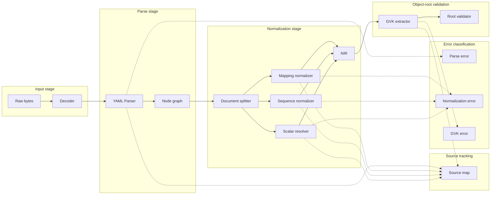

# KubeCheck — YAML Validation and Normalization

**Document ID:** YAML-NORM-001  
**File:** `docs/yaml/YAML_VALIDATION_AND_NORMALIZATION.md`  
**Status:** Normative — Approved  
**Version:** 1.0.0  
**Product:** KubeCheck  
**Owner:** Compiler and Data Validation Engineering  
**Last reviewed:** 2026-10-31  

**Related documents:**
- `docs/yaml/YAML_LANGUAGE_SPEC.md`
- `docs/yaml/YAML_KUBERNETES_PATTERNS.md`
- `docs/architecture/SYSTEM_ARCHITECTURE.md`
- `docs/architecture/REQUIREMENTS_AND_NFRS.md`
- `docs/architecture/ADR/ADR-002-yaml-parser-selection.md`
- `docs/diagnostics/DIAGNOSTIC_TAXONOMY.md`
- `docs/output/JSON_SCHEMA.md`
- `docs/security/THREAT_MODEL.md`
- `docs/testing/DETERMINISM_TESTS.md`

---

## 1. Purpose and scope

This document defines the **pipeline from raw YAML bytes to a normalized Kubernetes resource representation** inside KubeCheck. It specifies:

- Input decoding, parsing, document splitting, and source tracking.
- The YAML node model versus native language values.
- Mapping and sequence normalization rules.
- Type preservation and scalar-resolution policy.
- YAML-to-JSON conversion constraints.
- Kubernetes object-root validation.
- Duplicate-key rejection and unsupported-tag behavior.
- Source-map preservation through normalization.
- Unknown fields and unknown API versions.
- The distinction between **parse errors**, **normalization errors**, **schema errors**, and **semantic findings**.
- Handling of null, empty, absent, and defaulted fields.
- Deterministic serialization and stable resource identity.
- Error recovery **without silently changing the original input**.

**In scope:** the normalization pipeline and its internal representation.

**Out of scope:** diagnostic rule semantics (see `docs/diagnostics/DIAGNOSTIC_TAXONOMY.md`), schema bundle format (see ADR-003), and concrete parser selection (see ADR-002, **OPEN**). Where a decision depends on an OPEN ADR, this document states the dependency explicitly and marks the affected requirement as **provisional**.

---

## 2. Terminology and conventions

| Term | Definition |
|---|---|
| **Raw input** | The exact byte sequence supplied by the user or CI system, before any decoding. |
| **Decoded text** | Unicode text obtained by decoding the raw input according to the detected encoding. |
| **YAML node graph** | The representation graph produced by the YAML parser: a rooted, connected, directed graph of tagged nodes (`sequence`, `mapping`, `scalar`). |
| **Native value** | A value in the host language's type system (e.g., a language-level `int`, `string`, `map`). |
| **NIR** (Normalized Internal Representation) | KubeCheck's language-neutral, schema-neutral data structure derived from the YAML node graph and consumed by every downstream diagnostic component. |
| **Source map** | A mapping from every NIR node and every diagnostic anchor to the original byte offset, line, column, and document index. |
| **Parse error** | A failure to produce a YAML node graph from the decoded text. |
| **Normalization error** | A failure to construct the NIR from a successfully parsed YAML node graph. |
| **Schema error** | A finding produced when a document violates the OpenAPI schema of its declared GVK. |
| **Semantic finding** | A finding produced by cross-field or cross-document consistency checks, not by schema validation. |
| **Provisionally normative** | A requirement that depends on an OPEN ADR and may change when that ADR is resolved. |

**Conventions:**

- Requirement IDs use the form `NORM-REQ-NNN`.
- Every requirement maps to at least one test in `docs/testing/`.
- Pseudocode is language-neutral. It uses `function`, `return`, `match`, and `for` constructs without assuming a specific language's type system.
- Examples show **representative** input and output; they are not a substitute for the full test corpus.

---

## 3. Pipeline overview

The normalization pipeline has **seven stages**, each with a well-defined input and output type. A failure at any stage is isolated to the affected document; other documents in the same stream continue processing (§11).



**NORM-REQ-001:** Every stage MUST declare its input and output types, and a stage MUST NOT consume data produced by a later stage.

**NORM-REQ-002:** A failure in one document MUST NOT prevent other documents in the same stream from being processed (`SARCH-REQ-066`).

---

## 4. Stage 1 — Input decoding

### 4.1 Encoding detection and decoding

The raw input is a byte sequence. YAML is a Unicode-based language; the specification recommends UTF-8 and permits UTF-16 and UTF-32 with byte-order marks. KubeCheck targets **UTF-8** as the default encoding for Kubernetes manifests.

**NORM-REQ-003:** KubeCheck MUST attempt UTF-8 decoding of the raw input. If a byte-order mark (BOM) is present, it MUST be stripped. If the byte sequence is not valid UTF-8, KubeCheck MUST emit a **parse error** (`NORM-REQ-020`) identifying the byte offset of the first invalid sequence and MUST NOT attempt heuristic encoding detection.

**NORM-REQ-004:** KubeCheck MUST normalize line breaks (CRLF, CR) to LF in the decoded text, consistent with YAML 1.2.2 §5.4 and `YAML-SPEC-REQ-015`. The original byte offsets are preserved in the source map so that diagnostics can still reference the original file positions.

**NORM-REQ-005:** Input size is enforced by the resource governor (`LIM-REQ-001`) **before** decoding. The decoder receives an admitted byte sequence and does not itself enforce size limits.

### 4.2 Decoding pseudocode

```pseudo
function decode(raw_bytes) -> DecodedText | DecodeError:
    if raw_bytes starts_with UTF8_BOM:
        raw_bytes = raw_bytes[3:]
    try:
        text = utf8_decode(raw_bytes)
    except InvalidUTF8 at offset:
        return DecodeError(kind="invalid_utf8", byte_offset=offset)
    text = normalize_line_breaks(text)   # CRLF -> LF, CR -> LF
    return DecodedText(text=text, original_bytes=raw_bytes)
```

**NORM-REQ-006:** The decoder MUST return both the decoded text and a reference to the original bytes, so that the source map can resolve original byte offsets even after line-break normalization.

### 4.3 Example

Input (CRLF line endings, with BOM):

```
EF BB BF 61 3A 20 31 0D 0A 62 3A 20 32 0D 0A
```

Decoded text:

```
a: 1
b: 2
```

The source map records that line 1 corresponds to original bytes 3–6 and line 2 to original bytes 9–12.

---

## 5. Stage 2 — YAML parsing and the node model

### 5.1 The YAML node graph

YAML represents data as a **rooted, connected, directed graph of tagged nodes**. There are exactly three node kinds:

| Node kind | Semantics |
|---|---|
| **Sequence** | An ordered series of entries. |
| **Mapping** | An unordered association of unique keys to values. |
| **Scalar** | Any datum with opaque structure presentable as a series of Unicode characters. |

Each node carries, in addition to its kind and content, a **tag** specifying its data type. The YAML 1.2.2 Core Schema defines default tags for plain scalars (`!!str`, `!!int`, `!!bool`, `!!null`, `!!float`) and for collections (`!!seq`, `!!map`).

The node graph may contain **cycles** and a node may have **more than one incoming edge** (via aliases). The graph is document-scoped: anchors and aliases cannot cross document boundaries (`YAML-SPEC-REQ-002`).

### 5.2 Node graph versus native values

**Critical distinction:** The YAML parser produces a **node graph**, not native language values. Native values are produced by a **constructor** or **loader** that resolves tags to host-language types. KubeCheck deliberately separates these:

- The parser MUST produce the node graph with tags and source locations preserved.
- KubeCheck MUST NOT construct host-language objects from application-specific tags (`YAML-SPEC-REQ-023`).
- The NIR is built from the **node graph**, not from native values, so that source locations and type information are preserved through normalization.

**NORM-REQ-007:** The parser interface MUST expose the node graph (kinds, tags, content, and source locations). A parser that only exposes native values is insufficient for KubeCheck's requirements and MUST NOT be selected (this constrains ADR-002).

**NORM-REQ-008:** The parser MUST operate in safe mode: it MUST NOT resolve tags to host-language constructors, and it MUST NOT execute code embedded in tags (`SEC-REQ-001`, `YAML-SPEC-REQ-023`).

### 5.3 Source location tracking

Every node in the graph MUST carry a **source location**: document index, byte offset, 1-based line, and 1-based column in the decoded text. Some parsers expose locations only at the token level; in that case, KubeCheck's source-map augmentation layer computes node locations from token ranges.

**NORM-REQ-009:** The parser MUST provide, or the source-map augmentation layer MUST compute, a source location for every scalar, every mapping key, every mapping value, and every sequence entry.

**NORM-REQ-010:** Source locations MUST be 1-based for line and column and MUST be relative to the **decoded text** (after line-break normalization), with a mapping back to the original byte offset.

### 5.4 Parsing pseudocode

```pseudo
function parse(decoded_text, parse_budget) -> NodeGraph | ParseError:
    if not within(parse_budget):
        return ParseError(kind="governor_limit", limit="parse_budget")

    try:
        graph = yaml_parser.parse_safe(decoded_text)
    except YAMLSyntaxError at line, column, code:
        return ParseError(kind="syntax", line=line, column=column, code=code)

    if graph.has_duplicate_keys():
        first, second = graph.first_duplicate_key()
        return ParseError(kind="duplicate_key",
                           key=first.key, first=first.location, second=second.location)

    if graph.has_unsafe_tag():
        tag, location = graph.first_unsafe_tag()
        return ParseError(kind="unsafe_tag", tag=tag, location=location)

    return graph
```

**NORM-REQ-011:** Duplicate mapping keys MUST be rejected at parse time, before any downstream processing (`YAML-SPEC-REQ-016`). The parse error MUST identify **both** occurrences with their source locations.

**NORM-REQ-012:** Application-specific tags that resolve to host-language constructors MUST be rejected at parse time. Application-specific tags that are **opaque** (e.g., `!custom` with no registered constructor) MAY be preserved in the node graph with a warning (`YAML-SPEC-REQ-012`).

### 5.5 Example: parse error versus successful parse

**Input A (successful):**

```yaml
apiVersion: apps/v1
kind: Deployment
metadata:
  name: web
```

**Output A:** Node graph with three mapping entries at the root, each with a source location. The scalar `apps/v1` is tagged `!!str`; `Deployment` is tagged `!!str`; `web` is tagged `!!str`.

**Input B (duplicate key):**

```yaml
apiVersion: apps/v1
kind: Deployment
metadata:
  name: web
  name: api
```

**Output B:**

```
ParseError {
  kind: "duplicate_key",
  key: "name",
  first:  { doc: 0, line: 4, column: 3 },
  second: { doc: 0, line: 5, column: 3 }
}
```

The document is not admitted to the NIR; other documents in the same stream continue processing.

---

## 6. Stage 3 — Document splitting

A YAML stream contains zero or more documents. The parser produces a node graph **per document**; KubeCheck processes each document independently.

**NORM-REQ-013:** The document splitter MUST assign each document a 0-based `doc_index` in stream order and MUST preserve the stream order in the NIR and in the source map.

**NORM-REQ-014:** A document that is empty (null root) or has a scalar root MUST be admitted to the NIR and MUST be flagged with a structural marker (`root_kind`) so that downstream GVK validation can produce the appropriate finding. The document MUST NOT be silently dropped (`YAML-SPEC-REQ-019`).

### 6.1 Document splitting pseudocode

```pseudo
function split_documents(node_graph) -> List[DocumentNode]:
    documents = []
    for index, root in enumerate(node_graph.documents):
        documents.append(DocumentNode(
            doc_index=index,
            root=root,
            root_kind=classify_root(root)   # mapping | sequence | scalar | null
        ))
    return documents
```

---

## 7. Stage 4 — Mapping and sequence normalization

### 7.1 Normalization goal

Normalization converts the parser's node graph into the NIR — a canonical, language-neutral tree of mappings, sequences, and typed scalars — while preserving every source location. The NIR is the **only** structure that downstream diagnostics consume.

**NORM-REQ-015:** The NIR MUST NOT contain host-language objects, classes, or resolved types beyond the scalar types defined by the Core Schema (`string`, `integer`, `float`, `boolean`, `null`) and the opaque-scalar marker for application-tagged scalars.

**NORM-REQ-016:** The NIR MUST preserve the original **node kind** (mapping, sequence, scalar, null) for every node. A mapping MUST NOT be coerced to a sequence, and vice versa.

### 7.2 Mapping normalization

A YAML mapping is an **unordered** association of unique keys to values. The NIR represents a mapping as an ordered list of `(key, value)` pairs, where the order is **canonical** and independent of the source order, for the purpose of deterministic serialization and comparison.

**NORM-REQ-017:** The NIR mapping representation MUST be an ordered list of key-value pairs. The canonical order is defined as **byte-wise lexicographic order of the key's canonical scalar representation**, with non-scalar keys ordered after all scalar keys and compared by their canonical serialization. This order is used for deterministic serialization (`NORM-REQ-040`) and comparison; it does **not** alter the source map.

**NORM-REQ-018:** Mapping keys MUST be unique in the NIR. Duplicate keys are rejected at parse time (`NORM-REQ-011`), so normalization never encounters duplicates.

**NORM-REQ-019:** Non-scalar keys (mapping or sequence as key) MUST be preserved in the NIR as complex keys, with their own source locations. KubeCheck does not invent a string representation for them; downstream diagnostics may flag them if the Kubernetes schema requires string keys.

### 7.3 Sequence normalization

A YAML sequence is an **ordered** series of entries. The NIR preserves sequence order exactly.

**NORM-REQ-020:** Sequence order MUST be preserved in the NIR. Normalization MUST NOT sort, deduplicate, or otherwise reorder sequence entries.

**NORM-REQ-021:** Each sequence entry MUST retain its source location (the location of the entry's first token).

### 7.4 Normalization pseudocode

```pseudo
function normalize_mapping(node) -> NIRMapping:
    pairs = []
    for key_node, value_node in node.pairs:
        key_nir = normalize(key_node)
        value_nir = normalize(value_node)
        pairs.append(NIRPair(
            key=key_nir,
            value=value_nir,
            key_location=key_node.location,
            value_location=value_node.location
        ))
    canonical_order = sort_pairs(pairs)   # NORM-REQ-017
    return NIRMapping(pairs=pairs, canonical_order=canonical_order,
                      location=node.location)

function normalize_sequence(node) -> NIRSequence:
    items = []
    for item_node in node.items:
        items.append(NIRItem(
            value=normalize(item_node),
            location=item_node.location
        ))
    return NIRSequence(items=items, location=node.location)   # NORM-REQ-020

function normalize(node) -> NIRNode:
    match node.kind:
        case mapping: return normalize_mapping(node)
        case sequence: return normalize_sequence(node)
        case scalar: return resolve_scalar(node)
        case null: return NIRNull(location=node.location)
```

---

## 8. Stage 5 — Scalar resolution and type preservation

### 8.1 Core Schema resolution

Plain scalars are resolved according to the YAML 1.2.2 **Core Schema** (§10.3). The resolution order is **null → bool → int → float → string**. KubeCheck does not apply YAML 1.1 boolean, timestamp, or sexagesimal resolution (`YAML-SPEC-REQ-010`, `YAML-SPEC-REQ-011`).

**NORM-REQ-022:** Scalar resolution MUST produce exactly one of the following NIR scalar types: `string`, `integer`, `float`, `boolean`, `null`, or `opaque` (for application-tagged scalars that KubeCheck cannot type).

**NORM-REQ-023:** The NIR MUST preserve both the **resolved type** and the **original scalar text**. Downstream diagnostics that need to report "you wrote `yes` but the schema expects a boolean" can inspect the original text; diagnostics that need the resolved type can inspect the type field. Neither may be discarded.

**NORM-REQ-024:** Explicitly tagged scalars (`!!str`, `!!int`, etc.) MUST override implicit resolution. A plain scalar tagged `!!str` MUST resolve to a string even if its text would otherwise resolve to an integer.

### 8.2 Scalar resolution pseudocode

```pseudo
function resolve_scalar(node) -> NIRScalar:
    if node.tag is application_specific:
        return NIRScalar(kind="opaque", tag=node.tag,
                         text=node.text, location=node.location)

    if node.tag is explicit_core_tag:
        kind = core_tag_to_kind(node.tag)
        return NIRScalar(kind=kind, text=node.text,
                         resolved=parse_core(node.text, kind),
                         location=node.location)

    # Implicit resolution per Core Schema
    if node.text matches null_pattern:      # null, ~, empty
        kind = "null"
    elif node.text matches bool_pattern:    # true, false (any case)
        kind = "boolean"
    elif node.text matches int_pattern:     # decimal, 0x, 0o, 0b, underscores
        kind = "integer"
    elif node.text matches float_pattern:   # decimal, exponent, .inf, .nan
        kind = "float"
    else:
        kind = "string"

    return NIRScalar(kind=kind, text=node.text,
                     resolved=parse_core(node.text, kind),
                     location=node.location)
```

### 8.3 Type preservation examples

| Input | Core Schema resolution | NIR kind | NIR text | Diagnostic note |
|---|---|---|---|---|
| `replicas: 3` | integer 3 | `integer` | `"3"` | — |
| `replicas: "3"` | string `"3"` | `string` | `"3"` | Schema may flag type mismatch. |
| `enabled: true` | boolean `true` | `boolean` | `"true"` | — |
| `enabled: yes` | string `"yes"` | `string` | `"yes"` | Informational: YAML 1.2 treats `yes` as string. |
| `port: 0755` | integer `755` | `integer` | `"0755"` | Informational: YAML 1.2 treats `0755` as decimal 755. |
| `port: 0o755` | integer `493` | `integer` | `"0o755"` | — |
| `date: 2026-10-31` | string `"2026-10-31"` | `string` | `"2026-10-31"` | — |
| `value: !!str on` | string `"on"` | `string` | `"on"` | — |
| `custom: !myapp foo` | opaque | `opaque` | `"foo"` | Tag preserved. |

**NORM-REQ-025:** When the NIR kind differs from what the Kubernetes schema expects (e.g., `string` where `integer` is expected), the schema validator MUST emit a schema error (`NORM-REQ-035`), and the finding MUST include both the NIR kind and the original text so the user can see why the resolution occurred.

---

## 9. Stage 6 — YAML-to-JSON conversion constraints

Kubernetes manifests are frequently processed as JSON internally: the API server accepts JSON, and many tooling pipelines convert YAML to JSON before validation. The YAML 1.2.2 specification does **not** define a normative YAML-to-JSON conversion; this is an **application-defined** transformation. KubeCheck's NIR is designed so that conversion to JSON is possible without loss for Kubernetes-relevant constructs, and so that unsupported constructs are flagged explicitly.

### 9.1 Constructs with interoperability issues

The following YAML constructs are known to have interoperability issues when converted to JSON:

| Construct | Issue | KubeCheck handling |
|---|---|---|
| Non-UTF-8 encoding | JSON mandates UTF-8 | KubeCheck decodes to UTF-8 before parsing (`NORM-REQ-003`). |
| Non-string mapping keys | JSON requires string keys | KubeCheck preserves non-scalar keys in NIR and flags them if the Kubernetes schema requires string keys. |
| `!!binary` scalars | JSON has no binary type | KubeCheck preserves the scalar as `opaque` and emits a warning if the schema expects a string. |
| `.inf` / `.nan` floats | JSON does not support them | KubeCheck preserves as `float`; if the schema expects a finite number, emits a schema error. |
| Tags (custom, local) | JSON has no tag concept | KubeCheck preserves tags in NIR; JSON serialization drops the tag and uses the resolved value or opaque string. |
| Multi-document streams | JSON has no multi-document concept | KubeCheck processes each document independently; JSON output is per-document with a document index. |
| Aliases | JSON has no alias concept | KubeCheck resolves aliases to values in the NIR; JSON output contains the resolved value. |
| Circular references | JSON cannot represent cycles | KubeCheck detects cycles during NIR construction and emits a normalization error (`NORM-REQ-028`). |

**NORM-REQ-026:** The NIR MUST be JSON-serializable for all constructs that Kubernetes schemas accept. For constructs that are not JSON-serializable (cycles, non-string keys in contexts where strings are required), KubeCheck MUST emit a normalization error or a schema error rather than silently dropping or coercing data.

**NORM-REQ-027:** When KubeCheck serializes the NIR to JSON (for output or for schema validation), it MUST preserve the following:
- Scalar types as JSON types (`string`, `integer`/`number`, `boolean`, `null`).
- Mapping keys as JSON strings **only when** the key is a scalar that can be represented as a string without ambiguity; otherwise, the conversion MUST emit a normalization error.
- Sequence order exactly as in the source.

**NORM-REQ-028:** Circular references (via aliases) MUST be detected during NIR construction. If a cycle is found, the affected document MUST be rejected with a **normalization error** identifying the cycle's anchor names and locations. KubeCheck MUST NOT attempt to break cycles by inserting `null` or by truncating the graph.

### 9.2 YAML-to-JSON conversion pseudocode

```pseudo
function nir_to_json(nir_node, path) -> JsonValue | ConversionError:
    match nir_node:
        case NIRScalar:
            return scalar_to_json(nir_node)   # string, int, float, bool, null
        case NIRNull:
            return JsonNull()
        case NIRSequence:
            return JsonArray([ nir_to_json(item.value, path + [i])
                               for i, item in enumerate(nir_node.items) ])
        case NIRMapping:
            result = JsonObject()
            for pair in nir_node.pairs:
                key = nir_key_to_string(pair.key)
                if key is error:
                    return ConversionError(
                        kind="non_string_key", path=path,
                        location=pair.key_location)
                result[key] = nir_to_json(pair.value, path + [key])
            return result
```

**NORM-REQ-029:** The conversion MUST preserve the **document index** as metadata so that a conversion error can be attributed to the correct document in a multi-document stream.

---

## 10. Stage 7 — Kubernetes object-root validation

### 10.1 Required root structure

A Kubernetes manifest must be a **mapping** at the document root with at least `apiVersion` and `kind` as string fields. `metadata` is required for most resources; `spec` is required for some but not all. The Kubernetes API server and schema validation both treat a missing `apiVersion` or `kind` as a structural error.

**NORM-REQ-030:** The root validator MUST check, in order:

1. The document root kind is `mapping`.
2. `apiVersion` is present and is a `string` scalar.
3. `kind` is present and is a `string` scalar.
4. `metadata` is present and is a `mapping` (for resources where metadata is required; the validator emits a warning rather than a hard error when the requirement is resource-dependent).
5. `apiVersion` matches the pattern `<group>/<version>` or `<version>` (core group has no group segment).

Each failure produces a **GVK error** with a distinct code and a source location pointing at the root or the offending field.

### 10.2 Root validation pseudocode

```pseudo
function validate_root(document) -> GVK | GVKError:
    if document.root_kind != "mapping":
        return GVKError(code="INVALID_ROOT_KIND",
                        expected="mapping", actual=document.root_kind,
                        location=document.root.location)

    api_version = document.root.get("apiVersion")
    if api_version is absent:
        return GVKError(code="MISSING_API_VERSION",
                        location=document.root.location)
    if api_version.kind != "string":
        return GVKError(code="INVALID_API_VERSION_TYPE",
                        expected="string", actual=api_version.kind,
                        location=api_version.location)

    kind = document.root.get("kind")
    if kind is absent:
        return GVKError(code="MISSING_KIND",
                        location=document.root.location)
    if kind.kind != "string":
        return GVKError(code="INVALID_KIND_TYPE",
                        expected="string", actual=kind.kind,
                        location=kind.location)

    metadata = document.root.get("metadata")
    if metadata is absent:
        return GVKError(code="MISSING_METADATA",
                        severity="warning",
                        location=document.root.location)
    if metadata.kind != "mapping":
        return GVKError(code="INVALID_METADATA_TYPE",
                        expected="mapping", actual=metadata.kind,
                        location=metadata.location)

    return GVK(api_version=api_version.resolved,
               kind=kind.resolved,
               document=document)
```

### 10.3 Unknown API versions

**NORM-REQ-031:** If `apiVersion` and `kind` are structurally valid but the GVK is **not present** in the active bundle's schema index, the validator MUST emit a GVK error of code `UNKNOWN_API_VERSION` with severity `warning`, and MUST mark the document as `schema-unchecked` (`SARCH-REQ-027`). It MUST NOT treat an unknown GVK as a parse error or a normalization error.

**NORM-REQ-032:** If the GVK is present in the index but the specific **version** is marked as removed for the selected target Kubernetes version, the lifecycle engine (`SARCH-REQ-041`) emits an `error`-severity finding; this is a **schema/lifecycle finding**, not a GVK error. The document is still admitted to schema validation for the remaining fields, because the schema for the removed version may still be present in the bundle for reference.

### 10.4 Example: root validation outcomes

| Input | Outcome |
|---|---|
| `apiVersion: v1`, `kind: Pod`, `metadata: {name: x}` | Valid GVK. |
| `apiVersion: v1`, no `kind` | `MISSING_KIND` GVK error. |
| `kind: Pod` (no `apiVersion`) | `MISSING_API_VERSION` GVK error. |
| Root is a sequence | `INVALID_ROOT_KIND` GVK error. |
| Root is a scalar | `INVALID_ROOT_KIND` GVK error. |
| `apiVersion: example.com/v1`, `kind: Widget` (no schema in bundle) | `UNKNOWN_API_VERSION` warning; `schema-unchecked`. |
| `apiVersion: apps/v1`, `kind: Deployment`, `apiVersion` as integer | `INVALID_API_VERSION_TYPE` GVK error. |

---

## 11. Error classification and recovery

### 11.1 Error taxonomy

KubeCheck distinguishes **four** classes of problems. Conflating them produces misleading diagnostics.

| Class | Definition | Produced by | Output channel | Affects exit code |
|---|---|---|---|---|
| **Parse error** | The decoded text cannot be parsed into a node graph (syntax, duplicate keys, unsafe tags, invalid UTF-8). | Decoder / Parser | Finding of category `syntax`, severity `error` | Yes (error severity). |
| **Normalization error** | The node graph cannot be converted to the NIR (cycles, unsupported constructs that prevent JSON serialization). | NIR builder | Finding of category `normalization`, severity `error` | Yes (error severity). |
| **GVK error** | The document root is not a valid Kubernetes object root, or the GVK is unknown to the bundle. | Root validator | Finding of category `schema` or `syntax` depending on code | Yes for `error` severity; no for `warning` severity. |
| **Schema error** | The document violates the OpenAPI schema of its GVK (unknown field, wrong type, missing required field, invalid enum). | Schema validator | Finding of category `schema`, severity `error` or `warning` | Yes for `error` severity. |
| **Semantic finding** | A cross-field or cross-document inconsistency (e.g., Service selector matches no workload). | Rule engine / graph consumers | Finding of category `semantic`, severity per rule metadata | Yes for `error`; no for `warning`/`info`. |

**NORM-REQ-033:** Each class MUST be distinguishable in the output via a machine-readable `finding_class` field with the values `parse`, `normalization`, `gvk`, `schema`, `semantic`. The `category` field provides the diagnostic taxonomy category; `finding_class` provides the pipeline stage.

**NORM-REQ-034:** A parse error or normalization error MUST NOT be reported as a schema error or a semantic finding. The pipeline stage that produced the finding determines its class, not the severity.

### 11.2 Error recovery rules

**NORM-REQ-035:** A parse error in one document MUST NOT prevent other documents in the same stream from being parsed and processed (`SARCH-REQ-066`). The affected document is marked `parse-failed` and excluded from the NIR; other documents continue.

**NORM-REQ-036:** A normalization error in one document MUST NOT prevent other documents from being normalized. The affected document is marked `normalization-failed` and excluded from downstream stages; other documents continue.

**NORM-REQ-037:** A GVK error or schema error in one document MUST NOT prevent other documents from being validated. The affected document may still be processed by semantic checks if the schema error does not invalidate its structure; the pipeline records the schema status per document (`SARCH-REQ-030`).

**NORM-REQ-038:** KubeCheck MUST NOT **auto-repair**, **auto-correct**, or **silently drop** any input content. If a construct cannot be processed, the document is marked as failed with a diagnostic explaining why. The original input is never modified.

### 11.3 Recovery pseudocode

```pseudo
function process_stream(documents) -> List[DocumentResult]:
    results = []
    for doc in documents:
        result = process_document(doc)
        results.append(result)   # one result per document, always
    return results

function process_document(doc) -> DocumentResult:
    try:
        graph = parse(doc.text, budget)
    except ParseError as e:
        return DocumentResult(status="parse-failed", error=e, findings=[e.to_finding()])

    try:
        nir = normalize(graph)
    except NormalizationError as e:
        return DocumentResult(status="normalization-failed", error=e, findings=[e.to_finding()])

    gvk_result = validate_root(nir)
    if gvk_result is GVKError:
        return DocumentResult(status="gvk-failed", gvk_error=gvk_result,
                              findings=[gvk_result.to_finding()])

    schema_findings = validate_schema(nir, gvk_result)
    semantic_findings = evaluate_semantics(nir, gvk_result, graph_context)
    return DocumentResult(status="processed", nir=nir, gvk=gvk_result,
                          findings=schema_findings + semantic_findings)
```

**NORM-REQ-039:** Every document in the stream MUST produce exactly one `DocumentResult`, even when the document fails at an early stage. This ensures that the report can account for every input unit (`SARCH-REQ-065`).

---

## 12. Handling of null, empty, absent, and defaulted fields

### 12.1 Distinctions

| State | NIR representation | Source location | Example |
|---|---|---|---|
| **Absent** | The key is not present in the mapping. | No location for the absent key. | `spec: {}` — `replicas` is absent. |
| **Null** | The key is present with a `null` value. | Location of the `null` scalar or the empty value. | `replicas: null` or `replicas:` (empty). |
| **Empty string** | The key is present with a `string` value of zero length. | Location of the `""` scalar. | `replicas: ""` |
| **Empty collection** | The key is present with an empty mapping or sequence. | Location of the `{}` or `[]`. | `selector: {}` or `args: []` |
| **Defaulted** | The key is absent, and the schema provides a default. | No location; the default is applied by the schema validator, not by normalization. | `replicas` defaulting to `1`. |

**NORM-REQ-040:** The NIR MUST distinguish **absent**, **null**, **empty string**, and **empty collection**. These are distinct values and MUST NOT be collapsed. A diagnostic that reports "field is empty" must state which of the four states applies.

**NORM-REQ-041:** KubeCheck MUST NOT apply schema defaults to the NIR. Defaults are the API server's responsibility and depend on the target version; applying them locally would create a false impression of validation. The schema validator MAY report that a field is absent and that a default exists in the schema, but it MUST NOT mutate the NIR to insert the default.

**NORM-REQ-042:** When a field is `null` but the schema expects a non-nullable type, the schema validator MUST emit a schema error that distinguishes `null` from `absent`. When a field is absent but required, the schema validator MUST emit a `required` schema error. These are different errors and MUST use different codes.

### 12.2 Example: null versus absent

**Input A (`replicas` absent):**

```yaml
apiVersion: apps/v1
kind: Deployment
metadata:
  name: web
spec:
  template:
    spec:
      containers:
      - name: app
        image: nginx
```

**NIR A:** `spec.replicas` is **absent**. The schema validator reports `OPTIONAL_FIELD_ABSENT` (info) if the field is optional, or `REQUIRED_FIELD_ABSENT` if required.

**Input B (`replicas` null):**

```yaml
apiVersion: apps/v1
kind: Deployment
metadata:
  name: web
spec:
  replicas: null
  template:
    spec:
      containers:
      - name: app
        image: nginx
```

**NIR B:** `spec.replicas` is **present with kind `null`**. The schema validator reports `FIELD_IS_NULL` (error) if the schema expects an integer.

---

## 13. Source-map preservation through normalization

### 13.1 Source-map contract

Every NIR node MUST be resolvable to a source location. The source map is a bidirectional structure:

- **Forward:** NIR node ID → `(doc_index, byte_offset, line, column, original_byte_offset)`.
- **Reverse:** `(doc_index, line, column)` → nearest NIR node ID, used for locating diagnostics that are produced at a specific source position.

**NORM-REQ-043:** Every NIR node MUST carry a source location. Normalization MUST NOT synthesize nodes without locations. When a node is produced by a transformation that does not correspond to a single source position (e.g., a merge-key expansion), the node MUST carry the location of the key that introduced it, and a flag indicating the transformation.

**NORM-REQ-044:** The source map MUST preserve the **original byte offset** in addition to the decoded-text line and column. This allows diagnostics to reference the original file even when line breaks were normalized (`NORM-REQ-004`).

**NORM-REQ-045:** Every diagnostic emitted by KubeCheck MUST carry a source anchor that resolves through the source map to `(file, doc_index, line, column)` and, where useful, `json_path`. Diagnostics that cannot resolve a specific node (e.g., a missing reference) MUST carry the location of the closest enclosing node and state the limitation in the evidence field (`SARCH-REQ-022`).

### 13.2 Source-map resolution pseudocode

```pseudo
function resolve_location(nir_node_id) -> SourceLocation | None:
    entry = source_map.get(nir_node_id)
    if entry is None:
        return None
    return SourceLocation(
        file=entry.file,
        doc_index=entry.doc_index,
        line=entry.line,          # 1-based, decoded text
        column=entry.column,      # 1-based, decoded text
        byte_offset=entry.byte_offset,
        original_byte_offset=entry.original_byte_offset
    )

function anchor_for_finding(finding) -> SourceAnchor:
    node = finding.target_node_id
    loc = resolve_location(node)
    if loc is None:
        return SourceAnchor(unresolved=True, note="no source location")
    return SourceAnchor(
        file=loc.file, doc_index=loc.doc_index,
        line=loc.line, column=loc.column,
        json_path=finding.json_path
    )
```

### 13.3 Example: diagnostic anchor

**Input:**

```yaml
apiVersion: apps/v1
kind: Deployment
metadata:
  name: web
spec:
  replicas: "3"
  template:
    spec:
      containers:
      - name: app
        image: nginx
```

**Diagnostic:** `FIELD_TYPE_MISMATCH` at `spec.replicas` — expected `integer`, found `string`.

**Source anchor:**

```
file: manifest.yaml
doc_index: 0
line: 6
column: 13
json_path: /spec/replicas
evidence: original text "3" resolved as string because it is double-quoted
```

The `column` points at the opening quote of `"3"`. The evidence field explains the Core Schema resolution so the user can correct the manifest by removing the quotes.

---

## 14. Deterministic serialization and stable resource identity

### 14.1 Deterministic serialization

**NORM-REQ-046:** For a fixed NIR and a fixed output format, serialization MUST be deterministic. JSON output MUST use canonical key ordering (the NIR mapping canonical order, `NORM-REQ-017`) and MUST NOT include timestamps or other non-deterministic content in the finding content (report metadata may include a timestamp, excluded from comparison per `OUT-REQ-006`).

**NORM-REQ-047:** YAML output (if produced) MUST use a deterministic style: block style by default, fixed indentation, LF line endings, and sorted mapping keys according to the canonical order. Flow style is used only when the NIR node was originally a flow collection **and** the output format explicitly requests preservation; by default, output is normalized to block style for readability and determinism.

### 14.2 Stable resource identity

The **resource identity** is used for duplicate detection, inventory keying, and cross-document references.

**NORM-REQ-048:** The resource identity MUST be derived from the resolved GVK and `metadata` fields:

```
ResourceKey = (group, version, kind, namespace, name)
```

where:
- `group` and `version` are parsed from `apiVersion` (empty group for core resources).
- `namespace` is the `metadata.namespace` value if present, otherwise empty (cluster-scoped or defaulted by the API server; KubeCheck does not invent a namespace).
- `name` is the `metadata.name` value if present; if absent and `metadata.generateName` is present, the identity uses the `generateName` value with a marker that the name is generated.

**NORM-REQ-049:** Resource identity MUST be derived from the **resolved** NIR values, not from raw text. A quoted string and an unquoted string that resolve to the same text produce the same identity. An integer key and a string key that resolve to different types produce different identities and are not duplicates.

**NORM-REQ-050:** If `metadata.name` is absent and `metadata.generateName` is absent for a namespaced resource, the identity MUST be marked `name-unresolved` and the document MUST produce a GVK error (`MISSING_NAME`). The inventory MUST NOT use a synthetic name.

### 14.3 Identity pseudocode

```pseudo
function resource_key(nir, gvk) -> ResourceKey | IdentityError:
    metadata = nir.root.get("metadata")
    if metadata is absent or metadata.kind != "mapping":
        return IdentityError(code="INVALID_METADATA")

    name = metadata.get("name")
    generate_name = metadata.get("generateName")
    if name is present and name.kind == "string":
        resolved_name = name.resolved
        generated = false
    elif generate_name is present and generate_name.kind == "string":
        resolved_name = generate_name.resolved
        generated = true
    else:
        return IdentityError(code="MISSING_NAME")

    namespace = metadata.get("namespace")
    resolved_ns = namespace.resolved if namespace is a string else ""

    return ResourceKey(
        group=gvk.group, version=gvk.version, kind=gvk.kind,
        namespace=resolved_ns, name=resolved_name,
        generated=generated
    )
```

---

## 15. Error recovery without silently changing the original input

### 15.1 Principle

KubeCheck never modifies the user's input. It does not auto-fix YAML, auto-quote ambiguous scalars, auto-insert required fields, or auto-remove duplicate keys. Every problem is **reported**, not **repaired**.

**NORM-REQ-051:** KubeCheck MUST NOT write to any input file. It MUST NOT produce a "repaired" version of the manifest as a side effect of analysis.

**NORM-REQ-052:** If KubeCheck is invoked with a future `--fix` mode (not part of MVP; see `PRODUCT_VISION.md` §12.2), the fix MUST be opt-in, MUST produce a separate output artefact, and MUST NOT modify the input file in place unless the user explicitly requests in-place editing with a separate flag.

### 15.2 Recovery from pipeline failures

| Failure | Recovery behavior |
|---|---|
| Invalid UTF-8 in one document | Parse error for that document; other documents continue. |
| Duplicate key in one document | Parse error for that document; other documents continue. |
| Unsafe tag in one document | Parse error for that document; other documents continue. |
| Cycle in one document | Normalization error for that document; other documents continue. |
| GVK error in one document | GVK finding; the document is excluded from schema validation but the remaining documents continue. |
| Schema error in one document | Schema finding; semantic checks may still run if the schema status permits (`SARCH-REQ-030`). |
| Aggregate resource limit exceeded | Governor finding; the invocation stops admitting new documents; already-processed documents produce findings; exit code reflects the governor finding (`LIM-REQ-007`). |

**NORM-REQ-053:** Every failure MUST produce a finding with a stable error code and a source anchor where one is available. The finding MUST explain what was rejected and why, so that the user can correct the input.

---

## 16. Internal normalized representation (NIR) — type definitions

The NIR is defined here without binding to a specific implementation language. An implementation may use structs, classes, tagged unions, or records, provided the invariants hold.

### 16.1 NIR node types

```
NIRNode =
    NIRMapping
  | NIRSequence
  | NIRScalar
  | NIRNull

NIRMapping {
    pairs: List<NIRPair>              # ordered by canonical order
    canonical_order: List<Int>        # indices into pairs
    location: SourceLocation
}

NIRPair {
    key: NIRNode                      # scalar, or complex key
    value: NIRNode
    key_location: SourceLocation
    value_location: SourceLocation
}

NIRSequence {
    items: List<NIRItem>              # source order preserved
    location: SourceLocation
}

NIRItem {
    value: NIRNode
    location: SourceLocation
}

NIRScalar {
    kind: ScalarKind                  # string | integer | float | boolean | null | opaque
    text: String                      # original scalar text
    resolved: ResolvedValue           # typed value per kind; for opaque, text
    tag: Option<String>               # explicit tag or None
    location: SourceLocation
}

NIRNull {
    location: SourceLocation
}

SourceLocation {
    file: String                      # logical path
    doc_index: Int                    # 0-based
    byte_offset: Int                  # offset in decoded text
    original_byte_offset: Int         # offset in raw bytes
    line: Int                         # 1-based, decoded text
    column: Int                       # 1-based, decoded text
}

ResolvedValue =
    StringValue(text)
  | IntegerValue(big_integer)
  | FloatValue(f64)
  | BooleanValue(bool)
  | NullValue
  | OpaqueValue(text)
```

### 16.2 NIR invariants

**NORM-REQ-054:** The following invariants MUST hold for every NIR:

| Invariant ID | Statement |
|---|---|
| INV-01 | Every node has a `location` with non-negative `byte_offset` and 1-based `line` and `column`. |
| INV-02 | A `NIRMapping` has no duplicate keys; keys are compared by canonical scalar equality under the Core Schema. |
| INV-03 | A `NIRMapping`'s `canonical_order` is a permutation of `0..pairs.length - 1`; it is used only for serialization and comparison, not to reorder `pairs` in place. |
| INV-04 | A `NIRSequence`'s items are in source order; no reordering, deduplication, or sorting is applied. |
| INV-05 | A `NIRScalar` with `kind = string` has `resolved = StringValue(text)`; a `NIRScalar` with `kind = integer` has `resolved = IntegerValue(...)`; and so on for each kind. |
| INV-06 | A `NIRScalar` with `kind = opaque` has a non-empty `tag` and `resolved = OpaqueValue(text)`. |
| INV-07 | A `NIRNull` is distinct from a `NIRScalar` with `kind = null`; the former represents an implicit null (empty value), the latter an explicit `null` or `~`. Downstream diagnostics may treat them identically for schema purposes but MUST preserve the distinction for evidence reporting. |
| INV-08 | No node contains a host-language object, class instance, or code reference. |
| INV-09 | The NIR is acyclic. Cycles detected during construction produce a normalization error; the NIR is never built with a cycle. |
| INV-10 | The NIR is JSON-serializable for all constructs that the Kubernetes schema accepts; unsupported constructs produce a normalization error rather than an invalid NIR. |

**NORM-REQ-055:** An implementation MUST provide a validation function that checks INV-01 through INV-10 on every NIR it constructs in debug builds and in the test suite. Production builds MAY skip the validation for performance, but the test suite MUST exercise it on every corpus item.

---

## 17. Complete pipeline example

### 17.1 Input

```yaml
apiVersion: apps/v1
kind: Deployment
metadata:
  name: web
  labels: &labels
    app: web
    tier: frontend
spec:
  replicas: "3"
  selector:
    matchLabels: *labels
  template:
    metadata:
      labels: *labels
    spec:
      containers:
      - name: app
        image: nginx
        ports:
        - containerPort: 80
```

### 17.2 Pipeline outcomes

| Stage | Outcome |
|---|---|
| **Decode** | Valid UTF-8; no BOM; CRLF normalized (if present). |
| **Parse** | Node graph with anchors resolved: `*labels` expands to the mapping defined by `&labels`. No duplicate keys. No unsafe tags. |
| **Split** | One document, `doc_index = 0`. |
| **Normalize** | `NIRMapping` at root; `spec.replicas` is `NIRScalar(kind=string, text="3", resolved=StringValue("3"))`. Anchors are resolved to values; the alias nodes are gone from the NIR (but the source map retains the alias locations). |
| **YAML-to-JSON** | Serializable: `"replicas": "3"` as a JSON string. |
| **Root validation** | GVK = `(apps, v1, Deployment)`. `metadata` present. |
| **Schema validation** | `spec.replicas` is `string` but the Deployment schema expects `integer` → schema error `FIELD_TYPE_MISMATCH`, anchored to line 9, column 13. |
| **Semantic** | Service selector check: no Service in the input set; no semantic finding emitted for the absence of a Service. If a Service were present with `matchLabels: {app: web}`, the selector match would be confirmed. |

### 17.3 Example finding (JSON)

```json
{
  "rule_id": "SCH-REQ-TYPE-MISMATCH",
  "finding_class": "schema",
  "category": "schema",
  "severity": "error",
  "evidence_class": "deterministic",
  "anchor": {
    "file": "manifest.yaml",
    "doc_index": 0,
    "line": 9,
    "column": 13,
    "json_path": "/spec/replicas"
  },
  "evidence": {
    "expected_type": "integer",
    "actual_type": "string",
    "original_text": "\"3\"",
    "resolution_note": "double-quoted scalar resolves to string under Core Schema"
  },
  "remediation": "Remove the quotes to make this an integer, or confirm that the API accepts a string for this field."
}
```

---

## 18. Authoritative references

| Reference | Scope | Type | Retrieved |
|---|---|---|---|
| YAML Ain't Markup Language (YAML™) revision 1.2.2 (2021-10-01) | Node model, representation graph, Core Schema, document structure | Specification | 2026-10-31 |
| YAML 1.2.2 §3.1 (Processes) and §3.2 (Representation) | Representation graph, node kinds, tags | Specification sections | 2026-10-31 |
| YAML 1.2.2 §10.3 (Core Schema) | Implicit scalar resolution order | Specification section | 2026-10-31 |
| YAML Media Type (draft-ietf-httpapi-yaml-mediatypes) | YAML-to-JSON interoperability issues, multi-document streams, non-string keys, binary and special floats | IETF draft | 2026-10-31 |
| Kubernetes API conventions | Required root fields (`apiVersion`, `kind`, `metadata`) and field validation | Official documentation | 2026-10-31 |
| `docs/yaml/YAML_LANGUAGE_SPEC.md` (internal) | KubeCheck acceptance policy for YAML features | Internal | 2026-10-31 |
| `docs/architecture/SYSTEM_ARCHITECTURE.md` (internal) | Component interfaces, NIR interface (`IF-NIR-001`), source map (`IF-SMAP-001`) | Internal | 2026-10-31 |
| `docs/testing/ACCURACY_BENCHMARK_PROTOCOL.md` (internal) | Determinism and accuracy measurement methodology | Internal | 2026-10-31 |

**Licensing note:** The YAML 1.2.2 specification is freely copyable provided it is not modified. The IETF draft is subject to IETF Trust provisions. Kubernetes documentation is licensed under CC BY 4.0. No line numbers, benchmark results, or implementation status are asserted beyond what the cited sources state.

---

## 19. Open questions and unresolved decisions

| ID | Question | Status | Owner |
|---|---|---|---|
| OPEN-NORM-01 | Parser selection (ADR-002) must confirm that the parser exposes node-level source locations and supports safe-mode parsing with duplicate-key rejection. If it does not, the source-map augmentation layer (Assumption SARCH-02) is required. | **OPEN** | Software Architecture |
| OPEN-NORM-02 | Whether the NIR will expose aliases as explicit nodes (preserving the alias relation) or resolve them to values. The current specification resolves aliases in the NIR but preserves alias locations in the source map. | **OPEN** | Software Architecture |
| OPEN-NORM-03 | Whether explicit `null` and implicit null (empty value) should be merged into a single NIR kind for schema purposes or kept distinct. The current specification keeps them distinct (INV-07). | **OPEN** | Diagnostics Architecture |
| OPEN-NORM-04 | Canonical key ordering for mappings whose keys include non-scalar (complex) keys. The current specification orders scalar keys first, then complex keys by serialization; the exact serialization for complex keys is not yet finalized. | **OPEN** | Software Architecture |
| OPEN-NORM-05 | Whether `metadata.generateName`-only resources should be reported as `MISSING_NAME` or as an informational finding. The current specification reports `MISSING_NAME` as an error for most resources. | **OPEN** | Diagnostics Architecture |
| OPEN-NORM-06 | Whether a `--fix` mode will ever be offered and, if so, under what isolation constraints (NORM-REQ-052). | **OPEN** | Product Architecture |

---

## 20. Definition of done

This document is complete when the following conditions hold:

1. The pipeline is defined from raw bytes through decoding, parsing, document splitting, normalization, YAML-to-JSON conversion, and root validation, with explicit input/output types at each stage.
2. The YAML node model is distinguished from native language values, and the NIR is defined as language-neutral and schema-neutral.
3. Mapping and sequence normalization rules are stated, including canonical key ordering and sequence-order preservation.
4. Type preservation is specified: NIR preserves both resolved type and original text, and the Core Schema resolution policy is referenced.
5. YAML-to-JSON conversion constraints are enumerated, including non-string keys, binary, special floats, multi-document streams, aliases, and cycles.
6. Kubernetes root validation checks are specified with distinct error codes and source anchors.
7. Duplicate-key rejection and unsupported-tag behavior are stated at the parse stage, with the distinction between specification requirements and KubeCheck implementation decisions preserved.
8. Source-map preservation is specified through every stage, with forward and reverse resolution and original-byte-offset preservation.
9. Parse errors, normalization errors, GVK errors, schema errors, and semantic findings are distinguished with a machine-readable `finding_class` field.
10. Null, empty, absent, and defaulted fields are distinguished, and defaults are not applied to the NIR.
11. Deterministic serialization and stable resource identity are specified.
12. Error recovery is specified without silent input modification, with per-document isolation and aggregate-limit handling.
13. The NIR type definitions and invariants (INV-01 through INV-10) are complete and testable.
14. A representative input/output example demonstrates the full pipeline from anchors and quoting through to a source-anchored schema finding.
15. Every requirement has a stable ID (`NORM-REQ-NNN`), and dependencies on OPEN ADRs are marked.

---

## 21. Consistency and completeness review

A review was performed against the requested scope before finalization.

- **Input decoding, parsing, document splitting, source tracking:** §4–§6, §13.
- **YAML node model versus native language values:** §5.2.
- **Mapping and sequence normalization:** §7.
- **Type preservation and scalar-resolution policy:** §8.
- **YAML-to-JSON conversion constraints:** §9.
- **Kubernetes object-root validation:** §10.
- **Duplicate-key rejection and unsupported-tag behavior:** §5.4, with specification/implementation distinction.
- **Source-map preservation:** §13.
- **Unknown fields and unknown API versions:** §10.3, §12 (schema error handling).
- **Parse/normalization/schema/semantic distinction:** §11.
- **Null, empty, absent, defaulted:** §12.
- **Deterministic serialization and stable identity:** §14.
- **Error recovery without silent input changes:** §15.
- **Pseudocode and representative input/output examples:** throughout, plus §17.
- **Internal NIR definition and invariants:** §16.
- **Diagnostic mapping to file, document, line, column:** §13.
- **No binding to a specific implementation language:** all pseudocode and type definitions are language-neutral.

No empty boilerplate section was added solely to satisfy a checklist. The document is complete for its assigned responsibility.
